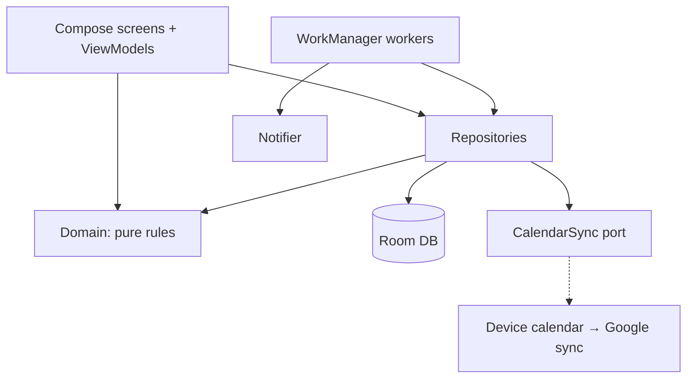

# Project Context

**Klas** — a native Android app for a **single** private tutor to manage students, groups, subjects,
schedule, payments and debts. **Offline-first / local-only — no backend.** Russian UI, Material 3.
See `PLANNING.md` for the product goal and success criteria.

The launcher label is the Latin **Klas** though every other string is Russian: it is a brand, not a
word being read. Renamed from «Репетит» (`com.seblful.repetit`) while unpublished, which is the only
reason the application id could move with it. `TutoringClass` keeps its name: it is the *domain* noun
for a tutoring class, not the app's.

**This file is the map: *what* was decided and *where* it lives.** The **reasoning** for every rule
below sits in the KDoc next to it — that is the place to add or read the argument, so this file can
stay short enough to read before starting work. If a bullet here tempts you into a paragraph, the
paragraph belongs in the KDoc.

---

## Architecture

MVVM with a **pure, unit-tested domain layer**. Room is the single source of truth; the calendar and
notifications are best-effort *mirrors* of it, never the other way round. DI is Hilt. Single `app`
module.



| Package | Responsibility |
|---|---|
| `domain/` | Pure Kotlin, no Android deps. Billing, class/group rules, scheduling, calendar layout, `CalendarSyncPolicy`, reminders, `Digests` (the two summaries: when each fires and whether it is worth sending), reports (+ `ReportPeriod`, `ReportCsv`), `PeopleSearch`, `Taught`, `DaySummary`/`NowMarker` (what a day comes to, and where "now" falls in it), `LessonKind`/`LessonFilter`, `AvatarPalette`, `Diagnostics`, models (incl. `Currency` and the report-only id types, `model/Ids.kt`), and the `ReminderScheduler`/`DigestScheduler` ports. All JVM-tested. |
| `data/local/` | Room entities, DAOs, `AppDatabase`, the `Transactor` port, and `upsertedId` — the one statement of `@Upsert`'s -1-on-update sentinel (the fakes reproduce it, so the fallback branch runs on the JVM too). Entities are also `@Serializable`, for the backup. `SnapshotDao` is the **separate** whole-table seam (see *Two interfaces onto the same tables*). |
| `data/Mappers.kt` | Entities ⇄ domain models. Where a stored enum is parsed back. |
| `data/repository/` | One invariant each, end to end, written in one transaction (see *Ownership*). Display **name ordering** is applied here. |
| `data/backup/` | The **file format**: export, transactional replace-all import, `BackupIntegrity` (what a file must be readable as before any of it is written), `BackupFailure` (which refusal it was) and `BackupRestore` (everything a *restore* means beyond the rows). What tables exist and the order they may be emptied and filled in is `SnapshotDao`'s. |
| `calendar/` | `CalendarSync` + `CalendarPermission` ports and a `CalendarContract` adapter. |
| `notifications/` | `Notifier`, `NotificationPermission` and `ExactAlarmPermission` ports + Android adapters, `DueReminder` and `DueDigest` (what each notification says, and whether it is still owed), `ReminderActions`/`TrayNavigation` (what a tray entry's buttons and taps do) and `ReminderAlarms`/`ReminderReceiver`/`ReminderActionReceiver` — reminders are **alarms**, not deferrable work. |
| `work/` | WorkManager's half: the periodic `MaintenanceWorker`, the two `DigestWorkers`, `WorkScheduler`, `BootReceiver` (alarms die on reboot), and `Maintenance` — what an upkeep pass decides, kept out of the worker. |
| `diagnostics/` | `CrashLogger` over `CrashLogStore`/`DeviceInfo` ports; the pure half is `domain/Diagnostics`. Viewed and exported from `ui/diagnostics`. |
| `storage/` | `DocumentStore` port + SAF adapter over an opaque `DocumentRef`, and `DocumentSharing` + its `ACTION_SEND`/`FileProvider` adapter — so no view model touches a `Uri`, an `Intent` or a `Context`. Two ports because the acts differ: one writes where the tutor pointed, the other hands a file to another app. |
| `format/` | `ru`-locale date/time/money formatting (with `LocalDate`/`LocalTime` faces, so no caller restates the zone), `MoneyField` (what a money input is — each `Kind` carries its own zero rule), `NameOrder` (the one definition of how names are listed). |
| `ui/` | Compose screens + `@HiltViewModel`s, `navigation/` (routes, tab items, screen transitions), shared `common/` atoms — the screen shell (`KlasScreen`), the spacing scale (`Spacing`), `Loadable`/`Skeleton` (the loaded-yet distinction), `SegmentedChoice`, `HeroCard`, `PinnedHeader` (and `StickyTabRow` over it) — plus `onboarding/` and `RootViewModel` gating onboarding vs. the tabs. **Settings and About live in `ui/more/`.** The theme (`ui/theme/`) owns the two colour schemes, `KlasColors`, the type scale and `dynamicColorAvailable`. |
| `preview/` (debug only) | `@Preview`s of the shared `ui/common/` vocabulary and the `@KlasPreview` multipreview that renders each in light, dark and 1.5× text. In `src/debug/` so neither the previews nor their sample data reach a release APK. |
| `di/` | The database module, the `@DebugBuild` flag, `@ApplicationScope`/`@Computation` (`CoroutinesModule`) and the `Clock` (`TimeModule`) — which every defaulted `now` in the engine reads (`Maintenance`, `DueReminder`, `RateHistoryRepository`, `CrashLogger`), so the tested path is the shipped one. Other Hilt modules live beside their adapters. |

### Ownership (one invariant, one place)

- `ClassRepository` — **all** side effects of a class change (calendar mirror + reminder refresh),
  and the **one-tutor-one-lesson refusal itself**: every write that would (re)occupy time checks the
  hour and returns `LessonWrite.Written | HourTaken(clash)` rather than trusting its callers to have
  asked (three used to, each with its own ignoring set; the fourth way in shipped as a double
  booking). Every write takes a whole **lesson** (`ClassSession`), so there is no single-class path
  to drift.
- `CalendarMirror` — what a mirrored event *shows*, and every table that decides it. A title is built
  from the student's, subject's and group's name and the guest from the student's email, so **four**
  tables can invalidate an event, not just `classes`; a caller that changes one of them asks for a
  refresh instead of knowing which table it touched. Also owns the sync on/off backfill and withdrawal.
- `EnrollmentRepository` — the subject⇄price invariant, and where prices are read.
- `GroupRepository` — the only writer of group membership; a group is saved with its exact roster,
  and `save` hands back `Saved(id, dropped)` — who the subject rule left out — so the form reports
  what the write did instead of predicting it with a second intersection.
- `PaymentRepository` — a payment's own date, and correcting one in place.
- `RateHistoryRepository` — what a *rate change* is, since two repositories set rates.
- `SettingsRepository` — one `update { it.copy(...) }` rather than a setter per field, serialized —
  returning `SettingsChange`, which classifies what the move owes the world (calendar re-earned,
  reminder plan re-derived, digests re-planned, finished lessons settled); the settings screen's one mutator
  discharges it,
  so no setting can lose its tail by lacking a named method. Two already had: the reminder lead left
  mirrored events stale, and auto-completion did nothing at all until something unrelated ran the
  upkeep pass — so confirming one old lesson by hand then credited every other one at once.
- `StudentRepository` — the whole act of **archiving**, which is more than a flag: a retired student's
  still-planned lessons are called off first, through `ClassRepository`.
- `SubjectRepository` — a subject is deletable only while nothing references it.

**"Is anything still taught here?" is answered by whoever owns the answer.** `ClassRepository.anyFor*`
and `GroupRepository.anyForSubject` are the referenced-by guards behind every refusal to delete or
unenroll. Three repositories used to count rows in `ClassDao` themselves for a single yes-or-no, which
put the reason for the refusal in the module doing the deleting rather than the one that knows it.

**A write that spans tables is one transaction, in all of them**, in three fixed phases: pure rules →
every row inside `Transactor.transaction` → calendar and reminders *after* the commit. What could
half-happen is exactly the invariant the class exists to hold, so a failure partway is not a lost
edit but a broken one. Reads that only *decide* whether to write stay outside the transaction.

---

## Key design decisions

### Money and billing

- **Money is integer minor units** (kopecks) — no floating point — and **bounded** by `Money.MAX`
  (1 000 000,00), because the arithmetic downstream multiplies. Enforced at both ways in: the typed
  input gate (`parseMoneyOrNull`) and a restored file (`BackupIntegrity`).
- **Currency is a display setting, not a fact about the data**: the `Currency` enum (BYN or RUB),
  chosen in Settings, provided through `LocalCurrency` and printed by `Money.text()`. Changing it
  **re-labels** stored amounts rather than converting them, so the switch confirms first. The stored
  word is parsed totally (`Currency.parse`, falling back to BYN — a label carries no money) and sits
  in `StoredEnumNamesTest` like every other persisted constant name.
- **Price is an hourly rate booked per class**, pre-filled from the student's rate for the subject
  (or the group's own), editable per lesson. `charge = booked rate × duration`, so later re-pricing
  never touches existing classes.
- **Balances and income are derived**, never stored.
- **Status**: `scheduled → completed | cancelled`, with corrections. Auto-completes once the end time
  passes (opt-in). Cancelling voids the charge — there is no "missed" status.
- **Reports cover active students only**, so archiving hides a debt — the app warns first.
- **A report is read inside a period** (`domain/ReportPeriod`): a month, a year, or all time, opening
  on the **year in progress**. **Debts are the deliberate exception** — a balance spans a student's
  whole history, and clipping charges to a year while payments stay whole would invent credit.
- **`Reports.of` is the only way in.** It takes the database's lists and a period and returns the whole
  `Report`: which classes count (active students, then the period), how each breakdown is ordered, and
  which sections are worth showing — a single kind of teaching is not a split, an empty month is a gap in
  the chart but not a row in the list. Those decisions used to be spread across the view model and a
  composable, none of them where a report is tested. The aggregations stay public and stay tested one
  rule at a time; `ReportsSurfaceTest` stops the app reaching past `of` to reassemble a report itself.
  The screen supplies only the subject and group **names**, keyed by the typed ids of `model/Ids.kt`.

### The booking form is a pure module

- **`BookingForm.change(intent, context)` is the whole mutable surface** of the booking form
  (`ui/schedule/BookingForm.kt`). Every rule about how the form moves lives there: the
  target/student/group/subject cascade that clears what belonged to the previous choice, the default
  length a start brings with it, the roster ticks. It needs no dispatcher, no `SavedStateHandle` and no
  repository, so `BookingFormTest` exercises it directly.
- **A change returns the reads it wants, as data** (`Lookup`), and the answers come back through the same
  `change` as their own intents. The view model runs the lookups and decides nothing. That is what puts
  the **three staleness checks** — a group's rate arriving after the tutor picked another group, a price
  after the subject changed, the only-subject answer after the target moved — in the module with the rules
  they protect. They were `if` guards inside `viewModelScope.launch` before, which is to say untested.
- **Whether a change is the tutor's work is a property of the intent** (`BookingIntent.isEdit`, and
  `AsSetup` for what the app does on their behalf). Four `selectX`/`applyX` pairs used to encode it by
  existing twice and differing in one line. An intent that moves nothing no longer marks the form
  unsaved — the old pair disagreed about that, and re-picking the target already chosen made back ask
  about work nobody did.
- Named `change`, not `apply`: every type already has `apply` from the standard library, and
  `form.apply { … }` would silently be the scope function.

### The view-model tail, named once

- **A screen's state says whether it has arrived** (`ui/common/Loadable.kt`). Every list flow started at
  an empty collection, which is the same value an empty database produces — so for the frame or two
  before Room's first emission each screen drew its *empty state*: «Нет занятий» over the tutor's real
  morning, "add your first student" to a tutor with forty. `Loadable<T>` is `Loading | Ready(value)`,
  the initial value of every screen flow that had a placeholder, and `ready()` is how a flow marks its
  emissions. Empty is now only ever said about data that was read. Screens draw `Loading` as a
  **skeleton shaped like the content** (`ui/common/Skeleton.kt`), never a centred spinner — a spinner
  reflows the whole screen on the first real frame, which is the jump it exists to prevent.
  - **The lists were only the visible half.** A default value is not neutral wherever the screen is
    *about a record*: `AppSettings()` is another tutor's settings, so «Настройки» opened with the switches
    at their defaults and then flipped them; a blank `ClassForm`/group `Form` states that the lesson has no
    student and the group no name, in the error red, over one that has both — so both edit forms wait
    (`LoadingFormScreen`), while **adding** anything is `Ready` at once, because a blank form is what
    adding *is*. A **form's pickers are part of its own readiness**, not separate state: the fields read
    the names they show out of them, so `ClassEditViewModel` waits for the lists as well as the lesson.
  - **What waits is decided per fact, not per screen.** Backup withholds only the «Последняя копия» card —
    the export button works without it — the student form only its subject checklist, and a calendar cell
    only its tallies (an empty cell *is* how the month says «свободно», so one dim bar stands in). Things
    computable without the database — a month grid, a week's dates, a duration chip set — never wait.
- **`derive` and `hold` end every screen flow** (`ui/common/ScreenState.kt`). Twenty-six flows across
  thirteen view models spelled the same `flowOn(computation).stateIn(viewModelScope,
  WhileSubscribed(5_000), initial)`, so the grace period — which decides whether rotating the device
  recomputes every class against every payment — was a bare literal in twenty-six places. Two functions
  rather than one with an optional dispatcher, so which one a flow uses says whether it computes
  anything.
- **`ShowMessagesFor` ends every screen's one-shot events**, and `rememberMessages` is the only thing
  that builds a `SnackbarHostState`. Three of eleven screens had drifted onto a raw host and lost the
  dismiss-what-is-up rule that keeps a second failure from arriving after the tutor has moved on. A
  screen that does more per event than show a string (an undo action, a navigation) keeps its own
  collector.
- **The guarded-write tail is named `write`** where a screen's actions outlive it:
  `ScheduleViewModel.write` and `StudentDetailViewModel.write` (application scope +
  `runCatchingCancellable` + one failure report, with the success outcome as a parameter). The
  student card had nine hand-spelled copies, and none of the money path's had a failure test.
- `ScreenStateSurfaceTest` pins both: neither tail can be written out by hand again.

### A screen draws, it does not decide

- **Every branch a screen takes is a value the module behind it returned.** `ArchiveIntent`,
  `SaveIntent`, `DeleteWarning`, `NotificationsIntent`, `RootRoute`, `ThemeChoice`,
  `OnboardingViewModel.restoreNeedsConfirming`, `ReportCsv.linesFor`, `PaymentDate.instantFor` (and
  `.today`), `ScheduleRow.statusChoices`/`canSwipeComplete`/`recedes`, `Reports.Line.share`,
  `Trend.shareOf` and the three picker defaults on `ClassEditViewModel` are the named answers; the
  screen holds only the words and the layout. A `@Composable` can be exercised
  only on a device, so a decision that lives in one is a decision with no test — and the eight sites
  these replaced included which rows the CSV export contains and what instant a payment is stored at.
- **`PaymentDate` was the app's one exception to the injected `Clock`.** It called `LocalDate.now()`
  and `Instant.now()` directly, in a composable, on the path that records money.
- **The condition that enables a save is named `canSave`, on a `LeavableForm`.** `leaveIntent` takes the
  form rather than two booleans: with booleans, one screen passed its full save condition and two passed
  only field validity, and nothing said which the shared rule meant.

### Two interfaces onto the same tables

- **`SnapshotDao` is the whole-database seam, and the only one.** Backup and restore need what nothing
  else does: whole tables, ids preserved, no rule applied. Those 25 methods used to sit on the same
  eight DAOs the repositories use, so every repository holding an invariant was also handed the
  `deleteAll()` that voids it. Its public surface is `read`, `insert` and `replace`; the per-table
  methods are `protected`, because both foreign-key orders — children before parents out, parents
  before children in — belong to the schema and are stated once, there. `WholeTableWritesTest` keeps
  whole-table deletes out of `Daos.kt` and pins that every table read is also emptied.
- **`classes` and `student_groups` are read whole in both**, and that duplicate SQL is deliberate: a
  repository reading every class maps it to the domain and applies a rule, and must not be reachable
  from the wipe next door.
- **The backup *file format* is `BackupData`, a separate type from `DatabaseSnapshot`** though they hold
  the same nine lists. `BackupData`'s field names are JSON keys in files already on somebody's phone, so
  they may never be renamed; the snapshot follows the schema.

### Reading back what was stored

- **An enum's constant name is a persisted value** (`classes.status`, the three `mode` columns, two
  SQL literals, three column defaults), so renaming a constant is a migration — and one that fails
  silently. `StoredEnumNamesTest` is the acknowledgement list.
- **Storage is parsed with a total function, never `valueOf`** (`ClassStatus.parse`, `ClassMode.parse`),
  because the read path is inside a `Flow` where a throw reports nothing. An unreadable **mode** falls
  back to `IN_PERSON`; an unreadable **status** fails loudly, because it carries money.
- **Ids carry a type in the report breakdowns, and only there** (`domain/model/Ids.kt`), where three
  identically shaped breakdowns are paired by hand with three identically shaped name tables.
  Elsewhere an id is a plain `Long`.

### Lessons

- **A lesson lasts a positive number of minutes**, insisted on by `Scheduling.Slot` — a zero-length
  slot made the overlap check fail *open*. Read paths meeting a stored row that breaks it
  (`Scheduling.conflicts`) skip that row rather than throw.
- **A lesson is a row, and who was in it is another** (`lessons` + `attendance`, joined by the `classes`
  view — `data/local/Entities.kt`). The lesson holds the hour, the subject and **one status**; each
  student's row holds their attendance, their rate and their charge. `TutoringClass` is the two of them
  read together, which is what every rule above storage still speaks in.
  - One enum used to answer both "did this hour happen" and "was this student in it", once per member. So
    a group lesson had no status of its own (hence the «Разные» badge, then a derivation), a no-show could
    only be recorded by cancelling that student's class — which also stopped charging them — and
    "called off for everyone" was the same rows as "nobody came". `Attended.ABSENT_BILLED` is the case
    none of it could express: absent, and charged anyway.
  - Only an **explicit absence** stops a charge. `EXPECTED` means nothing was recorded, and for a lesson
    marked taught the app has always assumed it happened for everyone in it — it can see the clock, not
    the room. So «Проведено» still bills the whole room in one tap.
  - What made rows one lesson used to be a `(groupId, start)` pair no schema could hold: edit one member's
    time and the lesson silently became two, each blocking the other's hour. It is a foreign key now, and
    a move is one row's update.
- **A lesson is the unit of change.** Every write takes a `ClassSession`: a group lesson's *n* classes,
  or one student's class as a session of one. Re-attributing a class is expressible only for a
  session of one. The one exception is `setAttendance`, which is about one person rather than the hour.
- **One tutor, one lesson at a time.** An overlapping slot is refused, not warned about. Back-to-back
  is fine, a cancelled class gives its slot back, and the lesson being edited is excluded by every one
  of its class ids. Booking in the **past is allowed**. The rule is pure (`Scheduling.conflicts`); the
  **enforcement is the repository's** — `book`/`apply`/`move`/`setStatus` return
  `LessonWrite.HourTaken(clash)` for a taken hour, so every way in is checked by the module that
  writes, un-cancelling included. The view models own only the *wording*: the clash arrives as data
  and is reported through `timeConflict` (schedule) or `SAVE_REFUSED_TIME_TAKEN` (form).
- **Editing is allowed in any status and the charge is recomputed** in place, so income cannot be
  double-counted. Deleting is allowed in any status; deleting a completed lesson removes its income
  and the UI warns. Classes are **one-off only** — no recurring series.

### Groups

- **A group prices its lessons; the students still owe for them.** The group carries its own hourly
  rate and a lesson writes one class per member *at that one rate*. Balances, debts and reports stay
  strictly per student. A new group's rate is pre-filled from settings (0 = "not set"); a rate is
  required but may be 0.
- **A lesson has one rate.** Only a lesson restored from a pre-v3 `BackupData` can hold differing
  member rates; the form then offers the group's current rate.
- **A group is taught one subject, fixed on the group.** Only students priced for it can be members —
  the roster is intersected on save, and the save **says who it dropped** (`GroupRepository.Saved`),
  so the form's «not priced» notice reports the write instead of predicting it. The column is **nullable** for a group restored from a pre-v4
  backup, and until the tutor picks one; such a group keeps the looser per-lesson behaviour.
- **Who attends one lesson is separate from who is on the roster**, and is correctable afterwards, in
  any status. An unticked member has no class at all (not a cancelled one); ticking one writes a class
  at the lesson's own terms and **the status the lesson is in**. Dropping a class that already billed
  asks first. An old lesson offers the group as it is now but ticks only its own members.
- **A session is a lesson's classes**, grouped by its id. Its status is the lesson's, read rather than
  derived; who missed it is each member's `attended`. Badges, tallies and the sheet's segmented control
  all show the lesson's own status, and none of them reports on the roster.
- **A group earns a report line of its own** (`Reports.incomeByGroup`) — the only line that answers
  whether running the group is worth the evening.
- Groups are **archive-only once they have lessons**. A group lesson mirrors as **one calendar event
  per member**; in-app **reminders are per lesson**.

### Students and subjects

- **A student's subjects == their priced subjects** — for *individual* lessons. Adding links and
  prices in one step; removing is refused while any class exists for that subject. Group lessons sit
  outside this.
- **Class mode** (in person / remote): a student default, overridable per class, mirrored into the
  calendar event's location.

### History and data safety

- **History is structurally protected.** `classes` and `payments` use `ON DELETE RESTRICT` on their
  parents. Students are archive-only; subjects and groups are deletable only while unreferenced.
- **A rate is current state; its past is a log** (`price_history`), one table for both a student's
  price and a group's rate, discriminated once into the sealed `RateOwner`. Two nulls carry meaning:
  no previous rate = the history starts here; no date = the rate predates the log. An **unchanged
  rate logs nothing**, and un-enrolling a subject forgets its log.

### Storage, migrations, backup

- **Offline-first.** Room is authoritative; the calendar and notifications no-op when their permission
  or calendar is absent, never blocking or corrupting local data.
- **Settings live in Room** (single row) and are **device-local** — deliberately not backed up. Writes
  go through one `update {}` **under a `Mutex`**, because the row is written whole.
- **The last export is a receipt, and it lives in that row** (`AppSettings.lastExportAt`). Not a
  preference, but the same kind of fact: device-local, and outside the snapshot on purpose — a backup
  that carried it would have last Tuesday's file claim that the phone restoring it exported something
  last Tuesday. It is **written after the file and only if the file was written**, in its own guard, so a
  stamp can neither be saved for a failed export nor turn a successful one into a reported error.
- **The platform's own backup is off** (`allowBackup="false"` + `res/xml/data_extraction_rules.xml`):
  Auto Backup would have copied `klas.db` — every student's name, phone and email — to Google's
  servers, without a WAL checkpoint, and restored it without `BackupRestore`. The app's own JSON
  export is how data moves between devices, and the export screen says the file is unencrypted PII.
- **Exactly one directory is reachable from outside the app** (`res/xml/file_paths.xml`, the other half of
  the same argument): the `FileProvider` behind the report share sheet is scoped to `cache/shared` and
  nothing else, is `exported="false"`, and hands out only the per-file read grant that travels with an
  `ACTION_SEND` intent and dies with it. A provider pointing at `.` would have made `klas.db` requestable
  by authority alone.
- **The database is at v5, and migrates.** The rename changed both the application id and the file name
  (`tutoring.db` → `klas.db`), and Android never upgrades one application id into another, so no device
  can hold a pre-v1 `klas.db` — v1 shipped with no migrations for that reason. **v2 splits `classes` into
  `lessons` + `attendance` and migrates anyway** (`MIGRATION_1_2`), because "no released baseline" is not
  the same as "no data": the v1 databases that exist are on development phones with real students in
  them. `MigrationTest` runs it against a real v1 database and asserts every row, rate and charge
  survives — including that a taught lesson whose absentee was cancelled becomes a taught lesson with an
  absentee. **v3 adds one nullable column** (`settings.lastExportMillis`, `MIGRATION_2_3`); null is what
  an upgrade lands on and is the honest answer — the app was not recording it, so it cannot say when that
  tutor last made a copy. **v4 adds one boolean** (`settings.dynamicColorEnabled`, `MIGRATION_3_4`),
  `NOT NULL DEFAULT 0` — an existing install has been looking at the app's own palette all along, so
  backfilling "off" changes nothing about how their phone looks the moment they upgrade. **v5 adds the
  five digest columns** (`MIGRATION_4_5`): both switches backfill **off**, because these are notifications
  the app did not previously send and an upgrade must not start sending a tutor a message every morning;
  the times backfill to 09:00 and Monday, so switching one on lands on a sensible hour rather than midnight.
- **The destructive fallback is debug-only.** A release build **refuses to open** a database it cannot
  migrate: a crash leaves every row on disk for the next build, and is recoverable in the way a wipe
  is not.
- **Every schema change bumps the version and ships a migration**, with an entity's `defaultValue` and
  the migration's `DEFAULT` kept in step; `MigrationChainTest` makes that a rule rather than a habit.
  **`BackupData.version` (currently 6) is the other half of the compatibility story** — the only bridge
  out of `com.seblful.repetit`, and the reason v6 still reads a v1–v5 file's flat `classes` list and
  splits it on the way in, by the same rule the migration applies to the table.
- **Backup = full DB snapshot → JSON via SAF.** Ids preserved, import is one transaction. The format
  is versioned: an **older** file still imports (missing tables come back empty, missing columns take
  their default), a **newer** one is refused. A restored file is reproduced as given.
- **A backup is checked for readability before a row of it is written** (`BackupIntegrity`), before the
  transaction, so the reason survives to be shown. It covers exactly the columns a read can *fail* on —
  a backup may be strange, just not unreadable; referential integrity is left to the foreign keys.
- **A refused backup says which refusal it was** (`BackupFailure`): from a newer build, not a Klas
  backup, or wouldn't open. Classification is pure; the wording is shared by the backup screen and the
  first-run restore.
- **Restoring is more than importing**: `BackupRestore` owns the whole act (replace rows, end first
  run, re-plan reminders, re-mirror to *this* device's calendar), so both entry points share one path.

### Calendar, reminders, diagnostics

- **Calendar sync via `CalendarContract`, not the Google REST API** — the OS syncs to Google, so there
  is no cloud project or OAuth. Opt-in, behind the `CalendarSync` port. What a status change means for
  the event is pure (`domain/CalendarSyncPolicy`: scheduled → upsert, cancelled → delete, completed →
  leave history alone).
- **Email reminders ride on the calendar**: a synced event adds the student as an attendee with an
  email reminder, and the calendar account does the sending.
- **Inviting students by email is its own setting**, separate from sync and **off by default**. Turning
  it off and re-syncing **withdraws** invitations already sent.
- **The calendar-permission rule sits behind the view model**, not behind the switch: sync cannot be
  enabled without the grant.
- **A lesson mirrors as one batch, under one snapshot of the settings** (`CalendarMirror`), so
  a lesson cannot mirror half under an old invite setting and half under a new one.
- **A rename re-mirrors.** An event's title and guest are read from the student, subject and group
  rows at mirror time, so those writes owe a refresh too — `CalendarMirror.refreshFor*`, driven off the
  classes that actually carry an event id. Until this existed only a `classes` write mirrored, and a
  rename left every already-mirrored event stale until something unrelated triggered a resync.
- **A reminder only fires *ahead* of a lesson, never on booking.** The plan is re-derived from scratch
  on every change — over the **horizon**, not the whole history; `Maintenance` names that horizon once
  and uses it both to fetch the window and to filter it. `MaintenanceTest` pins the boundary lesson.
- **A reminder's plan carries its firing instant** (`Reminders.Plan.fireAt`), not a delay: the delay
  was WorkManager's shape, and it made the alarm adapter re-derive the instant against a second clock
  read. `ReminderAlarms` arms what it is handed and decides nothing.
- **A reminder is an alarm; upkeep is a worker** — split by whether being late is acceptable.
  Reminders ride `AlarmManager` (`ReminderAlarms`): exact where `SCHEDULE_EXACT_ALARM` allows,
  `setAndAllowWhileIdle` where it does not, never prompting for the permission. Armed ids are kept in
  preferences because `AlarmManager` has no cancel-all. `BootReceiver` re-derives the plan after a
  reboot. `refreshNow` and the periodic upkeep stay on WorkManager.
- **Upkeep also runs in process at startup** (`KlasApp`), not only as an enqueued worker, because
  auto-completion is what *bills* a finished lesson.
- **Turning auto-completion on is an action, not just a flag.** It sweeps the whole backlog — every
  lesson that has already finished, however long ago — so the switch runs the pass itself, asks first
  whenever that would complete anything at all, and reports what it settled. Both counts are in
  **lessons**, not billed classes. No size threshold: the tutor cannot see the backlog before flipping
  the switch, so "small enough not to mention" would be a judgement made on their behalf about their
  money. Declining leaves the setting **off**: the sweep has no lower bound, so with it on the next pass
  would settle that backlog anyway, and a "no" that only postponed it would be a lie. Wanting
  auto-completion without the backlog is therefore not expressible — cancel the lessons you do not want
  billed first. The **background** pass still asks nobody; a worker cannot.
- **An unwatched pass says what it billed** (`Maintenance.runUnwatched`, the upkeep channel). Completing a
  lesson recognises income, so which pass *announces* itself is decided by who asked for it: the switch
  reports through the screen the tutor is standing in front of, an app-start pass reports by the schedule
  being right when they get there, and the pass that runs at four in the afternoon with the app closed had
  nothing to report to at all — so it moved the income figure in silence. Counted in **lessons**, with what
  they came to beside it.
- **A reminder is answerable from the tray**: «Проведено» and «Перенести», the schedule's own two words.
  «Проведено» acts in place — a broadcast into `ReminderActions`, no screen — because the tutor is
  walking out of the lesson, not sitting down with the app; «Перенести» can only *open* the lesson, since
  a notification cannot show a picker. What the buttons decide is outside the receiver
  (`ReminderActions`, `TrayNavigation`) for the reason `DueReminder` is: a `BroadcastReceiver` is
  reachable only from a device, and one of these buttons **bills**. Reminders **stack**, so they carry a
  group and a summary to collapse under — Android ignores the grouping without one.
- **Where a tray tap lands has one answer** (`TrayNavigation.destinationFor`), sealed rather than a nullable
  id per destination, so a third tray entry cannot quietly become a third boolean in `AppRoot`. It was
  `ReminderNavigation` while a reminder was the only notification that opened anything; the debt digest is
  the second, and it is not a reminder. The debts land on the **reports tab** the way the bottom bar
  reaches it — pushing it on top of wherever the tutor was would leave a back arrow and no tab selected.
- **Two digests, both opt-in, both scheduled by the upkeep pass** (`domain/Digests`, `notifications/DueDigest`):
  a morning agenda naming the day's lessons, and a weekly summary of who owes money. Times and the weekday
  are the tutor's, in settings, defaulting to 09:00 and Monday. They are **workers, not alarms** — the split
  the app already draws is whether being late is wrong, and «сегодня 4 занятия» is still true at twenty past;
  spending the exact-alarm budget here would put the one feature that needs punctuality behind two that do
  not. The firing instant is pure (a wall-clock promise through `ZoneId`, so a DST day still lands at nine),
  and re-derived by every pass, which is what corrects WorkManager's periodic drift.
- **A digest says nothing rather than saying nothing happened.** An empty day, a day whose only lesson was
  called off, a week with no debts: no notification at all. The agenda prints the **same** `DaySummary`
  sentence the schedule puts under that day (`format/daySummaryText`, one rule, two readers) and lists the
  lessons that summary counts — a cancelled one is named by the summary and given no line, exactly as on
  the screen. It covers the **whole** day and not the rest of it, because the total it prints is a whole-day
  total and two day-lengths in one notification would both look right.
- **A notification is a stale view of the lesson by construction**, so acting on one asks the same
  legality question the actions sheet asks (`GroupRules.sessionTransitions`): it can sit in the tray for
  hours while the lesson is cancelled, deleted or completed by hand. A cancelled lesson is never
  resurrected as a taught one on the strength of an old reminder. The reminder leaves the tray either
  way — "nothing to do" and "done" look identical from outside, and a button that visibly does nothing
  reads as broken.
- **The notification permission is asked for where reminders are**, in settings, never over a first
  launch — and the row shows the **platform's** answer beside the tutor's intent. «May a reminder be
  shown» has one definition, the port's: `AndroidNotifier` asks `NotificationPermission` too, instead
  of a weaker private copy that ignored the app-wide system switch. Deliberately *not*
  the calendar's rule: that flag gates a mirror, this one is only a preference, so it is never refused.
- **Both permission rows show the platform's answer**, not only the tutor's intent. The calendar row does
  it too now: its permission is revoked from the same place, while the app is away, and revoking it left
  the switch on with the mirror silently dead. The two questions stay distinct — whether sync may be
  *enabled* is a refusal (`setCalendarSyncEnabled`), whether it is *working* is a report — and neither is
  a `Flow`, so both are re-asked on resume.
- **A reminder needs two grants, and they fail differently** (`ReminderDelivery`: OFF | ON_TIME | BLOCKED |
  LATE). `POST_NOTIFICATIONS` decides whether it appears; `SCHEDULE_EXACT_ALARM` decides whether it appears
  *when promised* — and that one is absent by default on Android 14+, where `ReminderAlarms` falls back to
  an inexact alarm Doze may hold for hours. So the app's one time-critical promise was quietly approximate
  on every new install with the row underneath reporting it fine. Whether an alarm can be exact now has one
  definition, the port's (`ExactAlarmPermission`), for the reason "may a reminder be shown" does: the private
  copy inside the adapter decided the behaviour and nothing else could read it. **LATE is a report, not a
  refusal** — inexact is a real fallback, and the app still declines `USE_EXACT_ALARM` — but it carries the
  way out: a row that opens the system page, shown only while that is what the state is.
- **A refusal the tutor cannot act on is worse than silence.** «Уведомления запрещены» was a dead-end
  snackbar; it now carries «Открыть настройки», and the same message is shown when a *request* comes back
  denied — on Android 13+ turning notifications off app-wide revokes the permission, so re-asking is
  auto-denied and the switch reads as doing nothing. The guarded launch is shared with the student card's
  contact actions (`ui/common/launchExternally`), because an `ACTION_*_SETTINGS` with no activity behind it
  is as real on an OEM build as a tablet with no dialler.
- **Crash diagnostics are local + Play, no backend**: chains to the platform handler (so Android Vitals
  still reports) and appends to a size-capped file (`Diagnostics.appendBounded`, 64 000 chars, trimmed
  on entry boundaries), exportable from **Ещё → Настройки → Диагностика**. No Crashlytics/Sentry.

### UI — language and where decisions live

- **The app pins its own locale to Russian** (`Context.inRussian()` in `RussianLocale.kt`, applied in
  `KlasApp` and `MainActivity` via `attachBaseContext`), because a **plural** rule set comes from the
  *configuration's* locale. Counted nouns therefore always go through `<plurals>`, never `%d` plus a
  fixed word. There is one resource set; the bundle does not split by language.
- **A screen draws; it does not decide.** Rules that would sit inside composables live in the module
  behind them, because a `@Composable` can only be exercised on a device: `ClassFormState`,
  `MoneyField`, `leaveIntent`, `Maintenance`, `CrashLogger`.
- **A refusal is said out loud, and always the same way** (`ui/common/Messages`). View models report
  one-shot outcomes through `UiEvents`; screens show them through **one** snackbar helper, which can
  carry an action. There is no `android.widget.Toast` in the app. The exception to the one-shot rule
  is `ScheduleViewModel.timeConflict`, state because it must survive a rotation.
- **`java.time` everywhere** + core-library desugaring, so it works on `minSdk 24`. **Today rolls over
  at midnight** — from a flow that sleeps until the next local midnight and re-reads an injected
  `Clock`, not `LocalDate.now()` in a composable body.
- **12- or 24-hour is the phone's answer, on the dial and in the text** (`ClockFormatTest`).
  `TimePickerModal` leaves `is24Hour` out; screens print times through `ui/common/timeText` /
  `dateTimeText`, composables that ask `DateFormat.is24HourFormat` and pick one of the two faces
  `format/Formatters` owns — the same division as `Money.text` and the currency. The reminder asks the same
  question directly, having no composition to ask it in. The line is **read on this phone or away from it**,
  not screen or not-a-screen: what keeps `HH:mm` is a report, an export, a backup. `hour12` has **no
  default**, so no surface can pick a clock by saying nothing. The 12-hour marker is a pinned "AM"/"PM",
  since `ru` CLDR renders it «ДП»/«ПП» on some Androids and not others.
- **Where the week starts is the phone's answer too, where the phone has one** — the `fw` regional
  preference (Android 14+), read off the device's locales (`WeekStart.kt`) and injected as
  `di.FirstDayOfWeek`. The month grid, the week strip and the header row all take it from there, and the
  header reads its Пн…Вс off the week it labels so the two cannot drift. **Absent a preference: Monday.**
  The locale's own convention is not consulted — it would start an `en-US` phone's week on Sunday while the
  app speaks Russian to a tutor in Minsk. Material's `DatePicker` cannot be made to follow: it reads
  `WeekFields.of(locale)`, which ignores the keyword here (`WeekStartKeywordTest` pins this), so its own
  little month stays Monday-first.
- **The app speaks through the phone's haptics** (`ui/common/Haptics`, `HapticFeedbackTest`), in **five**
  named moments and no others: `GestureThresholdActivate` at a drag's mark («now»), `Confirm` when an action
  lands («done»), `Reject` when one is refused («no»), `ToggleOn`/`ToggleOff` when a stored fact flips, and
  `SegmentTick` moving between the segments of a fixed choice. Each is chosen in one place and wired into
  the shared atom that owns the moment — `SwitchRow`, `SegmentedChoice`, `SwipeToConfirmBox` — never per
  screen, so a switch cannot buzz "on" while turning off and a re-tap on the segment already chosen is
  silent. All go through `LocalHapticFeedback`, which honours the system touch-feedback setting and degrades
  an effect the phone is too old to know. No `Vibrator`, no `VIBRATE` permission.
- **What does *not* buzz is the point of the list**: an ordinary button, a list row, a tab, a navigation.
  The platform reserves haptics for state changes, thresholds and confirmations and leaves a plain tap to its
  ripple — a phone that buzzes at everything is one where no buzz means anything.
- **A refusal is felt, and a status change feels the same whichever way it was made.** The app's one hard
  "no" — an hour already taken — arrived as a dialog and nothing else, while a lesson marked taught buzzed
  twice; and marking one taught *from the sheet* only popped, so the same act felt different depending on how
  it was reached. The `Reject` is keyed on the refusal **arriving** rather than on the action, because
  `timeConflict` is state that survives a rotation.
- **A notification's buzz is the channel's**, not the app's: importance is set (HIGH for a reminder, DEFAULT
  for a digest, LOW for the upkeep report) and no `setVibrationPattern` or `setSound` anywhere — the same
  argument that keeps `Vibrator` out of the UI. Channels are created at **app start** rather than before the
  first post of each kind, or a tutor could not pre-mute a digest until it had already interrupted them once.

### UI — the platform edge

The app's own layer was careful long before this one was: these are the places where Compose meets
Android, and each was a default rather than a decision.

- **The launch window is the app's colour, in both themes** (`res/values/themes.xml`,
  `values-night/`, `res/values/colors.xml`). `Theme.Klas` was the platform's `Material.Light`, fixed, so
  the window the system paints for the whole cold start was white — on every dark-mode launch. The
  splash is declared through **core-splashscreen** so it exists on API 24–30 too, and `MainActivity`
  **holds it until the settings row arrives** (`setKeepOnScreenCondition`), which is what makes the
  handover silent: the theme is resolved from that row, so lifting earlier shows a spinner or a frame of
  the wrong theme. `values-night` follows the *system*, since the tutor's own choice lives in Room and
  cannot be read before a window exists — right for SYSTEM, which is the default.
- **The system bars' icons follow the app's resolved theme, not the phone's** (`ui/theme/Theme.kt`). The
  XML answer is per *configuration*; a light app forced onto a dark phone was drawing white icons over
  its own white background.
- **There is exactly one `Scaffold` in any tree.** The root is a `NavigationSuiteScaffold`
  (`ui/AppRoot.kt`) and every screen brings its own `Scaffold`. A `Scaffold` wrapping a `NavHost` of
  `Scaffold`-bearing screens applied the status-bar inset twice — a Compose inset is not consumed by a
  `padding()` call — so the four tab screens sat a status bar too low while every pushed screen sat
  correctly.
- **The chrome follows the window**: bottom bar on a phone, navigation rail once there is width
  (`NavigationSuiteType.None` on a pushed screen). Tabs are defined once as suite *items*
  (`ui/navigation/BottomBar.kt`, `klasTabs`), with the outlined/filled glyph pair Material asks for —
  the bar had one filled icon per tab, leaving the tinted pill as the only mark of where you were.
  Two-pane list-detail browsing is **deliberately not** done: the panes would be redone by the screen-shell
  refactor and no tablet is a target yet.
- **A form applies `imePadding()` before its scroll**, so the keyboard shrinks the viewport instead of
  covering it. Under edge-to-edge the IME is an inset rather than a resize, and M3's default scaffold
  insets leave it out — so the group's rate field, the roster and the per-subject prices sat under the
  keyboard with nothing to scroll. The one dialog tall enough to need it (`StudentEditDialog`) scrolls too.
- **Every scrolling screen's app bar reacts to the content under it** — `pinnedScrollBehavior` for the
  tonal change that separates bar from page, and `LargeTopAppBar` +
  `exitUntilCollapsedScrollBehavior` on the two detail cards, where the title *is* the subject of the
  screen. Repeated per screen for now; this is the strongest argument for a shared screen shell.
- **Motion says which direction the app moved** (`ui/navigation/Transitions.kt`): `tab` cross-fades
  between peers, `pushed` slides a quarter-width so back visibly reverses the way in. Two builder
  functions rather than four transition arguments per `composable`, because there are sixteen screens.
  Predictive back is opted into (`enableOnBackInvokedCallback`), which needs those directions to preview.

### UI — navigation and lists

- **The bottom bar reads who → when → money**: «Люди», «Расписание», «Отчёты», «Ещё»; the app opens on
  the schedule. **Students and groups are one tab** with a segmented control (`ui/people/PeopleScreen`)
  — a group *is* students seen as a roster. The shared app bar works one `PeopleSide` (search, its
  close-clears-it rule, the archive toggle); both view models are its adapters, and the screen picks
  the side on top once instead of per button. (The `showGroupsTab` **column** survives in `SettingsEntity`
  written-but-unread: SQLite gained `DROP COLUMN` only in 3.35 / Android 12 and this app supports API
  24. `AppSettings` has dropped it, so nothing above the DAO can reach it.) Labels shrink a step at a
  time rather than wrapping.
- **A row that opens a screen says so.** «Ещё»'s four entries had a leading icon and nothing trailing,
  which is the shape of a *settings* list — four things to set — and none of them is: each navigates.
  The trailing chevron is the platform's word for that, and the only mark telling these apart from the
  switch rows two taps away.
- **An empty list carries the way out of itself** (`ui/common/EmptyState`): an icon, a line saying what
  would be here, and — where there is one obvious thing to do — that action as a real button. A list
  empty because *nothing matched a search* says so instead and offers nothing.
- **The three list screens can be searched** (`domain/PeopleSearch`, one rule so they cannot disagree):
  case-insensitive in the Russian locale, substring rather than prefix, every space-separated term
  matching in any order, so «пет ив» finds «Иван Петров». Students also sort **by debt**. Filtering and
  sorting happen in the view model, on the computation dispatcher.
- **A state is a `StatusBadge`, never a font style.** «в архиве» was an italic grey word on both lists —
  the one place a state was said in emphasis rather than in the pill the lesson statuses use, and
  emphasis carries nothing to a screen reader. It stays *grey*, deliberately: archiving is not one of the
  three lesson statuses, and a retired student must not borrow the red a debt is written in.
- **The two rows are the same weight.** A group's row was four stacked lines against the students list's
  two, in a list the two halves of one tab swap between, so switching to «Группы» read as a change of
  density rather than of subject. The rate moved to the **trailing edge**, where money already sits.
- **Names are ordered in Kotlin, not SQL** (`format/NameOrder`): `COLLATE NOCASE` folds ASCII only.
  Time and id ordering stays in SQL.
- **Individual and group lessons are told apart wherever they meet** (`domain/LessonKind`,
  `LessonFilter`), including the schedule's markers, a student's mixed lesson list, and the reports.

### UI — schedule and forms

- **The schedule has three views**, picked with a segmented control rather than an unlabelled icon. Day
  and month both show one selected day; week always lists the whole week. Paging only *browses* — it
  never moves the selection. A calendar cell shows **one count per status**. Both markers and lessons
  are queried for the **active view's range only**.
- **Wherever a day is named, it says what it comes to** (`domain/DaySummary`): «4 занятия · 5 ч ·
  240 BYN», under the stepper, under the month's selected-day heading and on each heading of the week
  agenda. The screen listed a day's lessons and left the tutor to add up its money, which is the thing
  the app is for. A day's money is **what its lessons come to, billed or not yet** — `chargeFor(rate,
  duration)`, which for a taught lesson is the same number `rebill` stored, so tomorrow reads as itself
  instead of as zero. That is why it is not `Taught.Totals`, which is deliberately backward-looking; a
  calendar cell's `DayLoad` is the third of the three and counts statuses. **A cancelled lesson counts
  for nothing** and is named apart.
- **Today's list says where now is** (`domain/NowMarker`): a hairline between the lessons that have
  begun and the ones ahead, drawn only on today, re-derived every minute from the injected `Clock`.
  A `StateFlow` conflates an equal index, so the sixty ticks between two lessons cost no recomposition.
  The week agenda has none on purpose — it is a list of days, and "where am I in today" is not the
  question it asks.
- **The add button never disappears; it explains.** It was hidden while nothing could be booked, which
  fixed the wrong half of the earlier version's problem: that one popped a toast naming what was missing
  and left the tutor to find it. A control that comes and goes on the app's busiest screen is its own
  defect, so it stays and the message it shows **carries the way out** — «Добавить ученика» — which is
  what the toast never did.
- **A cancelled lesson recedes** — dimmed, time struck through — because the question a glance answers
  is "how full is this day". Its **badge is the error red**, so it is quiet without being lost; grey is
  now nobody's status at all (`ui/common/classStatusColor`).
- **Marking a lesson completed is one swipe**, offered only where completing is legal
  (`GroupRules.sessionTransitions`); the row springs back, and the status badge is the confirmation. The
  panel behind it is the **green of «Проведено»** — see *green means taught* below.
- **The swipe is a promise, and it can be taken back** (`ui/common/SwipeToConfirm`): the phone ticks at the
  mark — a third of the row — the lesson is marked **on the lift**, and sliding home again in between
  undoes the whole thing in silence. `swipeArmed` is the only copy of "would letting go act?", so the tick
  and the release cannot disagree; it is pure, and `SwipeToConfirmTest` asks it on the JVM while
  `SwipeToConfirmBoxTest` pins the wiring on a device, list-scroll arbitration included.
- **A moment that is felt is also seen** (`ui/common/Pop`), because haptics can be switched off on the phone
  and a thumb sits on the row: `armedPop` holds the ✓ enlarged for as long as letting go would act — drawn
  from the same flag as the tick, so neither can appear without the other — and `popsOnChange` pops the
  status badge when the status actually flips, by swipe or from the sheet. Both go through `graphicsLayer`,
  so a pop costs a redraw and never a re-layout; `popsOnChange` is **silent on arrival**, or every row
  scrolled into view would announce itself.
  **Deliberately not `SwipeToDismissBox`**: its release also has a *velocity* path (a flick commits from
  anywhere) and its live `targetValue` is half the width, so the mark, the tick and the action were three
  different places. Here a flick that travels nowhere does nothing — marking a lesson taught is what bills
  it.
- **A lesson is booked by its length, not its end time — and *held* as one.** «Длительность» as chips
  seeded from the tutor's default, «Другая» asking for hours and minutes; the end is derived from the
  start **instant** and only shown («до 00:00 (след. день)» when it crosses midnight). The form once kept
  the end as a second wall clock on the lesson's date, and a 23:00 lesson then read as *minus* twenty-three
  hours: it refused a booking it had made itself, and refused ones «Перенести» had already written. Nothing
  now needs a ceiling on how long a lesson may be to tell a late one from a reversed range, because a
  reversed range cannot be expressed — the picker asks for a length, and `Scheduling.Slot` keeps the `> 0`
  backstop.
- **One place answers "who was in this lesson"** — the lesson's own form, where the answer can be
  changed. The schedule's action sheet acts on the whole lesson and deliberately lists no members.
- **Anything hidden behind a tap is drawn as a field** (`ui/common/PickerField`) — a `Surface`, not a
  disabled `OutlinedTextField` with its colours painted back in, which would cost the ripple.
- **Picking one thing looks the same whether or not the thing has a row id.** `DropdownField` (a
  student, a group, a subject) and `ChoiceField` (a fixed set of values — `ModeField` over `ClassMode`)
  are the same private `MenuField`. «Место» used to be a label above two chips *and*, on the booking
  form, a `PickerField` that tapping replaced with them: one input, two appearances, neither matching
  the fields it sat among.
- **Nothing on the booking form is folded.** «Место» was the first to be unfolded and **the price is
  now too**: it was a `PickerField` for a student and a plain text field for a group, so the same input
  had two appearances decided by who the lesson was for. The fold saved one line and hid the only fact
  on the form that is about money — whether the rate pre-filled from the student's price is the one the
  tutor meant. The label is all that still differs, because the question does.
- **A form is a `verticalScroll`, except where it ends in a list.** The group form is a `LazyColumn` —
  its fields are `item`s and its roster is `items` — because the roster is as long as the tutor's student
  list, and a `forEach` inside a scroll composed and measured forty `MemberPickRow`s with forty avatars,
  none recycled and most off-screen. **Nothing on a form is a fixed width beside flexible text**, for the
  reason the per-subject price used to be: at 140 dp next to a checkbox and a subject name it took a
  third of a 360 dp phone, and at a large font scale the name was squeezed to an ellipsis while «Цена»
  kept every dp of its own. It stacks under the name it prices, indented by the checkbox's own width.
- **Leaving a filled-in form asks first** (`ui/common/UnsavedChanges`). `leaveIntent` picks the
  question, and `leaveGuard` is the **whole wiring** — the back handler, the dialog, and what each
  answer does; three screens spelled it by hand and two answered «Сохранить» without closing the
  dialog, trapping a refused save behind it. `UnsavedChangesTest` pins that only the guard asks. What counts as *dirty* differs per form on purpose — a snapshot where the
  baseline settles (student, group), "was touched" where the form keeps filling itself in (booking).
  Dialogs get no question, only `dismissOnClickOutside = false`.

### UI — detail cards

- **A student's and a group's card are tabbed, with the numbers on top** — a `StatRow` whose values
  shrink to fit, then a sticky `SecondaryTabRow` over one full-length list. A student's tabs are
  «Предметы | Занятия | Платежи»; a group's are «Ученики | Занятия» **only**, because a balance belongs
  to a student. Editing sits behind the pencil, so the card answers "how is this going?". A group's
  roster tab adds how many lessons each member attended. **Booking is not offered on a card** — it
  belongs to the schedule, the one place that knows what else the hour holds.
- **A stat row counts lessons, not classes — for a group** (`domain/Taught`): a lesson taught to three
  is *one* lesson of the tutor's, while the money sums the members' charges. A session counts as taught
  when **any** of its classes completed. A **calendar cell's tally** counts the same way
  (`CalendarLayout.dayLoads`, through the same `GroupRules.sessions` the schedule's list uses), so the
  cell and the list under it agree; a mixed lesson is tallied under no status of its own. A student's debt tile flips to «Переплата» rather than printing
  a negative, and a student's row holds **three** tiles, not four — four are unreadable on a 360dp phone.
- **A detail screen's list keys are namespaced** (`ui/students/StudentDetailKeys`): a subject id, a
  class id and a payment id all start at 1, and a duplicate key crashes composition.
- **A student's contacts are actions.** Phone, email and Telegram open the platform's handler; each
  launch is guarded, since a tablet with no dialler must not crash the card. They are reachable **from
  every tab**, through the card's overflow: the contact block is identity and belongs at the top, which
  is also the part that scrolls away first — a tutor two hundred lessons down the «Занятия» tab had to
  scroll back for a phone number. The block still *shows* the number, the email and the note, because
  reading one is why it stays visible; the menu is where you act on them.
- **A payment carries the date it was made**, defaulting to today, and can be **corrected in place**.
- **A rate's history lives in the reprice dialog**, not under every subject row, where it is the
  context for the number being typed.

### UI — reports and onboarding

- **A report draws a number only where the shape says something the number does not**, and stays plain
  text otherwise. The period is pinned above the report. Then: a **column chart** where the order is
  *time* (buckets one step finer than the period); **one stacked bar** where two parts make the whole
  (individual vs group); **ranked bars** where rows are compared with each other, each scaled to the
  largest row and dropped when a section has only one; **plain text** for totals, counts, per-month
  amounts and debts. A percentage is printed only where the rows genuinely partition the income (so
  not for groups, not for debts), is integer arithmetic on kopecks, and is **not** forced to total 100.
  The total is stated **against the period before it** (`Reports.change`); growth from a period that
  earned nothing has no baseline rather than «+100 %». Debt rows **navigate to the student**.
- **The report exports as CSV** (`domain/ReportCsv`), which a backup is not: semicolons and a BOM for
  Excel in a comma-decimal locale, and bare decimal amounts so a column can be summed.
- **The same CSV can be sent as well as saved** (`storage/DocumentSharing`, `ACTION_SEND`). Saving puts a
  file in a folder the tutor then has to find in a second app; sending it to an accountant — or to their
  own mail, so it is somewhere other than this phone — is what they were actually doing with a month.
  Both stay, because a file kept and a file sent are different acts. **The share sheet opening is its own
  confirmation**, so only a failure is reported: the app cannot see whether anything was sent, and
  «Файл сохранён» about a message that may never have gone would be claiming credit for it.
- **First-run onboarding is offered, not imposed**: walk the setup, restore a backup, or skip. Skipping
  is the same flag flip as finishing, so the app may legitimately open empty. **A subject added in step 1
  can be removed again** — undone from the snackbar rather than guarded by a dialog, since nothing can
  reference one yet; the step's only gate is "at least one subject", so a typo used to be something the
  tutor could finish setup with but not fix. Restore ends first run as
  part of what a restore *is*. Setup steps are numbered «Шаг N из M» from the enum. «Ещё» holds only
  what a tutor goes looking for — Diagnostics is folded into the foot of Settings, and About states the
  version and the offline promise.
- **A screen that raises a problem carries the way to act on it.** About makes the lost-phone point and
  now offers «Резервная копия» directly under the sentence that earns it; the backup screen leads with
  when the last copy was made, or says «Копий ещё не было». Diagnostics gives the log `weight(1f)` so its
  own scroll has a viewport — an uncapped 64 000-character card pushed the buttons off the screen.

### UI — one shell, one scale, one control per question

The layer above the platform edge. Everything here held because the author was careful, not because
the code prevented drift — so each of these is a **named thing that makes the careless version
impossible**, and three of them carry a tripwire.

- **Every screen is a `KlasScreen`** (`ui/common/KlasScreen.kt`), and it owns the `Scaffold`, the
  insets, the width cap, the snackbar host, the back arrow, the search toggle and the scroll
  behaviour. Fifteen screens hand-spelled that — eight back arrows, four save buttons
  (`SaveAction` now), two near-identical search toggles — and two of the fifteen (`MoreScreen`,
  `BackupScreen`) had already drifted off the scroll behaviour every other screen had.
  **The content lambda is handed a `Modifier`, not a `PaddingValues`**: that is what lets the shell
  compose `padding(insets)`, `imePadding()` and `constrainedContent()` *in the right order*, so
  "`imePadding()` before the scroll" is a rule in one place instead of a habit in fifteen.
  `KlasScreenSurfaceTest` pins it three ways — no `Scaffold(`, no `ArrowBack`, no `SnackbarHost(`
  outside it — plus a fourth assertion that the shell is really used, so the first three cannot pass by
  there being no screens left. It matches **code with comments stripped**, or documenting the rule would
  fail the test that enforces it.
- **`Spacing` is the app's rhythm** — `tight` 4, `inline` 8, `itemGap` 12, `gutter` 16, `leading` 16,
  `sectionGap` 24. Fourteen distinct gap values existed, four of them off Material's 4 dp grid, and
  the same pattern ("cards in a scrolling list") was drawn four ways. **The list owns the gutter**, via
  `contentPadding`, never the item — the schedule did it the other way and paid for it in two places
  `contentPadding` exists for. A gap that is deliberately *not* on the scale is a named local with the
  reason next to it (`TallySpacing` in a calendar cell, `TileInsetX` in a stat tile, `FabClearance`).
- **A card, or a row, by nesting depth.** A **top-level browsable** list uses `ContentCard`; a list
  *inside* a card or a settings surface uses `ListItem`. The old rule was by screen genre ("settings-style
  lists stay plain") and decided neither of the two cases that were actually wrong: Subjects was a
  browsable list of rows, and a lesson was a card in the schedule and a row on a student's card.
- **Both detail cards are the same three blocks in the same order**: identity → `StatRow` → sticky
  tabs. They disagreed, and the student's balance and the group's rate history were each in the wrong
  one of the two.
- **Lifecycle actions live on the entity's card**, behind the overflow — archive and delete, for a
  student and now for a group too (`GroupDetailViewModel`). The group's used to be a "danger zone" at
  the foot of its *form*, so the same verb was reached two different ways depending on the entity. The
  row bin stays for **subjects**, which have no card, and the sheet stays for a **lesson**.
- **A rate's history sits where the rate is typed** — the student's in the reprice dialog, the group's
  on the group form. It is context for the number being entered, which is an argument that applies to
  both and was being made on only one.
- **One control per kind of question.** A choice between a fixed, mutually exclusive few is
  `SegmentedChoice` (`ui/common/Segments.kt`) — seven places already were, and the booking form's
  student-or-group was a pair of chips. `SegmentLabel`'s one-line shrink rule came with it, so the
  settings rows get it too. **Chips stay for a shortlist with an escape hatch**, which is what the
  duration chips are.
- **One empty-state language** (`EmptyState`, with `compact` for inside a tab). The detail tabs drew a
  bare grey `Text` through a private `TabEmptyState` defined **twice, identically**, in the two card
  files — so five screens met a designed empty state and five tabs met an unstyled sentence with
  nowhere to put an action. `AddRow` moved to `ui/common/` for the same reason: the group's roster tab
  named its emptiness and offered nothing because the composable lived in the other file.
- **`HeroCard` is "the one number this screen exists to answer"**, and there are exactly **two**: the
  report's total and the student's balance. A filled accent surface earns its volume by being rare —
  the report's was the app's only one, and its counterpart was red text in a grey tile. The balance
  uses the tonal variant, because «Долг 240» in the app's happiest colour would be congratulating the
  tutor on money they have not been paid.
- **A field says why it is wrong, in its own supporting slot.** `MoneyField.error` classifies which
  rule broke (unreadable, or a zero payment) and the screen holds only the wording; required fields say
  so instead of leaving a greyed-out «Сохранить» to be decoded. **Everything that qualifies a field goes
  in that field's `supportingText`** — `PickerField` and `DropdownField` gained the parameter so the
  standalone hint `Text`s had somewhere to go, the group form having had two hint mechanisms 20 dp apart.
- **Filled for actions and selected states, outlined for art and inactive glyphs.** Empty-state
  pictures, decorative glyphs beside a line of text and settings leading icons are `Icons.Outlined`;
  buttons, menu items, chevrons and the selected tab stay filled. The two **lesson-kind** icons are
  deliberately exempt — they are a matched pair pinned on *ink height* by `LessonKindIconTest`, and
  swapping the set would change what that test measures.
- **A band content passes under is drawn as one** (`PinnedHeader`, and `StickyTabRow` over it):
  `surfaceContainer` and a divider, not the page's own `surface`, which is what made rows appear to
  slide out from behind nothing. The app has two, and they became fixed by different routes — a detail
  card's tab row through `stickyHeader`, «Люди»'s segmented control by sitting outside the lists
  entirely — which is why the shared thing is the *band* rather than the tab row: what earns it is that
  something scrolls underneath, not how it came to be up there.
- **«Готово» closes a picker; «Сохранить» writes; «Вернуть» undoes.** All three modals confirmed with
  «Сохранить», so booking a lesson asked for a save twice in a row — and the undo action was «Отменить»
  in an app where «Отменено» is a lesson *status*.

### UI — design system

- **`ui/theme/`**: curated Material 3 palette (indigo + teal), light/dark with a SYSTEM/LIGHT/DARK
  setting, dynamic colour off for a consistent brand.
- **Green means *taught*, and it is the app's own colour role** (`KlasColors`, handed down by `KlasTheme`
  beside the Material scheme). «Проведено» used to be `tertiary` — the palette's teal — so it read as a
  second blue next to the indigo of a lesson still to come, and the panel the swipe revealed
  (`tertiaryContainer`) was a pale cyan: the gesture promised one colour and produced another. The badge
  and that panel are now the two tones of one green. Roles Material has no slot for live in `KlasColors`
  rather than being read off `isSystemInDarkTheme()`, because the light/dark answer is the *tutor's*
  (`ThemeChoice`), not the phone's.
- **The tonal ladder is stated**, not left to Material's defaults: an *item* sits on
  `surfaceContainerLow` (`ContentCard`), the *section* holding items on `surfaceContainer`
  (`SectionCard`, `StatRow`, a report card, a pinned `StickyTabRow`). Which of the two a list uses is
  decided by **nesting depth** — see *one shell, one scale, one control per question* above.
- **The app is set in Golos Text** (`res/font/`, `ui/theme/Type.kt`), a Cyrillic-first text face — the
  right way round for a UI pinned to Russian, where the Latin is the borrowed alphabet. The type scale
  states every style, including the ones matching the default, and names the family through one
  `AppFontFamily` constant so the styles cannot disagree. Shipped as **four static instances** cut from
  the upstream variable font, because Android honours a `wght` axis only from API 26 and `minSdk` is 24 —
  a variable font would have flattened the whole scale to Regular on 24 and 25. Not subsetted: the face
  is 566 codepoints to begin with, and trimming it risks tofu on the Belarusian «і», «ў» or Ukrainian «ї»
  a Minsk tutor's roster can hold. The OFL notice ships in `res/raw/` and is readable from **About**.
- **Dynamic colour is offered, off by default** (`settings.dynamicColorEnabled`, Android 12+ only, and
  Settings hides the row below that). The curated indigo/teal is the app's identity and what a tutor who
  never opens Settings should get; wanting the wallpaper's colours instead is a real preference and now a
  stated one rather than an absence. `dynamicColorAvailable` (`ui/theme/Theme.kt`) is the single place the
  OS version is checked, so the switch and the theme cannot disagree about when it applies. `KlasColors`
  is deliberately **unaffected**: green is what "this lesson happened" means, not a matter of taste.
- **Avatar colours key off the student's id, not their name** (`domain/AvatarPalette`), so a rename
  doesn't move them; `AvatarStack` draws a roster as overlapping monograms.
- **A monogram is a picture, and says nothing.** `Avatar` clears its own semantics — every caller puts
  the full name in the same row, so TalkBack announcing «И» before «Ирина Петрова» was the letter
  arriving as a word. `AvatarStack` replaces its children with one description naming **every** member,
  including the ones behind «+N»: the truncation is what a list row's width can afford and a reader has
  no width.
- **The themed launcher icon has its own drawable** (`ic_launcher_monochrome.xml`), not an alias of the
  colour foreground. Android tints that layer flat and a launcher draws it at 48dp, where the brand art's
  hairline page fan — half a unit wide in a 108-unit viewport — is a fifth of a pixel of grey smear. The
  silhouette resolves that passage into one solid edge, keeps the same geometry (outer radius 30.75, so
  inside the 33-unit safe circle), and is wired into **both** `ic_launcher` and `ic_launcher_round`.
- **Shared components have previews** (`src/debug/java/.../preview/`), rendered light, dark and at 1.5×
  text by one `@KlasPreview` multipreview annotation. In the **debug** source set on purpose: a preview
  is a development tool, so its sample data has no business in a release APK. They exist because a card's
  inset or a badge's weight is repeated across fifteen screens, and that kind of drift is caught by
  seeing two of them side by side rather than a fortnight apart.
- **The two lesson-kind icons are one pair, not a ranking** (`ui/common/LessonKindUi.kt`): same brand
  colour, matched on **ink height** rather than nominal size.
- **Anything tappable clears 48dp** (`ui/common/MinTouchTarget`), and the main lists carry
  `Modifier.animateItem()`.
- **Responsive width**: `constrainedContent()` (~600.dp cap, centred on wide screens, full-width on
  phones) is applied **once, by `KlasScreen`**, to the modifier it hands its content — so no screen body
  applies it again. Vertical fit comes from every screen scrolling.

---

## Data flow

ViewModels observe repository `Flow`s and expose `StateFlow` UI state. Writes go ViewModel →
repository → Room, and the repository then mirrors to the calendar and refreshes reminders — so a
ViewModel expresses intent only and cannot forget a side effect.

**Reads live in `viewModelScope`; writes do not.** A write goes to the injected `@ApplicationScope`
(`di/CoroutinesModule`), because `viewModelScope` dies with its screen and would otherwise cancel a
save between its committed rows and the mirroring that follows. `ClassEditViewModel` awaits the write
for its `onDone`; the schedule's status/move/delete actions just launch it.

**Deriving state happens off the main thread**: every screen is
`combine(…repository flows…) { … }.derive(this, computation, initial)` — see *The view-model tail, named
once*. `flowOn` governs only what is upstream of *it*, which is why `derive` applies it at the end of the
chain. The dispatcher is injected (`@Computation`) so tests keep one scheduler; `ReportsViewModelTest`
has a tripwire that fails if `derive` stops moving the work.

**A failed write is reported, not fatal.** `@ApplicationScope` carries a `CoroutineExceptionHandler`
into the crash log, since `SupervisorJob` scopes *cancellation*, not failure. Where a screen can say
so it does — `ClassEditViewModel` guards inside the `async` (a failure must come back as a value), and
the schedule's sheet actions report `ACTION_FAILED`.

State a view model exposes is **read-only** (`StateFlow`, never `MutableStateFlow`) and changes only
through its mutators.

Guarded suspend calls use `runCatchingCancellable`, never `runCatching`: the latter catches
`CancellationException` too. Plain `runCatching` stays only around **non**-suspending best-effort work,
as in the calendar adapter.

---

## Non-goals (v1)

Multi-user/login, cloud sync across devices, web/iOS, in-app payments, recurring lesson series.

---

## Testing

- **JVM unit tests** (`src/test`, `testDebugUnitTest`, ~60 classes) cover the domain layer, the backup
  format and its failure classification, view models, repository side effects and transaction
  boundaries, mappers and formatters — against **in-memory fake DAOs** with a test main dispatcher, so
  most logic is verified without a device. Android-bound halves are reachable through their ports; a
  worker or handler is an adapter, never a decision. The fakes reproduce filtering and time ordering
  only — **name ordering is not restated there**, so they have no version of it to disagree with.
- **`isReturnDefaultValues` is deliberately off.** It turns an unmocked framework call into a silent
  pass on `null`/`0`. A test that needs Android has found a missing port.
- **A test reads screen state through `current`, not `.value`** (`testutil/Observing.kt`). State is
  `Loadable`, and `current` insists on `Ready` — so a test that forgot `observing(…)`, or advanced the
  scheduler too early, now fails naming the cause instead of asserting happily against a placeholder
  that was an empty list of exactly the shape it expected.
- **Three test doubles exist for what cannot otherwise be observed** (`testutil/`): `CountingDispatcher`
  (was the derivation really moved off the main thread — a `flowOn` is invisible in the result),
  `MutableClock` (a midnight rollover needs the wall clock and the scheduler moved together) and
  `RecordingTransactor` (see *atomicity* below).
- **Seed through `testutil/Fixtures`, not the DAOs** (`env.fixtures.completedLesson(…)`). Writing rows
  straight to a fake skips the repository that owns the invariant, so a test can set up a state the app
  cannot reach — and every test that builds its own rows builds them differently. Three versions of "a
  completed class" once coexisted, each asserting only the field it had remembered to fill in; one
  hard-coded a charge that ignored the duration it was passed, and the assertion built on it was wrong
  by 20. A fixture books and completes the lesson, so the charge is `ClassRules`'. The ~330 direct
  writes predating this are being migrated a file at a time, and `DirectSeedingRatchetTest` caps the
  count so it can only fall: a new direct write fails there, and a migration has to bring the cap down
  with it. Reaching for a DAO to build what the repositories deliberately refuse is still legitimate —
  lowering the cap by hand is how such a call gets acknowledged rather than absorbed.
- **Fixtures pin the clock, not `now()`.** Seed a fixed hour and pick days by excluding today.
- Eight tests are **tripwires against silent drift**, all deriving expectations from a real artifact
  rather than restating them: `BackupSchemaCoverageTest` (a new table must be carried or named
  device-local), `MappersTest` (a new column must be mapped), `StoredEnumNamesTest` (a renamed enum
  constant is a migration — it reads the DAO source, since `@Query` is not retained at runtime, *and*
  `FakeDaos.kt`, which had restated three of the same predicates as bare strings and so sat outside the
  very scan built for the risk), `WholeTableWritesTest` (a whole-table delete belongs to `SnapshotDao`,
  and every table it reads it must also empty), `ReportsSurfaceTest` (the app asks `Reports` one
  question), `ScreenStateSurfaceTest` (the sharing policy and the snackbar host each live in one place),
  `KlasScreenSurfaceTest` (the screen shell does too — no `Scaffold(`, no back arrow and no
  `SnackbarHost(` outside `KlasScreen.kt`; the `Scaffold(` match is word-bounded so `AppRoot`'s
  `NavigationSuiteScaffold` does not count) and
  `MigrationChainTest` (a bumped schema version must ship a migration for every step from v1 *and* wire
  it into the builder, and the destructive fallback must stay debug-only — it reads `AppDatabase.kt`,
  since `@Database` is `BINARY`-retained). The first seven are acknowledgement lists; the last is the
  upgrade path, and it sits in the **unit** suite precisely because instrumented tests need a device CI
  does not have. Two more guard structure: one asserts the booking form leaves **no query open** once
  nothing collects it, one asserts a save is launched into the application scope.
- **`EdgeCaseCombinationsTest` is the one test file not beside its subject**, deliberately: what it
  tests is the *combination*, spanning layers with no shared home. It holds regressions found that way
  and — in the same file on purpose — pins for behaviour that reads like a bug and is decided.
- **Atomicity is tested by counting transactions**, not by rolling back: the fake DAOs are in-memory
  maps with no rollback to reproduce, so `RecordingTransactor` counts and nests them. Real rollback is
  only observable against Room and belongs in `androidTest`.
- **CI** (`.github/workflows/ci.yml`) runs the unit suite, `lintDebug`, the debug APK and the
  *compilation* of the instrumented tests on every PR and every push to `main`/`develop` — a tripwire
  nobody runs is not a tripwire. The instrumented tests themselves still need a device.
- **Instrumented tests** (`src/androidTest`, 13 classes) cover Room integration — including the FK
  cascade and restrict rules (`SubjectDeletionCascadeTest`) and the **migration chain** (`MigrationTest`,
  see below) — backup round-trip and restore, calendar
  sync, auto-completion, and the questions that need real rendering: text measurement
  (`BottomBarLabelTest` for the tab labels, `StatRowAutoSizeTest` for a stat tile's amount — both through
  the shared `testutil/textLayoutOf`, since an autosized `Text`'s settled size is *not* in its layout
  input and can only be read back off `GetTextLayoutResult`), icon ink height (`LessonKindIconTest`),
  what a screen reader is handed (`AvatarSemanticsTest`), the plural rule set
  (`RussianPluralsTest`) and **a gesture**, which exists nowhere else (`SwipeToConfirmBoxTest` —
  it caught the swipe deciding against a stale offset, so a slide home still confirmed). A debug-only
  manifest entry lets the test host show over the keyguard, so they run against a locked phone (there is
  no emulator).
- **Every instrumented class is `@HiltAndroidTest` with a `HiltAndroidRule`, and the run happens on
  `KlasTestApp`, not Hilt's stock test application.** Not because the tests inject anything — most do
  not — but because the app's own components keep waking up *inside* the instrumentation process:
  `ReminderReceiver` when a real lesson's alarm comes due, `BootReceiver` after the run's own install,
  `MainActivity` when the phone's owner opens the app mid-run, and WorkManager's `SystemJobService` when
  the periodic maintenance job fires. Each needs something the stock test application cannot give —
  a Hilt component, or a WorkManager `Configuration` — and the process dies without it, so the *whole
  run* reports **zero tests** rather than a failure. It looked like flakiness in whichever test was
  unlucky. The argument lives in `androidTest/KlasTestApp.kt`; the rules are what make it hold.
- **The migration chain is run for real, end to end** (`androidTest/.../MigrationTest`): a v1 database
  built from the exported `schemas/1.json`, migrated **v1 → v2 → v3 → v4** against `MigrationTestHelper`
  (one `migrateToCurrent()` helper, so the next step is added in one place), with
  the rows asserted and `runMigrationsAndValidate` refusing a result that does not match the exported
  schema column for column. That validation is the half a hand-written `ALTER TABLE` needs — a `DEFAULT`
  on one side and not the other fails there rather than on a phone. It is instrumented, so **CI only
  compiles it**; `MigrationChainTest` is the unit-suite half, and it guards the chain's *existence* and
  wiring rather than its behaviour. Every new step needs a case here, not just a `Migration` object.
- Notification display and real calendar writes can only be observed on a device.

---

## Tooling & build

- Kotlin 2.3.21, AGP 9.3.1, Gradle 9.6.1, JDK 21 (Android Studio JBR). compileSdk 37, targetSdk 36,
  minSdk 24. Hilt 2.60.1, Room 2.8.4, WorkManager, Navigation Compose, kotlinx-serialization,
  core-splashscreen, material3-adaptive-navigation-suite (BOM-managed, like material3) — versions
  in `gradle/libs.versions.toml`. Current release: `0.2.0` (`versionCode` 3).
- **AGP 9 compiles Kotlin itself**: the `kotlin.android` plugin is not applied, and the root
  `build.gradle.kts` pins the built-in KGP so it matches the Compose/serialization plugins and KSP.
  That pin repeats the catalog's `kotlin` because `libs` accessors do not exist inside `buildscript {}`,
  so a configuration-time `check` fails the build if the two drift.
- **Kotlin tracks KSP** — KSP drives Room + Hilt codegen, and its `major.minor` is the Kotlin *line* it
  supports, so Kotlin moves freely within that line and never past it. Kotlin 2.4.x is released and lint
  offers it every build; there is no KSP 2.4.x, and taking it would leave the app with no Room DAOs and
  no Hilt graph. The catalog says so at the pin, with how to re-check.
- **Lint's remaining warnings are all "a newer version is available"** and are left deliberately: the
  Kotlin one is held by KSP as above, and `OldTargetApi` asks for a `targetSdk` bump, which changes
  runtime behaviour and so wants a pass on a device rather than a green desktop build.
- `lint { checkReleaseBuilds = false }` works around a lint-jar file-lock bug seen on Windows under
  AGP 9.2.1 (worth re-testing now the project is on 9.3.1); lint still runs via `lintDebug`.
- Needs `JAVA_HOME` on a JDK 21 and `local.properties` pointing at the Android SDK.
- Common commands: `./gradlew :app:testDebugUnitTest`, `:app:assembleDebug`,
  `:app:assembleDebugAndroidTest`, `:app:lintDebug`.
- The **debug build is installable beside the release one**: `applicationIdSuffix = ".debug"`,
  `versionNameSuffix = "-debug"` and its own «Klas-debug» label — so it also has its own database.
- **Release** is minified + resource-shrunk (R8); signing reads `keystore.properties` (gitignored, see
  the `.example`) and is left unsigned when absent. Play artifact: `./gradlew :app:bundleRelease`. Bump
  `versionCode` per upload. R8 keep rules for `@Serializable` types live in `proguard-rules.pro`.

```
app/src/main/java/com/seblful/klas/
├── domain/            # pure rules + ports + models
│   └── model/         # incl. Ids.kt — typed ids, report breakdowns only
├── data/              # Mappers.kt + {local,repository,backup}/
├── calendar/  notifications/  diagnostics/  work/  format/  storage/  di/
│                 └── ReminderAlarms + ReminderReceiver (reminders are alarms, not workers)
│                     + ReminderActions/ReminderActionReceiver («Проведено» from the tray)
├── Coroutines.kt      # runCatchingCancellable — the only way suspend calls are guarded
├── RussianLocale.kt   # Context.inRussian() — the locale pin
├── ui/{schedule,people,students,groups,subjects,reports,backup,more,
│       onboarding,diagnostics,common,navigation,theme}/
├── MainActivity.kt    # @AndroidEntryPoint → AppRoot()
└── KlasApp.kt         # @HiltAndroidApp, WorkManager config, in-process startup upkeep
```
