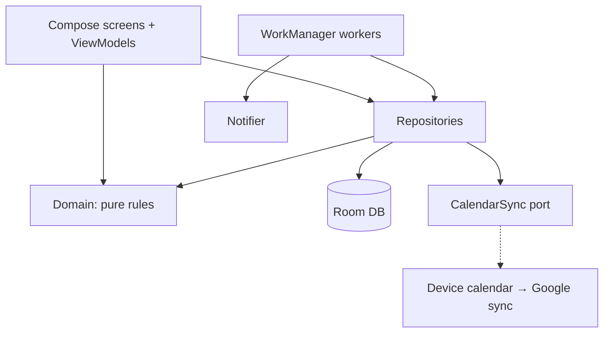

# Project Context

**Klas** — native Android app for a **single** private tutor: students, groups, subjects, schedule,
payments, debts. **Offline-first / local-only, no backend.** Russian + English UI, Material 3.
See `PLANNING.md` for product goal.

Renamed from «Репетит» (`com.seblful.repetit`) pre-release — different application id, no upgrade path;
JSON export/backup is the only bridge.

**This file is the map: what was decided and where it lives.** Reasoning lives in KDoc next to the code.

---

## Architecture

MVVM, pure unit-tested domain layer. Room is the single source of truth; calendar and notifications are
best-effort mirrors of it, never the reverse. DI: Hilt. Single `app` module.



| Package | Responsibility |
|---|---|
| `domain/` | Pure Kotlin, no Android deps: billing, class/group rules, scheduling, recurrence, calendar policy, reminders, `LessonPhase`, `Homework`, `Digests`, reports, search, formatting-adjacent models (`Balance`, `Currency`, `AppLanguage`). All JVM-tested. |
| `data/local/` | Room entities, DAOs, `AppDatabase`, `Migrations`, `Transactor` port. `SnapshotDao` is the separate whole-table seam. |
| `data/Mappers.kt` | Entities ⇄ domain models. |
| `data/repository/` | One invariant each, end to end, one transaction (see *Ownership*). |
| `data/backup/` | File format: export, transactional replace-all import, integrity/failure classification, restore. |
| `calendar/` | `CalendarSync`/`CalendarPermission` ports, `CalendarContract` adapter, calendar/guest choice rules. |
| `notifications/` | `Notifier` + permission ports/adapters, reminder/digest content, tray actions/navigation, alarm scheduling. |
| `work/` | Periodic maintenance worker, two digest workers, `WorkScheduler`, `BootReceiver`, `Maintenance`. |
| `diagnostics/` | `CrashLogger` over local storage; viewed/exported from `ui/diagnostics`. |
| `storage/` | `DocumentStore` (SAF) and `DocumentSharing` (`ACTION_SEND`) ports. |
| `format/` | Date/time/money formatting, `AppLocale`, `MoneyField`, `NameOrder`. |
| `ui/` | Compose screens + `@HiltViewModel`s, `navigation/`, shared `common/` atoms, `onboarding/`, `RootViewModel`. The «Задания» tab and the homework parts the schedule and student card share in `ui/homework/`. Settings/About in `ui/more/`. Theme in `ui/theme/`. |
| `preview/` (debug only) | `@Preview`s of `ui/common/`. |
| `di/` | DB module, scopes/dispatchers, `Clock`, week-start, device locales. |

### Ownership (one invariant, one place)

- `ClassRepository` — side effects of a class change (calendar mirror, reminder refresh) and the
  one-tutor-one-lesson refusal. Every write takes a whole lesson (`ClassSession`). `bookSeries` reports
  instead of refusing.
- `CalendarMirror` — what a mirrored event shows; owns sync on/off backfill and withdrawal.
- `EnrollmentRepository` — the subject⇄price invariant.
- `GroupRepository` — the only writer of group membership.
- `PaymentRepository` — a payment's date and correcting one in place; the instant is derived here.
- `RateHistoryRepository` — what a rate change is (two repositories set rates).
- `SettingsRepository` — one serialized `update {}`, returning what the change owes the rest of the app.
  Also owns the default currency and the display locale.
- `StudentRepository` — archiving calls off a retired student's planned lessons first.
- `SubjectRepository` — deletable only while unreferenced.

**A write spanning tables is one transaction**, in three phases: pure rules → rows inside
`Transactor.transaction` → calendar/reminders after commit.

---

## Key design decisions

### Money and billing

- Money is integer minor units (kopecks), no floats, bounded by `Money.MAX`.
- Currency (`BYN|RUB|USD|EUR`) is a **display** setting: changing it re-labels stored amounts, never
  converts. Always printed as ISO code, never a symbol. Fresh install defaults from phone region.
- Decimal separator follows the app **language**, not the currency.
- Price is an hourly rate booked per class, pre-filled from student/group rate, editable per lesson;
  re-pricing never touches existing classes. Balances/income are always derived, never stored.
- Status: `scheduled → completed | cancelled`; auto-completes past end time (opt-in). No "missed" status.
  «Идёт» is derived, not a fourth status (see *Lessons*).
- Reports cover active students only, over a period (`domain/ReportPeriod`) — debts are always the whole
  history. `Reports.of` is the only entry point.

### Pure-module pattern

- The booking form's whole mutable surface is `BookingForm.change(intent, context)`
  (`ui/schedule/BookingForm.kt`); reads it needs come back as data (`Lookup`) through the same `change`.
- Every screen's loading/ready state is `Loadable<T>` (`Loading | Ready`), drawn as a skeleton, never a
  spinner; applies to forms too (a blank form is a real, wrong state until data arrives).
- `derive`/`hold` end every screen flow; `ShowMessagesFor`/`rememberMessages` end one-shot snackbar events;
  the guarded-write tail is named `write` (application scope + `runCatchingCancellable` + failure report).
- A screen draws, it does not decide: every branch is a named value from the domain layer
  (`ArchiveIntent`, `DeleteWarning`, `ScheduleEmpty`, `Balance`, `Taught.Totals.hint`, etc.), never an
  `if` inside a composable. Clock reads for money/scheduling go through the injected `Clock`, never
  `Instant.now()`/`ZoneId.systemDefault()` in a composable.

### Storage seams

- `SnapshotDao` is the only whole-database seam (backup/restore); its per-table methods are `protected`,
  everything else goes through the ordinary repositories.
- Backup file format (`BackupData`) is a separate type from the internal snapshot — its field names are
  JSON keys already on disk and may never be renamed.
- An enum's constant name is a persisted value (status, mode columns, SQL literals) — renaming one is a
  migration (`StoredEnumNamesTest`). Storage parses with a total function, never `valueOf`.

### Lessons

- A lesson is a row; attendance is another (`lessons` + `attendance`, joined by the `classes` view). The
  lesson holds hour/subject/one status; each member's row holds attendance, rate, charge.
  `ABSENT_BILLED` = absent but charged; only an explicit absence stops a charge.
- A lesson's phase is derived, never stored (`domain/LessonPhase`: `UPCOMING|IN_PROGRESS|OVERDUE|SETTLED`),
  from status + injected clock — not a fourth `LessonStatus`.
- A lesson carries one note (`lessons.notes`), shared by every class in it; rides the ordinary edit. It is
  the tutor's own and **never leaves the app** — the calendar event carries the homework instead.
- A lesson is the unit of change — every write takes a `ClassSession` (except `setAttendance` and
  `setHomeworkResult`, per person).

### Homework

- Set at a lesson (`lessons.homework`, the lesson's like the note), checked at the next one **on its
  track**: the group's next lesson in that subject, or the same student's next individual lesson in the
  same subject; a cancelled lesson is skipped. That lesson is **derived, never stored** (`domain/Homework`),
  because with no series the next lesson is often not booked yet, and it can move.
- Each student's verdict (`DONE|PARTIAL|NOT_DONE`, null = not checked) is on their `attendance` row **of
  the lesson it was set at**, written as one column (`AttendanceDao.setHomeworkResult`) — no calendar
  mirror, no reminder re-plan; the reminder reads what is left to check as it fires.
- Set on the lesson's form (edit only — a booking, and a repeating one especially, sets none) or from the
  schedule's sheet; checked on the next lesson's sheet, in the tab, or on the student's card.
- The «Задания» tab is a worklist, not an archive: the latest homework per track, set within
  `Homework.FOLLOWED_UP_FOR` (60 days), for active students and groups — «Проверить» (due today, then
  overdue) and «Выдано» (due later, then no next lesson booked). The whole record is the student card's.
- Sent through the share sheet, worded with the due lesson's date. Not in v1: photos/files, grades, due
  dates independent of lessons, anything student-facing.
- **One tutor, one lesson at a time**: overlap refused, not warned; back-to-back fine; cancelled frees the
  slot; past booking allowed. Pure rule in `Scheduling.conflicts`, enforced by the repository
  (`LessonWrite.HourTaken`).
- Editing/deleting allowed in any status; charge recomputed in place; deleting a completed lesson removes
  its income (UI warns).
- A repeating booking writes ordinary lessons, not a series (`domain/Recurrence`, `ClassRepository.bookSeries`)
  — no series table, no expand-on-read, no "cancel the rest" in one tap. A taken hour is *reported*, not
  refused (`SeriesWrite`), and the whole run is one transaction.

### Groups

- A group prices its lessons; students still owe individually. One rate per lesson (pre-v3 backups excepted).
- A group is taught one fixed subject; only priced students may be members; roster is intersected on save
  and the save reports who was dropped.
- Attendance is separate from roster membership and correctable afterwards.
- A lesson is captioned by one module (`domain/Captions`): group lesson titled by group, individual by student.
- Groups are archive-only once they have lessons; mirror as one calendar event per member; reminders per lesson.

### Students, subjects, history

- A student's subjects == their priced subjects (individual lessons only); un-enrolling refused while a
  class references it.
- Class mode (in person/remote): student default, overridable per class, mirrored into the calendar location.
- History is structurally protected: `classes`/`payments` use `ON DELETE RESTRICT`; students archive-only;
  subjects/groups deletable only while unreferenced.
- A rate's past is a log (`price_history`, one table for student price + group rate). Unchanged rate logs
  nothing; un-enrolling forgets its log.

### Storage, migrations, backup

- Settings live in Room (single row), device-local, not backed up, written under a `Mutex`.
- Platform auto-backup is off; the app's own JSON export (SAF) is the only way data moves between devices.
- DB is at v8, baseline v5 (`AppDatabase.BASELINE_VERSION`); `Migrations.kt` holds exactly the steps since
  baseline. Every schema change past baseline bumps the version and ships a migration
  (`MigrationChainTest` enforces wiring; each migration also gets a device test against the exported schema).
- A step that changes a column the `classes` view projects drops and recreates the view — Room validates
  views but never rebuilds them. The latest such step reads `CLASSES_VIEW_SQL`; earlier ones keep their own
  version's `SELECT` frozen, and `MigrationChainTest` runs every step against that version's exported view.
- Destructive fallback (wipe-on-unmigratable) is debug-only; release refuses to open such a database.
- `BackupData.version` is independent of the schema version — it's the only bridge out of the old app id.
- Backup = full DB snapshot → JSON. Ids preserved, import is one transaction. Older file versions still
  import (defaults fill gaps); newer ones are refused. Restore reproduces the file as given.
- `BackupIntegrity` checks readability before any row is written; `BackupFailure` classifies a refusal;
  `BackupRestore` owns the whole restore act (rows + first-run flag + reminders + calendar re-mirror).

### Calendar, reminders, digests

- Sync via `CalendarContract` (OS handles Google sync), opt-in. Mirror runs **one way**, app → calendar,
  through `ClassRepository.write`'s post-commit phase; nothing reads the calendar back.
- A completed lesson's event is kept true but never (re)created (`Action.REFRESH`); the **homework** is the
  event description (`CalendarEvent.description`), written verbatim even when blank — never the note, since
  an invited student is an attendee of the same event.
- Email invites are a separate, off-by-default setting; turning it off and re-syncing withdraws invites.
- Reminders are alarms (`AlarmManager`), not workers — exact where the OS allows, inexact fallback
  otherwise; re-derived from scratch over a fixed horizon on every change; re-armed after reboot.
- Turning auto-completion on sweeps the whole backlog, asks first, reports what it settled; the background
  pass never asks.
- Tray actions: «Проведено» bills in place via a broadcast; «Перенести» opens the lesson. Both re-check
  legality against the current lesson state (a notification can be stale).
- Two digests (morning agenda, weekly debts), opt-in, scheduled by the upkeep pass, are workers (lateness
  is fine). A run already due is left alone rather than skipped; a digest with nothing to say sends nothing.
  The evening digest is auto-completion's counterpart (asks vs. assumes), counts lessons only, today only,
  no action button.
- `ReminderDelivery` (`OFF|ON_TIME|BLOCKED|LATE`) reports the two permission grants (post-notifications,
  exact-alarm) as one settings row with a link to the right system page.
- Crash diagnostics are local-only (capped log file, exportable from Settings). No Crashlytics/Sentry.

### UI conventions

- **Language**: `AppLanguage` (SYSTEM|RUSSIAN|ENGLISH) is a setting; pinned onto resources via
  `ProvideLocalizedResources`, never `Locale.setDefault()`. `StringCoverageTest` pins parity between
  `values/`/`values-ru/` (strings, plurals, format args, array lengths). A language change re-syncs the
  calendar (mirrored text is baked in).
- **Time**: `java.time` everywhere (desugared, minSdk 24); 12/24-hour and week-start both follow the
  *phone's* setting, not the app language; today rolls over at local midnight off the injected `Clock`.
- **Haptics**: five named moments only (`ui/common/Haptics`), wired into shared atoms, never per-screen;
  ordinary taps stay silent.
- **Screens draw, they don't decide** (see *Pure-module pattern*): `ClassFormState`, `MoneyField`,
  `leaveIntent`, `Maintenance`, `CrashLogger` hold the rules. One-shot outcomes report through one
  snackbar helper (`ui/common/Messages`) — no `Toast`.
- **Shell**: every screen is a `KlasScreen` (owns `Scaffold`, insets, width cap, snackbar host, back arrow,
  scroll behavior) — exactly one `Scaffold` per tree. `Spacing` is the app's rhythm (`tight`…`sectionGap`).
  Card vs. row is by nesting depth (`ContentCard` top-level, `ListItem` nested). Detail cards are all
  identity → `StatRow` → sticky tabs. One control per kind of question: `SegmentedChoice` (fixed few,
  swipeable), `ChoiceRow` (settings-shaped choice, segments up to 4 then a field), chips (shortlist +
  escape hatch).
- **Navigation**: bottom bar «Люди·Задания·Расписание·Отчёты·Ещё», opens on the schedule (the middle tab);
  Students+Groups share one tab via a segmented control. Which tab is marked is read off the back stack.
  Destinations cross-fade; predictive back is on.
- **Lists**: shared search rule (`domain/PeopleSearch`) across the three list screens — case-insensitive,
  substring, terms in any order. Empty lists always carry the way out (`EmptyState`). State is a
  `StatusBadge`, never a font style.
- **Schedule**: three views (Day/Week/Month) via segmented control; a day is always summarized as
  count·hours·money (`domain/DaySummary`); a "now" hairline on today only; completing a lesson is a
  revocable swipe (green panel); a cancelled lesson recedes, badge stays red. Can be narrowed to one
  student (dismissible chip). Booking is by length, not end time.
- **Reports**: number only where the chart shape adds meaning (column/stacked-bar/ranked-bars/plain text);
  CSV export's delimiter follows the decimal separator; can be saved or sent.
- **Design system**: curated indigo+teal Material 3 palette, dynamic color off by default. Amber = "on
  now"; green = "taught" (`KlasColors`, app-owned, unaffected by dynamic color). Golos Text typeface
  (Cyrillic-first, full Latin). Avatar colors key off id, not name.

---

## Data flow

ViewModels observe repository `Flow`s, expose `StateFlow`. Writes: ViewModel → repository → Room →
(repository) mirrors calendar + refreshes reminders.

Reads live in `viewModelScope`; writes go to the injected `@ApplicationScope` so a save outlives its
screen. Deriving state happens off the main thread (`combine(...).derive(scope, computation, initial)`).
A failed write is reported via the crash log and, where possible, the screen — never fatal. ViewModel
state is read-only (`StateFlow`, never mutable). Guarded suspend calls use `runCatchingCancellable`
(never plain `runCatching`, which swallows cancellation).

---

## Non-goals (v1)

Multi-user/login, cloud sync across devices, web/iOS, in-app payments, a recurring-series entity (a
repeating booking writes lessons and keeps no rule — see *Lessons*).

---

## Testing

- JVM unit tests (`src/test`, ~60 classes): domain, backup format, view models, repository side effects,
  mappers, formatters — against in-memory fake DAOs. `isReturnDefaultValues` is off (a test needing
  Android has found a missing port). Seed through `testutil/Fixtures`, never DAOs directly.
- A handful of tripwire tests guard silent drift by deriving expectations from a real artifact rather than
  restating them (schema coverage, enum names, whole-table writes, screen-state/shell surface rules,
  migration chain wiring and the view each step leaves). `MigrationChainTest` is the only one in the unit
  suite guarding the upgrade path.
- Instrumented tests (`src/androidTest`, 13 classes) cover what needs a device: Room/FK integration,
  backup round-trip, calendar sync, auto-completion, text measurement, gesture behavior, plural rules,
  screen-reader semantics. Every class runs under a custom `KlasTestApp` (the app's own receivers/workers
  wake mid-run and need a real Hilt component). Every migration has a device test validating column-for-column
  against the exported schema.
- CI runs the unit suite, `lintDebug`, the debug APK, and instrumented-test *compilation* on every PR/push.
  Notification display and real calendar writes can only be observed on a device.

---

## Tooling & build

- Kotlin 2.3.21, AGP 9.3.1, Gradle 9.6.1, JDK 21. compileSdk 37, targetSdk 36, minSdk 24. Hilt 2.60.1,
  Room 2.8.4, WorkManager, Navigation Compose, kotlinx-serialization — versions in `gradle/libs.versions.toml`.
  Current release: `0.3.0` (`versionCode` 4).
- Kotlin version is capped by KSP's supported line (Room/Hilt codegen) — do not bump past it.
- Needs `JAVA_HOME` on JDK 21 and `local.properties` pointing at the Android SDK — or only Docker:
  `docker compose run --rm android <tasks>` builds in `docker/Dockerfile`'s image (JDK 21 + the pinned SDK
  packages), with the Gradle cache in a named volume and `local.properties` overridden inside the container.
- Common commands: `./gradlew :app:testDebugUnitTest`, `:app:assembleDebug`, `:app:assembleDebugAndroidTest`,
  `:app:lintDebug`, `:app:bundleRelease`.
- Debug build installs beside release (`.debug` app id, own DB). Release is minified/shrunk (R8); signing
  reads `keystore.properties` (gitignored), unsigned if absent.

```
app/src/main/java/com/seblful/klas/
├── domain/            # pure rules + ports + models
├── data/              # Mappers.kt + {local,repository,backup}/
├── calendar/  notifications/  diagnostics/  work/  format/  storage/  di/
├── Coroutines.kt      # runCatchingCancellable
├── Localization.kt    # Context.inLanguage() + deviceLocales()
├── ui/{schedule,people,homework,students,groups,subjects,reports,backup,more,
│       onboarding,diagnostics,common,navigation,theme}/
├── MainActivity.kt    # @AndroidEntryPoint → AppRoot()
└── KlasApp.kt         # @HiltAndroidApp, WorkManager config, in-process startup upkeep
```
