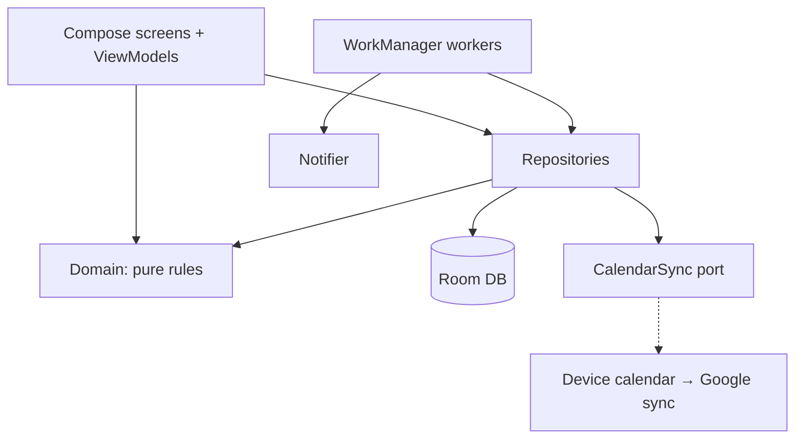

# Project Context

## Overview

A native Android app for a **single** private tutor to manage students, subjects, schedule,
payments and debts. **Offline-first / local-only — no backend.** Russian UI, Material 3.
Currency is **BYN** (Belarusian ruble). See `PLANNING.md` for the product goal and success criteria.

---

## Architecture

MVVM with a **pure, unit-tested domain layer**. Room is the single source of truth; notifications
and calendar are best-effort *mirrors* of it, never the other way round. DI is Hilt.



### Layers / modules (single `app` module)

| Package | Responsibility |
|---|---|
| `domain/` | Pure Kotlin, no Android deps: billing, class rules, reminders, reports, scheduling, the `ReminderScheduler` port, and the models. All JVM-unit-tested. |
| `data/local/` | Room entities, DAOs, `AppDatabase`. Entities are also `@Serializable` (for backup). |
| `data/repository/` | Repositories mapping entities ⇄ domain models. `ClassRepository` owns *all* side effects of a class change (calendar mirroring + reminder refresh). |
| `data/backup/` | Whole-DB JSON snapshot: export + transactional replace-all import. |
| `calendar/` | `CalendarSync` port + a `CalendarContract` adapter. |
| `notifications/` | `Notifier` — reminder channel + posting. |
| `diagnostics/` | `CrashLogger` — appends crashes to a capped local file, then chains to the platform default (so Play/Android Vitals still reports). Viewed/exported from `ui/diagnostics`. |
| `work/` | WorkManager workers + `WorkScheduler` (implements `ReminderScheduler`). |
| `format/` | Shared `ru`-locale date/time/money formatting, used by UI and non-UI. |
| `ui/` | Compose screens + `@HiltViewModel`s, `navigation/`, shared `common/` widgets, `onboarding/`, settings, and a `RootViewModel` gating onboarding vs. the main tabs. |
| `di/` | Hilt modules (database; calendar/work port bindings). |

---

## Key design decisions

- **Money is integer minor units (kopecks)** — no floating point.
- **Price is an hourly rate booked per class**, pre-filled from the student's rate for the subject
  and editable per class. At completion the charge = booked rate × lesson duration. Using the
  *booked* rate means later edits to a student's rate never touch existing classes.
- **Status state machine**: `scheduled → completed | cancelled`, with corrections. A scheduled
  class **auto-completes once its end time passes** (opt-in setting). Cancelling voids the charge —
  there is no separate "missed" status.
- **Editing is allowed in any status; the charge is recomputed, not preserved.** Re-attributing a
  class to a new student/subject credits the new owner at the current rate, so editing history is
  safe. Edits update the row in place (never insert), so income can't be double-counted. **Move
  (reschedule) is allowed for any status.** A completed class can't be *deleted* (cancel it first).
  Classes are **one-off only** — no recurring series.
- **A student's subjects == their priced subjects** (single source of truth). Adding a subject links
  it and sets a price in one step; removing drops both, but is **refused when the student has any
  class for that subject**, preserving the invariant that a booked subject always has a price.
- **History is structurally protected.** Subjects are deletable only when unreferenced; `classes`
  and `payments` use `ON DELETE RESTRICT` on their parents, so the DB itself refuses to cascade-erase
  earned income. Students are **archive-only** (no delete path).
- **Class mode** (in person / remote): each student has a default; a class inherits and can override
  it. Mirrored into the calendar event's location. Students also carry a free-text phone.
- **Offline-first.** Room is authoritative; calendar and notifications no-op if their
  permission/calendar is absent, never blocking or corrupting local data.
- **Crash diagnostics are local + Play, no backend** (`diagnostics/CrashLogger`): it chains to the
  platform's previous uncaught-exception handler (so crashes still reach Google Play's Android
  Vitals) and also appends each crash to a size-capped file in `filesDir`, viewable and
  SAF-exportable from **More → Диагностика**. No Crashlytics/Sentry, to avoid a third-party SDK,
  network calls and a privacy policy. The pure formatting/bounding lives in `domain/` (JVM-tested).
- **Settings live in Room** (single row): notifications, calendar sync, onboarding flag, reminder
  lead time, auto-complete (opt-in), theme, default lesson length, currency. Device-local, so
  **not** part of the backup snapshot. Schema changes ship a real Room migration.
- **First-run onboarding** forces adding ≥1 subject, then a first student with subjects and prices.
- **Reports cover active students only**; archiving therefore hides a student's debt, so the app
  **warns before archiving a student with a non-zero balance**.
- **Email reminders via the calendar, not a backend**: a synced class event adds the student as an
  attendee with an email reminder, so the calendar account (e.g. Google) does the sending.
- **Calendar sync via `CalendarContract`, not the Google REST API** — writing to the device calendar
  lets the OS sync to Google, so there's no cloud project or OAuth to set up. Behind the
  `CalendarSync` port (a REST adapter could be added later). Opt-in; grants read + write calendar.
- **WorkManager** drives time-based behavior (precise one-shot reminders + a periodic maintenance
  worker that auto-completes due classes and refreshes reminders). The *decisions* are pure and tested.
- **Backup = full DB snapshot → JSON via SAF.** Ids are preserved; import is one transaction.
- **`java.time` everywhere + core-library desugaring** so it works on `minSdk 24`.
- **Design system** (`ui/theme/`): curated Material 3 palette (indigo + teal), light/dark schemes,
  dynamic color off by default for a consistent brand. Convention: content lists use the shared
  `ContentCard`; settings-style lists stay as plain `ListItem` rows. Shared atoms in `ui/common/`.
- **Responsive width.** Phone-first, but every screen's top-level scrollable content applies
  `Modifier.constrainedContent()` (`ui/common/`), capping width at ~600.dp and centring it on wide
  screens (tablets/foldables/landscape) while staying full-width on phones. Vertical fit comes from
  every screen scrolling, so short viewports never clip.

---

## Data flow

ViewModels observe repository `Flow`s and expose `StateFlow` UI state. Writes go ViewModel →
repository → Room, and the repository then mirrors the change to the calendar and refreshes
reminders — so ViewModels express intent only and can't forget a side effect. Balances and income
are derived on the fly, never stored.

---

## Non-goals (v1)

Multi-user/login, cloud sync across devices, web/iOS, in-app payments.

---

## Testing

- **JVM unit tests** (`src/test`, `testDebugUnitTest`) cover the domain layer and the backup format,
  plus the view models, repository side effects, mappers and formatters — run against **in-memory
  fake DAOs** with a test main dispatcher, so most logic is verified without an emulator.
- **Instrumented tests** (`src/androidTest`) cover the Room integration (auto-complete, calendar
  sync on move, backup round-trip).
- Notification display and real calendar writes can only be observed on a device.

---

## Tooling & build

- Kotlin 2.1, AGP 8.7, Gradle 8.9, JDK 21 (Android Studio JBR). compile/target SDK 35, minSdk 24.
- Hilt 2.55 (older Hilt can't read Kotlin 2.1 metadata), Room, WorkManager, Navigation Compose,
  kotlinx-serialization — versions in `gradle/libs.versions.toml`.
- Build needs `JAVA_HOME` set to a JDK 21 and `local.properties` pointing at the Android SDK.
- Common commands: `./gradlew :app:testDebugUnitTest`, `:app:assembleDebug`, `:app:assembleDebugAndroidTest`.

```
app/src/main/java/com/seblful/tutoringapp/
├── domain/            # pure rules + ports + models
├── data/{local,repository,backup}/
├── calendar/  notifications/  diagnostics/  work/  format/  di/
├── ui/{schedule,students,subjects,reports,backup,more,onboarding,diagnostics,common,navigation,theme}/
├── MainActivity.kt    # @AndroidEntryPoint → AppRoot()
└── TutoringApp.kt     # @HiltAndroidApp, WorkManager config, startup scheduling
```
