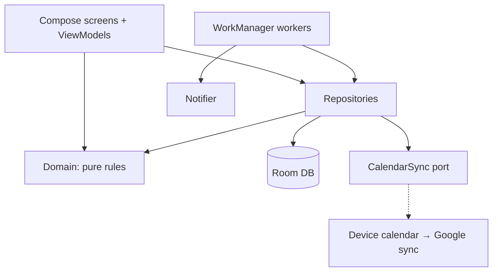

# Project Context

## Overview

A native Android app for a **single** private tutor to manage students, groups, subjects, schedule,
payments and debts. **Offline-first / local-only — no backend.** Russian UI, Material 3.
Currency is **BYN** (Belarusian ruble). See `PLANNING.md` for the product goal and success criteria.

---

## Architecture

MVVM with a **pure, unit-tested domain layer**. Room is the single source of truth; notifications
and calendar are best-effort *mirrors* of it, never the other way round. DI is Hilt.



### Layers / modules (single `app` module)

| Package | Responsibility |
|---|---|
| `domain/` | Pure Kotlin, no Android deps: billing, class rules, group rules (sessions, bookable subjects), calendar layout, reminders, reports, scheduling, the `ReminderScheduler` port, and the models. All JVM-unit-tested. |
| `data/local/` | Room entities, DAOs, `AppDatabase`. Entities are also `@Serializable` (for backup). |
| `data/repository/` | Repositories mapping entities ⇄ domain models. `ClassRepository` owns *all* side effects of a class change (calendar mirroring + reminder refresh) and the batch (group-lesson) forms of each write. `EnrollmentRepository` owns the subject⇄price invariant — the single seam that links/unlinks a subject and sets/deletes its price together. `GroupRepository` is the only writer of group membership (a group is always saved together with its exact roster). |
| `data/backup/` | Whole-DB JSON snapshot: export + transactional replace-all import. |
| `calendar/` | `CalendarSync` port + a `CalendarContract` adapter. |
| `notifications/` | `Notifier` — reminder channel + posting. |
| `diagnostics/` | `CrashLogger` — appends crashes to a capped local file, then chains to the platform default (so Play/Android Vitals still reports). Viewed/exported from `ui/diagnostics`. |
| `work/` | WorkManager workers + `WorkScheduler` (implements `ReminderScheduler`). |
| `format/` | Shared `ru`-locale date/time/money formatting, used by UI and non-UI. |
| `ui/` | Compose screens + `@HiltViewModel`s, `navigation/`, shared `common/` widgets, `onboarding/`, settings, and a `RootViewModel` gating onboarding vs. the main tabs. |
| `di/` | Hilt modules (database; calendar/work port bindings). |

---

## Key design decisions

- **Money is integer minor units (kopecks)** — no floating point.
- **Price is an hourly rate booked per class**, pre-filled from the student's rate for the subject
  and editable per class. At completion the charge = booked rate × lesson duration. Using the
  *booked* rate means later edits to a student's rate never touch existing classes.
- **Status state machine**: `scheduled → completed | cancelled`, with corrections. A scheduled
  class **auto-completes once its end time passes** (opt-in setting). Cancelling voids the charge —
  there is no separate "missed" status.
- **Editing is allowed in any status; the charge is recomputed, not preserved.** Re-attributing a
  class to a new student/subject credits the new owner at the current rate, so editing history is
  safe. Edits update the row in place (never insert), so income can't be double-counted. The edit
  path goes through `ClassRules.edit`, which folds the move (re-plan) and rebill into one step so a
  caller can't persist a stale charge. **Move (reschedule) is allowed for any status.** A class can
  be **deleted in any status**; deleting a
  completed one removes its recognized income (derived, not stored, so it just disappears from
  reports/balances) and the UI warns before doing so. The repository's `delete` removes the
  calendar event and refreshes reminders regardless of status. Classes are **one-off only** — no
  recurring series.
- **A group is a roster, not a billing entity.** Booking a lesson for a group writes **one class per
  member**, each at that member's own rate, so prices, balances, debts and reports stay strictly
  per-student and nothing about groups touches the money model. The members' classes of one lesson
  share a `groupId` **and a start** — that pair *is* the "session" the schedule collapses into one
  card (`GroupRules.sessions`); sessions are derived, never stored, so a class moved on its own leaves
  its session by construction, with no membership flag to go stale. Consequences: a group lesson can
  only be booked for a subject **every** member has a price for (`GroupRules.bookableSubjects`);
  archived students are left out of new lessons but keep their past ones; per-member corrections stay
  expressible (mark the lesson completed, then cancel the absentee's class — the session then reads
  as "разные"), which is why status changes apply per class (`GroupRules.applicableTo` skips the ones
  a change isn't legal for). Groups are **archive-only once they have lessons** (deleting is refused,
  like subjects), and a group lesson **mirrors as one calendar event per member** — each student keeps
  their own invite and email reminder — with the group's name in the title. In-app **reminders are
  per lesson, not per member** (`Reminders.plan` dedupes a session and the notification names the
  group).
- **A student's subjects == their priced subjects** (single source of truth). Adding a subject links
  it and sets a price in one step; removing drops both, but is **refused when the student has any
  class for that subject**, preserving the invariant that a booked subject always has a price. This
  is enforced in `EnrollmentRepository` (the only writer of subject links and prices), not by caller
  discipline in the view models.
- **History is structurally protected.** Subjects and groups are deletable only when unreferenced;
  `classes` and `payments` use `ON DELETE RESTRICT` on their parents (student, subject, group), so the
  DB itself refuses to cascade-erase earned income. Students are **archive-only** (no delete path);
  groups fall back to archiving once they have lessons.
- **Class mode** (in person / remote): each student has a default; a class inherits and can override
  it. Mirrored into the calendar event's location. Students also carry a free-text phone.
- **Offline-first.** Room is authoritative; calendar and notifications no-op if their
  permission/calendar is absent, never blocking or corrupting local data.
- **Crash diagnostics are local + Play, no backend** (`diagnostics/CrashLogger`): it chains to the
  platform's previous uncaught-exception handler (so crashes still reach Google Play's Android
  Vitals) and also appends each crash to a size-capped file in `filesDir`, viewable and
  SAF-exportable from **More → Диагностика**. No Crashlytics/Sentry, to avoid a third-party SDK,
  network calls and a privacy policy. The pure formatting/bounding lives in `domain/` (JVM-tested).
- **Settings live in Room** (single row): notifications, calendar sync, onboarding flag, reminder
  lead time, auto-complete (opt-in), theme, default lesson length, currency. Device-local, so
  **not** part of the backup snapshot.
- **Schema changes ship a real Room migration** in `data/local/Migrations.kt` (registered on the Room
  builder; the destructive fallback now only covers dev devices predating v1). **v2** added the group
  tables and `classes.groupId`, recreating `classes` to do so — which also retired the unused
  `recurringGroupId` column (recurring series are a non-goal, and the name clashed with the new group
  id). Migrations are validated against the exported schema JSONs by an instrumented test.
- **First-run onboarding** forces adding ≥1 subject, then a first student with subjects and prices.
- **Reports cover active students only**; archiving therefore hides a student's debt, so the app
  **warns before archiving a student with a non-zero balance**.
- **Email reminders via the calendar, not a backend**: a synced class event adds the student as an
  attendee with an email reminder, so the calendar account (e.g. Google) does the sending.
- **Calendar sync via `CalendarContract`, not the Google REST API** — writing to the device calendar
  lets the OS sync to Google, so there's no cloud project or OAuth to set up. Behind the
  `CalendarSync` port (a REST adapter could be added later). Opt-in; grants read + write calendar.
- **WorkManager** drives time-based behavior (precise one-shot reminders + a periodic maintenance
  worker that auto-completes due classes and refreshes reminders). The *decisions* are pure and tested.
- **Backup = full DB snapshot → JSON via SAF.** Ids are preserved; import is one transaction. The
  format is versioned (**v2** carries groups); an older file still imports, since missing tables come
  back empty and retired keys are ignored.
- **`java.time` everywhere + core-library desugaring** so it works on `minSdk 24`.
- **Design system** (`ui/theme/`): curated Material 3 palette (indigo + teal), light/dark schemes,
  dynamic color off by default for a consistent brand. Convention: content lists use the shared
  `ContentCard`; settings-style lists stay as plain `ListItem` rows. Shared atoms in `ui/common/`.
- **The schedule has three views**, picked from the top bar. **Day** and **month** both show one
  selected day's classes (the month grid is a day picker with an overview); **week** is the odd one
  out — its strip picks the day the add button books into, but the agenda below always lists the
  *whole* week grouped by day, since seeing a week at once is the point. Calendar cells carry up to
  three dots (one per class, tinted by the day's dominant status). Paging weeks or months only
  *browses* and never moves the selection; opening a calendar view snaps its page back to the
  selected day, so it can't open on a page where nothing looks selected. Day markers are queried
  for the **active view's range only**, so browsing far from the selection never widens the query
  and the day view pays for no markers at all. The layout rules — how many week rows a month needs,
  which neighbouring days pad them, where a week starts, how a day's classes collapse to one marker
  — are pure and JVM-tested in `domain/CalendarLayout`, leaving the composables to draw only. The
  chosen view is view-model state, deliberately **not** persisted: it isn't in the settings row, so
  no migration.
- **Responsive width.** Phone-first, but every screen's top-level scrollable content applies
  `Modifier.constrainedContent()` (`ui/common/`), capping width at ~600.dp and centring it on wide
  screens (tablets/foldables/landscape) while staying full-width on phones. Vertical fit comes from
  every screen scrolling, so short viewports never clip.

---

## Data flow

ViewModels observe repository `Flow`s and expose `StateFlow` UI state. Writes go ViewModel →
repository → Room, and the repository then mirrors the change to the calendar and refreshes
reminders — so ViewModels express intent only and can't forget a side effect. Balances and income
are derived on the fly, never stored.

---

## Non-goals (v1)

Multi-user/login, cloud sync across devices, web/iOS, in-app payments.

---

## Testing

- **JVM unit tests** (`src/test`, `testDebugUnitTest`) cover the domain layer and the backup format,
  plus the view models, repository side effects, mappers and formatters — run against **in-memory
  fake DAOs** with a test main dispatcher, so most logic is verified without an emulator.
- **Instrumented tests** (`src/androidTest`) cover the Room integration (auto-complete, calendar
  sync on move, backup round-trip) and the **schema migrations** (`MigrationTest` runs each migration
  against the exported schema JSON, so a hand-written `CREATE TABLE` can't drift from the entities).
- Notification display and real calendar writes can only be observed on a device.

---

## Tooling & build

- Kotlin 2.3.20, AGP 9.2.1, Gradle 9.6.0, JDK 21 (Android Studio JBR). compileSdk 37, targetSdk 36,
  minSdk 24. **AGP 9 compiles Kotlin itself** (built-in Kotlin): there is no `kotlin.android` plugin;
  the root `build.gradle.kts` pins the built-in KGP to 2.3.20 via a `buildscript` classpath so it
  matches the Compose/serialization compiler plugins and KSP. **Kotlin tracks KSP** — KSP (which
  drives Room + Hilt codegen) lags Kotlin, so Kotlin can't move past the version the latest KSP
  embeds (KSP 2.3.9 → Kotlin 2.3.20).
- Hilt 2.59.2, Room 2.8, WorkManager, Navigation Compose, kotlinx-serialization — versions in
  `gradle/libs.versions.toml`.
- `lint { checkReleaseBuilds = false }` works around an AGP 9.2.1 lint-jar file-lock bug on Windows;
  lint still runs via `lintDebug`.
- Build needs `JAVA_HOME` set to a JDK 21 and `local.properties` pointing at the Android SDK.
- Common commands: `./gradlew :app:testDebugUnitTest`, `:app:assembleDebug`, `:app:assembleDebugAndroidTest`.
- **Release**: `release` is minified + resource-shrunk (R8). Signing reads `keystore.properties` (repo
  root, gitignored — see `keystore.properties.example`); when absent the release build is left
  unsigned so debug/CI/contributors are unaffected. Play artifact: `./gradlew :app:bundleRelease`
  (→ `app/build/outputs/bundle/release/app-release.aab`). Bump `versionCode` per upload. R8 keep
  rules for `@Serializable` types live in `proguard-rules.pro` (Room/Hilt ship their own).

```
app/src/main/java/com/seblful/tutoringapp/
├── domain/            # pure rules + ports + models
├── data/{local,repository,backup}/
├── calendar/  notifications/  diagnostics/  work/  format/  di/
├── ui/{schedule,students,groups,subjects,reports,backup,more,onboarding,diagnostics,common,navigation,theme}/
├── MainActivity.kt    # @AndroidEntryPoint → AppRoot()
└── TutoringApp.kt     # @HiltAndroidApp, WorkManager config, startup scheduling
```
