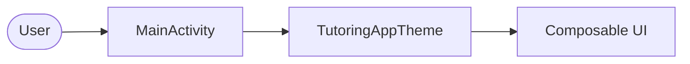

# Project Context

## Overview

An Android tutoring application built with Kotlin and Jetpack Compose. The app
is currently a fresh single-module scaffold — the feature surface has not been
built yet.

---

## Architecture

Single-module Android app following the standard Gradle + Compose layout. UI is
declared with Jetpack Compose; `MainActivity` is the single entry point that
hosts the composable tree under the app theme.



### Modules

| Module | Purpose |
|--------|---------|
| `app/` | The application module (only module) |
| `app/.../MainActivity.kt` | Entry point — `ComponentActivity` that sets the Compose content |
| `app/.../ui/theme/` | Material 3 theme: color scheme, typography, `TutoringAppTheme` wrapper |
| `app/src/main/res/` | Android resources — strings, icons, themes, backup rules |
| `gradle/libs.versions.toml` | Version catalog — single source of truth for dependency and plugin versions |

---

## Key Design Decisions

- **Jetpack Compose for all UI** — no XML layouts; views are declared in Kotlin.
- **Material 3 with dynamic color** — `TutoringAppTheme` uses dynamic color on Android 12+, falling back to a static purple scheme.
- **Gradle version catalog** (`libs.versions.toml`) — centralizes versions so modules stay consistent.
- **Vector adaptive launcher icons** — no PNG density buckets; icons are vector drawables.

---

## Non-Goals / Out of Scope

- Multi-module architecture (single `app` module for now).
- Backend / networking layer (not yet defined).

---

## Project Structure

```
├── app/
│   ├── build.gradle.kts                 # App module build config
│   └── src/main/
│       ├── AndroidManifest.xml
│       ├── java/com/seblful/tutoringapp/
│       │   ├── MainActivity.kt          # Entry point
│       │   └── ui/theme/                # Compose theme (Color, Type, Theme)
│       └── res/                         # Resources (strings, icons, themes)
├── gradle/
│   ├── libs.versions.toml               # Dependency version catalog
│   └── wrapper/                         # Gradle wrapper
├── build.gradle.kts                     # Root build config
└── settings.gradle.kts                  # Module declarations + repositories
```

---

## Tooling

- **Kotlin** 2.1.0, **AGP** 8.7.3, **Gradle** 8.9
- **compileSdk / targetSdk** 35, **minSdk** 24
- **Compose BOM** 2024.12.01, **Material 3**
