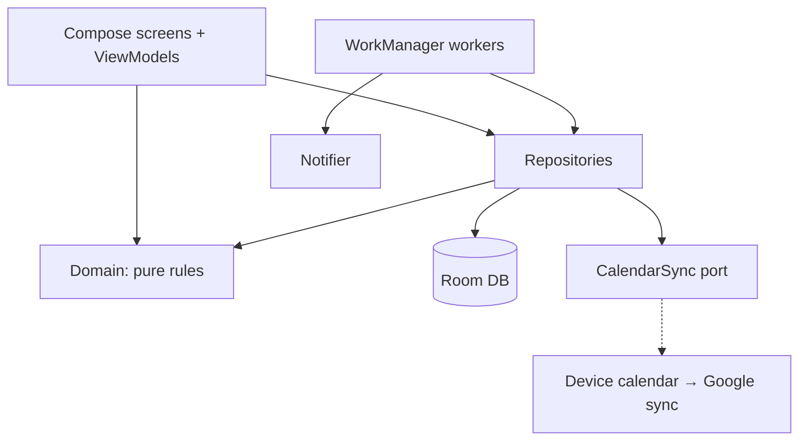

# Project Context

**Klas** — a native Android app for a **single** private tutor to manage students, groups, subjects,
schedule, payments and debts. **Offline-first / local-only — no backend.** Russian UI, Material 3.
See `PLANNING.md` for the product goal and success criteria.

The launcher label is the Latin **Klas** though every other string is Russian: it is a brand, not a
word being read. Renamed from «Репетит» (`com.seblful.repetit`) while unpublished, which is the only
reason the application id could move with it. `TutoringClass` keeps its name: it is the *domain* noun
for a tutoring class, not the app's.

**This file is the map: *what* was decided and *where* it lives.** The **reasoning** for every rule
below sits in the KDoc next to it — that is the place to add or read the argument, so this file can
stay short enough to read before starting work. If a bullet here tempts you into a paragraph, the
paragraph belongs in the KDoc.

---

## Architecture

MVVM with a **pure, unit-tested domain layer**. Room is the single source of truth; the calendar and
notifications are best-effort *mirrors* of it, never the other way round. DI is Hilt. Single `app`
module.



| Package | Responsibility |
|---|---|
| `domain/` | Pure Kotlin, no Android deps. Billing, class/group rules, scheduling, calendar layout, `CalendarSyncPolicy`, reminders, reports (+ `ReportPeriod`, `ReportCsv`), `PeopleSearch`, `Taught`, `LessonKind`/`LessonFilter`, `AvatarPalette`, `Diagnostics`, models (incl. the report-only id types, `model/Ids.kt`), and the `ReminderScheduler` port. All JVM-tested. |
| `data/local/` | Room entities, DAOs, `AppDatabase`, and the `Transactor` port. Entities are also `@Serializable`, for the backup. `SnapshotDao` is the **separate** whole-table seam (see *Two interfaces onto the same tables*). |
| `data/Mappers.kt` | Entities ⇄ domain models. Where a stored enum is parsed back. |
| `data/repository/` | One invariant each, end to end, written in one transaction (see *Ownership*). Display **name ordering** is applied here. |
| `data/backup/` | The **file format**: export, transactional replace-all import, `BackupIntegrity` (what a file must be readable as before any of it is written), `BackupFailure` (which refusal it was) and `BackupRestore` (everything a *restore* means beyond the rows). What tables exist and the order they may be emptied and filled in is `SnapshotDao`'s. |
| `calendar/` | `CalendarSync` + `CalendarPermission` ports and a `CalendarContract` adapter. |
| `notifications/` | `Notifier` and `NotificationPermission` ports + Android adapters, `DueReminder`, and `ReminderAlarms`/`ReminderReceiver` — reminders are **alarms**, not deferrable work. |
| `work/` | WorkManager's half: the periodic `MaintenanceWorker`, `WorkScheduler`, `BootReceiver` (alarms die on reboot), and `Maintenance` — what an upkeep pass decides, kept out of the worker. |
| `diagnostics/` | `CrashLogger` over `CrashLogStore`/`DeviceInfo` ports; the pure half is `domain/Diagnostics`. Viewed and exported from `ui/diagnostics`. |
| `storage/` | `DocumentStore` port + SAF adapter over an opaque `DocumentRef`, so no view model touches a `Uri` or a `Context`. |
| `format/` | `ru`-locale date/time/money formatting, `MoneyField` (what a money input is), `MoneyInput` (rate vs payment), `NameOrder` (the one definition of how names are listed). |
| `ui/` | Compose screens + `@HiltViewModel`s, `navigation/`, shared `common/` atoms, `onboarding/`, and `RootViewModel` gating onboarding vs. the tabs. **Settings and About live in `ui/more/`.** |
| `di/` | The database module, the `@DebugBuild` flag, `@ApplicationScope`/`@Computation` (`CoroutinesModule`) and the `Clock` (`TimeModule`). Other Hilt modules live beside their adapters. |

### Ownership (one invariant, one place)

- `ClassRepository` — **all** side effects of a class change (calendar mirror + reminder refresh).
  Every write takes a whole **lesson** (`ClassSession`), so there is no single-class path to drift.
- `CalendarMirror` — what a mirrored event *shows*, and every table that decides it. A title is built
  from the student's, subject's and group's name and the guest from the student's email, so **four**
  tables can invalidate an event, not just `classes`; a caller that changes one of them asks for a
  refresh instead of knowing which table it touched. Also owns the sync on/off backfill and withdrawal.
- `EnrollmentRepository` — the subject⇄price invariant, and where prices are read.
- `GroupRepository` — the only writer of group membership; a group is saved with its exact roster.
- `PaymentRepository` — a payment's own date, and correcting one in place.
- `RateHistoryRepository` — what a *rate change* is, since two repositories set rates.
- `SettingsRepository` — one `update { it.copy(...) }` rather than a setter per field, serialized.
- `StudentRepository` — the whole act of **archiving**, which is more than a flag: a retired student's
  still-planned lessons are called off first, through `ClassRepository`.
- `SubjectRepository` — a subject is deletable only while nothing references it.

**"Is anything still taught here?" is answered by whoever owns the answer.** `ClassRepository.anyFor*`
and `GroupRepository.anyForSubject` are the referenced-by guards behind every refusal to delete or
unenroll. Three repositories used to count rows in `ClassDao` themselves for a single yes-or-no, which
put the reason for the refusal in the module doing the deleting rather than the one that knows it.

**A write that spans tables is one transaction, in all of them**, in three fixed phases: pure rules →
every row inside `Transactor.transaction` → calendar and reminders *after* the commit. What could
half-happen is exactly the invariant the class exists to hold, so a failure partway is not a lost
edit but a broken one. Reads that only *decide* whether to write stay outside the transaction.

---

## Key design decisions

### Money and billing

- **Money is integer minor units** (kopecks) — no floating point — and **bounded** by `Money.MAX`
  (1 000 000,00), because the arithmetic downstream multiplies. Enforced at both ways in: the typed
  input gate (`parseMoneyOrNull`) and a restored file (`BackupIntegrity`).
- **Currency is a display setting, not a fact about the data**: BYN or RUB, chosen in Settings,
  provided through `LocalCurrency` and printed by `Money.text()`. Changing it **re-labels** stored
  amounts rather than converting them, so the switch confirms first.
- **Price is an hourly rate booked per class**, pre-filled from the student's rate for the subject
  (or the group's own), editable per lesson. `charge = booked rate × duration`, so later re-pricing
  never touches existing classes.
- **Balances and income are derived**, never stored.
- **Status**: `scheduled → completed | cancelled`, with corrections. Auto-completes once the end time
  passes (opt-in). Cancelling voids the charge — there is no "missed" status.
- **Reports cover active students only**, so archiving hides a debt — the app warns first.
- **A report is read inside a period** (`domain/ReportPeriod`): a month, a year, or all time, opening
  on the **year in progress**. **Debts are the deliberate exception** — a balance spans a student's
  whole history, and clipping charges to a year while payments stay whole would invent credit.
- **`Reports.of` is the only way in.** It takes the database's lists and a period and returns the whole
  `Report`: which classes count (active students, then the period), how each breakdown is ordered, and
  which sections are worth showing — a single kind of teaching is not a split, an empty month is a gap in
  the chart but not a row in the list. Those decisions used to be spread across the view model and a
  composable, none of them where a report is tested. The aggregations stay public and stay tested one
  rule at a time; `ReportsSurfaceTest` stops the app reaching past `of` to reassemble a report itself.
  The screen supplies only the subject and group **names**, keyed by the typed ids of `model/Ids.kt`.

### A screen draws, it does not decide

- **Every branch a screen takes is a value the module behind it returned.** `ArchiveIntent`,
  `SaveIntent`, `DeleteWarning`, `NotificationsIntent`, `RootRoute`, `ThemeChoice`,
  `OnboardingViewModel.restoreNeedsConfirming`, `ReportCsv.linesFor` and `PaymentDate.instantFor` are
  the named answers; the screen holds only the words and the layout. A `@Composable` can be exercised
  only on a device, so a decision that lives in one is a decision with no test — and the eight sites
  these replaced included which rows the CSV export contains and what instant a payment is stored at.
- **`PaymentDate` was the app's one exception to the injected `Clock`.** It called `LocalDate.now()`
  and `Instant.now()` directly, in a composable, on the path that records money.
- **The condition that enables a save is named `canSave`, on a `LeavableForm`.** `leaveIntent` takes the
  form rather than two booleans: with booleans, one screen passed its full save condition and two passed
  only field validity, and nothing said which the shared rule meant.

### Two interfaces onto the same tables

- **`SnapshotDao` is the whole-database seam, and the only one.** Backup and restore need what nothing
  else does: whole tables, ids preserved, no rule applied. Those 25 methods used to sit on the same
  eight DAOs the repositories use, so every repository holding an invariant was also handed the
  `deleteAll()` that voids it. Its public surface is `read`, `insert` and `replace`; the per-table
  methods are `protected`, because both foreign-key orders — children before parents out, parents
  before children in — belong to the schema and are stated once, there. `WholeTableWritesTest` keeps
  whole-table deletes out of `Daos.kt` and pins that every table read is also emptied.
- **`classes` and `student_groups` are read whole in both**, and that duplicate SQL is deliberate: a
  repository reading every class maps it to the domain and applies a rule, and must not be reachable
  from the wipe next door.
- **The backup *file format* is `BackupData`, a separate type from `DatabaseSnapshot`** though they hold
  the same nine lists. `BackupData`'s field names are JSON keys in files already on somebody's phone, so
  they may never be renamed; the snapshot follows the schema.

### Reading back what was stored

- **An enum's constant name is a persisted value** (`classes.status`, the three `mode` columns, two
  SQL literals, three column defaults), so renaming a constant is a migration — and one that fails
  silently. `StoredEnumNamesTest` is the acknowledgement list.
- **Storage is parsed with a total function, never `valueOf`** (`ClassStatus.parse`, `ClassMode.parse`),
  because the read path is inside a `Flow` where a throw reports nothing. An unreadable **mode** falls
  back to `IN_PERSON`; an unreadable **status** fails loudly, because it carries money.
- **Ids carry a type in the report breakdowns, and only there** (`domain/model/Ids.kt`), where three
  identically shaped breakdowns are paired by hand with three identically shaped name tables.
  Elsewhere an id is a plain `Long`.

### Lessons

- **A lesson lasts a positive number of minutes**, insisted on by `Scheduling.Slot` — a zero-length
  slot made the overlap check fail *open*. Read paths meeting a stored row that breaks it
  (`Scheduling.conflicts`) skip that row rather than throw.
- **A lesson is the unit of change.** Every write takes a `ClassSession`: a group lesson's *n* classes,
  or one student's class as a session of one. Re-attributing a class is expressible only for a
  session of one.
- **One tutor, one lesson at a time.** An overlapping slot is refused, not warned about. Back-to-back
  is fine, a cancelled class gives its slot back, and the lesson being edited is excluded by every one
  of its class ids. Booking in the **past is allowed**. The rule is pure; the *refusal* lives in the
  view models, which name the lesson in the way. **Every way back into an hour is checked**, including
  «вернуть в расписание» (`ScheduleViewModel.setStatus`), through the same `timeConflict` a refused
  move reports.
- **Editing is allowed in any status and the charge is recomputed** in place, so income cannot be
  double-counted. Deleting is allowed in any status; deleting a completed lesson removes its income
  and the UI warns. Classes are **one-off only** — no recurring series.

### Groups

- **A group prices its lessons; the students still owe for them.** The group carries its own hourly
  rate and a lesson writes one class per member *at that one rate*. Balances, debts and reports stay
  strictly per student. A new group's rate is pre-filled from settings (0 = "not set"); a rate is
  required but may be 0.
- **A lesson has one rate.** Only a lesson restored from a pre-v3 `BackupData` can hold differing
  member rates; the form then offers the group's current rate.
- **A group is taught one subject, fixed on the group.** Only students priced for it can be members —
  the roster is intersected on save. The column is **nullable** for a group restored from a pre-v4
  backup, and until the tutor picks one; such a group keeps the looser per-lesson behaviour.
- **Who attends one lesson is separate from who is on the roster**, and is correctable afterwards, in
  any status. An unticked member has no class at all (not a cancelled one); ticking one writes a class
  at the lesson's own terms and **the status the lesson is in**. Dropping a class that already billed
  asks first. An old lesson offers the group as it is now but ticks only its own members.
- **A session is derived, never stored**: the classes sharing a `(groupId, start)` pair. Statuses
  still apply per class, so a hand-corrected lesson can read «Разные».
- **A group earns a report line of its own** (`Reports.incomeByGroup`) — the only line that answers
  whether running the group is worth the evening.
- Groups are **archive-only once they have lessons**. A group lesson mirrors as **one calendar event
  per member**; in-app **reminders are per lesson**.

### Students and subjects

- **A student's subjects == their priced subjects** — for *individual* lessons. Adding links and
  prices in one step; removing is refused while any class exists for that subject. Group lessons sit
  outside this.
- **Class mode** (in person / remote): a student default, overridable per class, mirrored into the
  calendar event's location.

### History and data safety

- **History is structurally protected.** `classes` and `payments` use `ON DELETE RESTRICT` on their
  parents. Students are archive-only; subjects and groups are deletable only while unreferenced.
- **A rate is current state; its past is a log** (`price_history`), one table for both a student's
  price and a group's rate, discriminated once into the sealed `RateOwner`. Two nulls carry meaning:
  no previous rate = the history starts here; no date = the rate predates the log. An **unchanged
  rate logs nothing**, and un-enrolling a subject forgets its log.

### Storage, migrations, backup

- **Offline-first.** Room is authoritative; the calendar and notifications no-op when their permission
  or calendar is absent, never blocking or corrupting local data.
- **Settings live in Room** (single row) and are **device-local** — deliberately not backed up. Writes
  go through one `update {}` **under a `Mutex`**, because the row is written whole.
- **The platform's own backup is off** (`allowBackup="false"` + `res/xml/data_extraction_rules.xml`):
  Auto Backup would have copied `klas.db` — every student's name, phone and email — to Google's
  servers, without a WAL checkpoint, and restored it without `BackupRestore`. The app's own JSON
  export is how data moves between devices, and the export screen says the file is unencrypted PII.
- **The database is at v1 and ships no migrations.** The rename changed both the application id and
  the file name (`tutoring.db` → `klas.db`), and Android never upgrades one application id into
  another, so no device can hold a pre-v1 `klas.db`.
- **The destructive fallback is debug-only.** A release build **refuses to open** a database it cannot
  migrate: a crash leaves every row on disk for the next build, and is recoverable in the way a wipe
  is not.
- **Once v1 is released the "no migrations" part stops being true**: every schema change must then bump
  the version and ship a real migration, with an entity's `defaultValue` and the migration's `DEFAULT`
  kept in step. `MigrationChainTest` makes that a rule rather than a habit. Until then,
  **`BackupData.version` (currently 5) is the only cross-build compatibility story the app has** — and
  the only bridge out of `com.seblful.repetit`.
- **Backup = full DB snapshot → JSON via SAF.** Ids preserved, import is one transaction. The format
  is versioned: an **older** file still imports (missing tables come back empty, missing columns take
  their default), a **newer** one is refused. A restored file is reproduced as given.
- **A backup is checked for readability before a row of it is written** (`BackupIntegrity`), before the
  transaction, so the reason survives to be shown. It covers exactly the columns a read can *fail* on —
  a backup may be strange, just not unreadable; referential integrity is left to the foreign keys.
- **A refused backup says which refusal it was** (`BackupFailure`): from a newer build, not a Klas
  backup, or wouldn't open. Classification is pure; the wording is shared by the backup screen and the
  first-run restore.
- **Restoring is more than importing**: `BackupRestore` owns the whole act (replace rows, end first
  run, re-plan reminders, re-mirror to *this* device's calendar), so both entry points share one path.

### Calendar, reminders, diagnostics

- **Calendar sync via `CalendarContract`, not the Google REST API** — the OS syncs to Google, so there
  is no cloud project or OAuth. Opt-in, behind the `CalendarSync` port. What a status change means for
  the event is pure (`domain/CalendarSyncPolicy`: scheduled → upsert, cancelled → delete, completed →
  leave history alone).
- **Email reminders ride on the calendar**: a synced event adds the student as an attendee with an
  email reminder, and the calendar account does the sending.
- **Inviting students by email is its own setting**, separate from sync and **off by default**. Turning
  it off and re-syncing **withdraws** invitations already sent.
- **The calendar-permission rule sits behind the view model**, not behind the switch: sync cannot be
  enabled without the grant.
- **A lesson mirrors as one batch, under one snapshot of the settings** (`CalendarMirror`), so
  a lesson cannot mirror half under an old invite setting and half under a new one.
- **A rename re-mirrors.** An event's title and guest are read from the student, subject and group
  rows at mirror time, so those writes owe a refresh too — `CalendarMirror.refreshFor*`, driven off the
  classes that actually carry an event id. Until this existed only a `classes` write mirrored, and a
  rename left every already-mirrored event stale until something unrelated triggered a resync.
- **A reminder only fires *ahead* of a lesson, never on booking.** The plan is re-derived from scratch
  on every change — over the **horizon**, not the whole history; `Maintenance` names that horizon once
  and uses it both to fetch the window and to filter it. `MaintenanceTest` pins the boundary lesson.
- **A reminder is an alarm; upkeep is a worker** — split by whether being late is acceptable.
  Reminders ride `AlarmManager` (`ReminderAlarms`): exact where `SCHEDULE_EXACT_ALARM` allows,
  `setAndAllowWhileIdle` where it does not, never prompting for the permission. Armed ids are kept in
  preferences because `AlarmManager` has no cancel-all. `BootReceiver` re-derives the plan after a
  reboot. `refreshNow` and the periodic upkeep stay on WorkManager.
- **Upkeep also runs in process at startup** (`KlasApp`), not only as an enqueued worker, because
  auto-completion is what *bills* a finished lesson.
- **The notification permission is asked for where reminders are**, in settings, never over a first
  launch — and the row shows the **platform's** answer beside the tutor's intent. Deliberately *not*
  the calendar's rule: that flag gates a mirror, this one is only a preference, so it is never refused.
- **Crash diagnostics are local + Play, no backend**: chains to the platform handler (so Android Vitals
  still reports) and appends to a size-capped file (`Diagnostics.appendBounded`, 64 000 chars, trimmed
  on entry boundaries), exportable from **Ещё → Настройки → Диагностика**. No Crashlytics/Sentry.

### UI — language and where decisions live

- **The app pins its own locale to Russian** (`Context.inRussian()` in `RussianLocale.kt`, applied in
  `KlasApp` and `MainActivity` via `attachBaseContext`), because a **plural** rule set comes from the
  *configuration's* locale. Counted nouns therefore always go through `<plurals>`, never `%d` plus a
  fixed word. There is one resource set; the bundle does not split by language.
- **A screen draws; it does not decide.** Rules that would sit inside composables live in the module
  behind them, because a `@Composable` can only be exercised on a device: `ClassFormState`,
  `MoneyField`, `leaveIntent`, `Maintenance`, `CrashLogger`.
- **A refusal is said out loud, and always the same way** (`ui/common/Messages`). View models report
  one-shot outcomes through `UiEvents`; screens show them through **one** snackbar helper, which can
  carry an action. There is no `android.widget.Toast` in the app. The exception to the one-shot rule
  is `ScheduleViewModel.timeConflict`, state because it must survive a rotation.
- **`java.time` everywhere** + core-library desugaring, so it works on `minSdk 24`. **Today rolls over
  at midnight** — from a flow that sleeps until the next local midnight and re-reads an injected
  `Clock`, not `LocalDate.now()` in a composable body.

### UI — navigation and lists

- **The bottom bar reads who → when → money**: «Люди», «Расписание», «Отчёты», «Ещё»; the app opens on
  the schedule. **Students and groups are one tab** with a segmented control (`ui/people/PeopleScreen`)
  — a group *is* students seen as a roster. (The `showGroupsTab` **column** survives in `SettingsEntity`
  written-but-unread: SQLite gained `DROP COLUMN` only in 3.35 / Android 12 and this app supports API
  24. `AppSettings` has dropped it, so nothing above the DAO can reach it.) Labels shrink a step at a
  time rather than wrapping.
- **An empty list carries the way out of itself** (`ui/common/EmptyState`): an icon, a line saying what
  would be here, and — where there is one obvious thing to do — that action as a real button. A list
  empty because *nothing matched a search* says so instead and offers nothing.
- **The three list screens can be searched** (`domain/PeopleSearch`, one rule so they cannot disagree):
  case-insensitive in the Russian locale, substring rather than prefix, every space-separated term
  matching in any order, so «пет ив» finds «Иван Петров». Students also sort **by debt**. Filtering and
  sorting happen in the view model, on the computation dispatcher.
- **Names are ordered in Kotlin, not SQL** (`format/NameOrder`): `COLLATE NOCASE` folds ASCII only.
  Time and id ordering stays in SQL.
- **Individual and group lessons are told apart wherever they meet** (`domain/LessonKind`,
  `LessonFilter`), including the schedule's markers, a student's mixed lesson list, and the reports.

### UI — schedule and forms

- **The schedule has three views**, picked with a segmented control rather than an unlabelled icon. Day
  and month both show one selected day; week always lists the whole week. Paging only *browses* — it
  never moves the selection. A calendar cell shows **one count per status**. Both markers and lessons
  are queried for the **active view's range only**.
- **A cancelled lesson recedes** — dimmed, time struck through — because the question a glance answers
  is "how full is this day".
- **Marking a lesson completed is one swipe**, offered only where completing is legal
  (`GroupRules.sessionTransitions`); the row springs back, and the status badge is the confirmation.
- **A lesson is booked by its length, not its end time.** «Длительность» as chips seeded from the
  tutor's default, «Другая» keeping the clock picker; the end time is stored and shown as a consequence.
- **One place answers "who was in this lesson"** — the lesson's own form, where the answer can be
  changed. The schedule's action sheet acts on the whole lesson and deliberately lists no members.
- **Anything hidden behind a tap is drawn as a field** (`ui/common/PickerField`) — a `Surface`, not a
  disabled `OutlinedTextField` with its colours painted back in, which would cost the ripple.
- **Leaving a filled-in form asks first** (`ui/common/UnsavedChanges`). `leaveIntent(dirty, canSave)`
  picks the question. What counts as *dirty* differs per form on purpose — a snapshot where the
  baseline settles (student, group), "was touched" where the form keeps filling itself in (booking).
  Dialogs get no question, only `dismissOnClickOutside = false`.

### UI — detail cards

- **A student's and a group's card are tabbed, with the numbers on top** — a `StatRow` whose values
  shrink to fit, then a sticky `SecondaryTabRow` over one full-length list. A student's tabs are
  «Предметы | Занятия | Платежи»; a group's are «Ученики | Занятия» **only**, because a balance belongs
  to a student. Editing sits behind the pencil, so the card answers "how is this going?". A group's
  roster tab adds how many lessons each member attended. **Booking is not offered on a card** — it
  belongs to the schedule, the one place that knows what else the hour holds.
- **A stat row counts lessons, not classes — for a group** (`domain/Taught`): a lesson taught to three
  is *one* lesson of the tutor's, while the money sums the members' charges. A session counts as taught
  when **any** of its classes completed. A student's debt tile flips to «Переплата» rather than printing
  a negative, and a student's row holds **three** tiles, not four — four are unreadable on a 360dp phone.
- **A detail screen's list keys are namespaced** (`ui/students/StudentDetailKeys`): a subject id, a
  class id and a payment id all start at 1, and a duplicate key crashes composition.
- **A student's contacts are actions.** Phone, email and Telegram open the platform's handler; each
  launch is guarded, since a tablet with no dialler must not crash the card.
- **A payment carries the date it was made**, defaulting to today, and can be **corrected in place**.
- **A rate's history lives in the reprice dialog**, not under every subject row, where it is the
  context for the number being typed.

### UI — reports and onboarding

- **A report draws a number only where the shape says something the number does not**, and stays plain
  text otherwise. The period is pinned above the report. Then: a **column chart** where the order is
  *time* (buckets one step finer than the period); **one stacked bar** where two parts make the whole
  (individual vs group); **ranked bars** where rows are compared with each other, each scaled to the
  largest row and dropped when a section has only one; **plain text** for totals, counts, per-month
  amounts and debts. A percentage is printed only where the rows genuinely partition the income (so
  not for groups, not for debts), is integer arithmetic on kopecks, and is **not** forced to total 100.
  The total is stated **against the period before it** (`Reports.change`); growth from a period that
  earned nothing has no baseline rather than «+100 %». Debt rows **navigate to the student**.
- **The report exports as CSV** (`domain/ReportCsv`), which a backup is not: semicolons and a BOM for
  Excel in a comma-decimal locale, and bare decimal amounts so a column can be summed.
- **First-run onboarding is offered, not imposed**: walk the setup, restore a backup, or skip. Skipping
  is the same flag flip as finishing, so the app may legitimately open empty. Restore ends first run as
  part of what a restore *is*. Setup steps are numbered «Шаг N из M» from the enum. «Ещё» holds only
  what a tutor goes looking for — Diagnostics is folded into the foot of Settings, and About states the
  version and the offline promise.

### UI — design system

- **`ui/theme/`**: curated Material 3 palette (indigo + teal), light/dark with a SYSTEM/LIGHT/DARK
  setting, dynamic colour off for a consistent brand.
- **The tonal ladder is stated**, not left to Material's defaults: an *item* sits on
  `surfaceContainerLow` (`ContentCard`), the *section* holding items on `surfaceContainer`
  (`SectionCard`, `StatRow`, a report card). Settings-style lists stay plain `ListItem`s.
- **The type scale states every style**, including the ones matching the default. `AppFontFamily` is
  one constant, so a Cyrillic-first face is a one-line swap.
- **Avatar colours key off the student's id, not their name** (`domain/AvatarPalette`), so a rename
  doesn't move them; `AvatarStack` draws a roster as overlapping monograms.
- **The two lesson-kind icons are one pair, not a ranking** (`ui/common/LessonKindUi.kt`): same brand
  colour, matched on **ink height** rather than nominal size.
- **Anything tappable clears 48dp** (`ui/common/MinTouchTarget`), and the main lists carry
  `Modifier.animateItem()`.
- **Responsive width**: every top-level scrollable applies `Modifier.constrainedContent()` (~600.dp cap,
  centred on wide screens, full-width on phones). Vertical fit comes from every screen scrolling.

---

## Data flow

ViewModels observe repository `Flow`s and expose `StateFlow` UI state. Writes go ViewModel →
repository → Room, and the repository then mirrors to the calendar and refreshes reminders — so a
ViewModel expresses intent only and cannot forget a side effect.

**Reads live in `viewModelScope`; writes do not.** A write goes to the injected `@ApplicationScope`
(`di/CoroutinesModule`), because `viewModelScope` dies with its screen and would otherwise cancel a
save between its committed rows and the mirroring that follows. `ClassEditViewModel` awaits the write
for its `onDone`; the schedule's status/move/delete actions just launch it.

**Deriving state happens off the main thread**: every screen is
`combine(…repository flows…) { … }.flowOn(computation).stateIn(viewModelScope, …)`. Room's own
`flowOn` governs only what is upstream of *it*. The dispatcher is injected (`@Computation`) so tests
keep one scheduler; `ReportsViewModelTest` has a tripwire that fails if the `flowOn` is deleted.

**A failed write is reported, not fatal.** `@ApplicationScope` carries a `CoroutineExceptionHandler`
into the crash log, since `SupervisorJob` scopes *cancellation*, not failure. Where a screen can say
so it does — `ClassEditViewModel` guards inside the `async` (a failure must come back as a value), and
the schedule's sheet actions report `ACTION_FAILED`.

State a view model exposes is **read-only** (`StateFlow`, never `MutableStateFlow`) and changes only
through its mutators.

Guarded suspend calls use `runCatchingCancellable`, never `runCatching`: the latter catches
`CancellationException` too. Plain `runCatching` stays only around **non**-suspending best-effort work,
as in the calendar adapter.

---

## Non-goals (v1)

Multi-user/login, cloud sync across devices, web/iOS, in-app payments, recurring lesson series.

---

## Testing

- **JVM unit tests** (`src/test`, `testDebugUnitTest`, ~60 classes) cover the domain layer, the backup
  format and its failure classification, view models, repository side effects and transaction
  boundaries, mappers and formatters — against **in-memory fake DAOs** with a test main dispatcher, so
  most logic is verified without a device. Android-bound halves are reachable through their ports; a
  worker or handler is an adapter, never a decision. The fakes reproduce filtering and time ordering
  only — **name ordering is not restated there**, so they have no version of it to disagree with.
- **`isReturnDefaultValues` is deliberately off.** It turns an unmocked framework call into a silent
  pass on `null`/`0`. A test that needs Android has found a missing port.
- **Three test doubles exist for what cannot otherwise be observed** (`testutil/`): `CountingDispatcher`
  (was the derivation really moved off the main thread — a `flowOn` is invisible in the result),
  `MutableClock` (a midnight rollover needs the wall clock and the scheduler moved together) and
  `RecordingTransactor` (see *atomicity* below).
- **Seed through `testutil/Fixtures`, not the DAOs** (`env.fixtures.completedLesson(…)`). Writing rows
  straight to a fake skips the repository that owns the invariant, so a test can set up a state the app
  cannot reach — and every test that builds its own rows builds them differently. Three versions of "a
  completed class" once coexisted, each asserting only the field it had remembered to fill in; one
  hard-coded a charge that ignored the duration it was passed, and the assertion built on it was wrong
  by 20. A fixture books and completes the lesson, so the charge is `ClassRules`'. The ~330 direct
  writes predating this are being migrated a file at a time, and `DirectSeedingRatchetTest` caps the
  count so it can only fall: a new direct write fails there, and a migration has to bring the cap down
  with it. Reaching for a DAO to build what the repositories deliberately refuse is still legitimate —
  lowering the cap by hand is how such a call gets acknowledged rather than absorbed.
- **Fixtures pin the clock, not `now()`.** Seed a fixed hour and pick days by excluding today.
- Six tests are **tripwires against silent drift**, all deriving expectations from a real artifact
  rather than restating them: `BackupSchemaCoverageTest` (a new table must be carried or named
  device-local), `MappersTest` (a new column must be mapped), `StoredEnumNamesTest` (a renamed enum
  constant is a migration — it reads the DAO source, since `@Query` is not retained at runtime, *and*
  `FakeDaos.kt`, which had restated three of the same predicates as bare strings and so sat outside the
  very scan built for the risk), `WholeTableWritesTest` (a whole-table delete belongs to `SnapshotDao`,
  and every table it reads it must also empty), `ReportsSurfaceTest` (the app asks `Reports` one
  question) and
  `MigrationChainTest` (a bumped schema version must ship a migration for every step from v1 *and* wire
  it into the builder, and the destructive fallback must stay debug-only — it reads `AppDatabase.kt`,
  since `@Database` is `BINARY`-retained). The first five are acknowledgement lists; the last is the
  upgrade path, and it sits in the **unit** suite precisely because instrumented tests need a device CI
  does not have. Two more guard structure: one asserts the booking form leaves **no query open** once
  nothing collects it, one asserts a save is launched into the application scope.
- **`EdgeCaseCombinationsTest` is the one test file not beside its subject**, deliberately: what it
  tests is the *combination*, spanning layers with no shared home. It holds regressions found that way
  and — in the same file on purpose — pins for behaviour that reads like a bug and is decided.
- **Atomicity is tested by counting transactions**, not by rolling back: the fake DAOs are in-memory
  maps with no rollback to reproduce, so `RecordingTransactor` counts and nests them. Real rollback is
  only observable against Room and belongs in `androidTest`.
- **CI** (`.github/workflows/ci.yml`) runs the unit suite, `lintDebug`, the debug APK and the
  *compilation* of the instrumented tests on every PR and every push to `main`/`develop` — a tripwire
  nobody runs is not a tripwire. The instrumented tests themselves still need a device.
- **Instrumented tests** (`src/androidTest`, 8 classes) cover Room integration — including the FK
  cascade and restrict rules (`SubjectDeletionCascadeTest`) — backup round-trip and restore, calendar
  sync, auto-completion, and the questions that need real rendering: text measurement
  (`BottomBarLabelTest`), icon ink height (`LessonKindIconTest`) and the plural rule set
  (`RussianPluralsTest`). A debug-only manifest entry lets the test host show over the keyguard, so
  they run against a locked phone (there is no emulator).
- **Known gap: there is no instrumented Room *migration* test yet.** `room-testing` and the exported
  schema JSON are wired up and `MigrationChainTest` guards the chain's *existence*, but nothing yet
  runs a real v1→vN upgrade against `MigrationTestHelper`. This has to exist before the first schema
  bump after v1 ships.
- Notification display and real calendar writes can only be observed on a device.

---

## Tooling & build

- Kotlin 2.3.21, AGP 9.3.1, Gradle 9.6.1, JDK 21 (Android Studio JBR). compileSdk 37, targetSdk 36,
  minSdk 24. Hilt 2.60.1, Room 2.8.4, WorkManager, Navigation Compose, kotlinx-serialization — versions
  in `gradle/libs.versions.toml`. Current release: `0.2.0` (`versionCode` 3).
- **AGP 9 compiles Kotlin itself**: the `kotlin.android` plugin is not applied, and the root
  `build.gradle.kts` pins the built-in KGP so it matches the Compose/serialization plugins and KSP.
  That pin repeats the catalog's `kotlin` because `libs` accessors do not exist inside `buildscript {}`,
  so a configuration-time `check` fails the build if the two drift.
- **Kotlin tracks KSP** — KSP drives Room + Hilt codegen, and its `major.minor` is the Kotlin *line* it
  supports, so Kotlin moves freely within that line and never past it. Kotlin 2.4.x is released and lint
  offers it every build; there is no KSP 2.4.x, and taking it would leave the app with no Room DAOs and
  no Hilt graph. The catalog says so at the pin, with how to re-check.
- **Lint's remaining warnings are all "a newer version is available"** and are left deliberately: the
  Kotlin one is held by KSP as above, and `OldTargetApi` asks for a `targetSdk` bump, which changes
  runtime behaviour and so wants a pass on a device rather than a green desktop build.
- `lint { checkReleaseBuilds = false }` works around a lint-jar file-lock bug seen on Windows under
  AGP 9.2.1 (worth re-testing now the project is on 9.3.1); lint still runs via `lintDebug`.
- Needs `JAVA_HOME` on a JDK 21 and `local.properties` pointing at the Android SDK.
- Common commands: `./gradlew :app:testDebugUnitTest`, `:app:assembleDebug`,
  `:app:assembleDebugAndroidTest`, `:app:lintDebug`.
- The **debug build is installable beside the release one**: `applicationIdSuffix = ".debug"`,
  `versionNameSuffix = "-debug"` and its own «Klas-debug» label — so it also has its own database.
- **Release** is minified + resource-shrunk (R8); signing reads `keystore.properties` (gitignored, see
  the `.example`) and is left unsigned when absent. Play artifact: `./gradlew :app:bundleRelease`. Bump
  `versionCode` per upload. R8 keep rules for `@Serializable` types live in `proguard-rules.pro`.

```
app/src/main/java/com/seblful/klas/
├── domain/            # pure rules + ports + models
│   └── model/         # incl. Ids.kt — typed ids, report breakdowns only
├── data/              # Mappers.kt + {local,repository,backup}/
├── calendar/  notifications/  diagnostics/  work/  format/  storage/  di/
│                 └── ReminderAlarms + ReminderReceiver (reminders are alarms, not workers)
├── Coroutines.kt      # runCatchingCancellable — the only way suspend calls are guarded
├── RussianLocale.kt   # Context.inRussian() — the locale pin
├── ui/{schedule,people,students,groups,subjects,reports,backup,more,
│       onboarding,diagnostics,common,navigation,theme}/
├── MainActivity.kt    # @AndroidEntryPoint → AppRoot()
└── KlasApp.kt         # @HiltAndroidApp, WorkManager config, in-process startup upkeep
```
