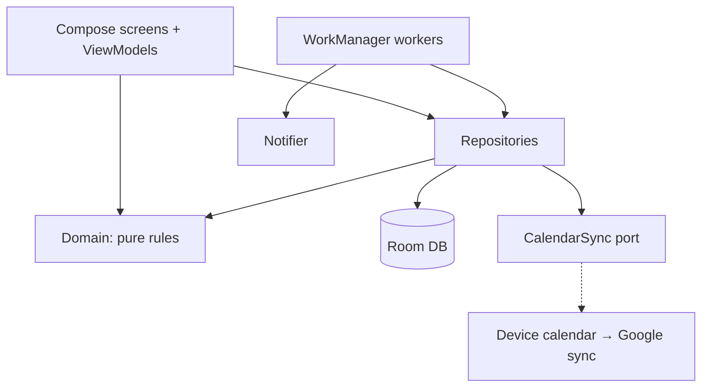

# Project Context

A native Android app for a **single** private tutor to manage students, groups, subjects, schedule,
payments and debts. **Offline-first / local-only — no backend.** Russian UI, Material 3.
Currency is **BYN**. See `PLANNING.md` for the product goal and success criteria.

This file is the map: *what* was decided and *where* it lives. The **reasoning** for each rule sits in
the KDoc next to it — that is the place to add or read the argument, so this file can stay short
enough to read before starting work.

---

## Architecture

MVVM with a **pure, unit-tested domain layer**. Room is the single source of truth; the calendar and
notifications are best-effort *mirrors* of it, never the other way round. DI is Hilt. Single `app`
module.



| Package | Responsibility |
|---|---|
| `domain/` | Pure Kotlin, no Android deps: billing, class/group rules, scheduling, calendar layout, reminders, reports, `Taught` (what a stat row counts), `LessonKind` (individual vs a group's), models, and the `ReminderScheduler` port. All JVM-tested. |
| `data/local/` | Room entities, DAOs, `AppDatabase`, `Migrations`. Entities are also `@Serializable`, for the backup. |
| `data/repository/` | Entities ⇄ domain models, and where display **name ordering** is applied. Each repository owns one invariant end to end (see *Ownership* below). |
| `data/backup/` | Whole-DB JSON snapshot: export, transactional replace-all import, and `BackupRestore` (everything a *restore* means beyond the rows). |
| `calendar/` | `CalendarSync` + `CalendarPermission` ports and a `CalendarContract` adapter. |
| `notifications/` | `Notifier` port + Android adapter, and `DueReminder` — what a fired reminder decides, kept out of the worker. |
| `work/` | WorkManager workers + `WorkScheduler`, and `Maintenance` — what an upkeep pass decides, kept out of the worker. |
| `diagnostics/` | `CrashLogger` over `CrashLogStore`/`DeviceInfo` ports. Viewed and exported from `ui/diagnostics`. |
| `storage/` | `DocumentStore` port + SAF adapter over an opaque `DocumentRef`, so no view model touches a `Uri` or a `Context`. |
| `format/` | `ru`-locale date/time/money formatting, `MoneyField` (what a money input is), `NameOrder` (the one definition of how names are listed). |
| `ui/` | Compose screens + `@HiltViewModel`s, `navigation/`, shared `common/` atoms, `onboarding/`, settings, and `RootViewModel` gating onboarding vs. the tabs. |
| `di/` | The database module and the `@DebugBuild` flag. Other Hilt modules live beside their adapters. |

### Ownership (one invariant, one place)

- `ClassRepository` — **all** side effects of a class change (calendar mirror + reminder refresh).
  Every write takes a whole **lesson** (`ClassSession`), so there is no single-class path to drift.
- `EnrollmentRepository` — the subject⇄price invariant, and where prices are read.
- `GroupRepository` — the only writer of group membership; a group is saved with its exact roster.
- `RateHistoryRepository` — what a *rate change* is, since two repositories set rates.
- `SettingsRepository` — one `update { it.copy(...) }` rather than a setter per field.

---

## Key design decisions

### Money and billing

- **Money is integer minor units** (kopecks) — no floating point.
- **Price is an hourly rate booked per class**, pre-filled from the student's rate for the subject (or
  the group's own), editable per lesson. `charge = booked rate × duration`, so later re-pricing never
  touches existing classes.
- **Balances and income are derived**, never stored.
- **Status**: `scheduled → completed | cancelled`, with corrections. Auto-completes once the end time
  passes (opt-in). Cancelling voids the charge — there is no "missed" status.
- **Reports cover active students only**, so archiving hides a debt — the app warns first.
- **A report is read inside a period** (`domain/ReportPeriod`): a month, a year, or all time, opening on
  the **year in progress** — an all-time total stops answering "how am I doing?" as soon as there is a
  second year of history. Every income number on the screen means that one slice at once. **Debts are
  the deliberate exception**: a balance is charges minus payments over a student's whole history, so
  clipping the charges to a year while the payments stay whole would invent credit. The section says so.

### Lessons

- **A lesson is the unit of change.** Every write takes a `ClassSession`: a group lesson's *n* classes,
  or one student's class as a session of one. Re-attributing a class to another student is expressible
  only for a session of one.
- **One tutor, one lesson at a time.** An overlapping slot is refused, not warned about. Back-to-back
  is fine, a cancelled class gives its slot back, and the lesson being edited is excluded by every one
  of its class ids. Booking in the **past is allowed**. The rule is pure; the *refusal* lives in the
  view models, because it has to name which lesson is in the way.
- **Editing is allowed in any status and the charge is recomputed**, in place, so income cannot be
  double-counted. Deleting is allowed in any status; deleting a completed lesson removes its income and
  the UI warns. Classes are **one-off only** — no recurring series.

### Groups

- **A group prices its lessons; the students still owe for them.** The group carries its own hourly
  rate and a lesson writes one class per member *at that one rate*. Balances, debts and reports stay
  strictly per student: the group decides *how much*, never *who owes it*. A new group's rate is
  pre-filled from settings (0 = "not set" → the field starts empty); a rate is required but may be 0.
- **A lesson has one rate.** Only a lesson booked before v5 can hold differing member rates; the form
  then offers the group's current rate rather than picking one member's.
- **A group is taught one subject, fixed on the group.** Only students priced for it can be members —
  the roster is intersected on save — and the booking form takes the subject from the group. The column
  is **nullable** purely for groups made before v6, which keep the old per-lesson behaviour.
- **Who attends one lesson is separate from who is on the roster**, and is a fact the tutor may
  correct afterwards. The lesson's form ticks its members — in any status, past or future. An unticked
  member has no class at all (not the same as a cancelled one); ticking one who has none writes a
  class at the lesson's own terms, taking **the status the lesson is in**, so adding somebody to a
  completed lesson owes exactly what being in it owed. Dropping a class that already billed removes
  that income, so the form asks first. An old lesson offers the group as it is *now* but ticks only
  its own members, so opening and re-saving it changes nothing.
- **A session is derived, never stored**: the classes sharing a `(groupId, start)` pair. Moving one
  class therefore leaves its session by construction. Statuses still apply per class, so a lesson
  whose members were corrected one at a time reads «Разные» — reachable now only through old data or
  the repository, since the schedule changes a lesson's status as a whole.
- **A group earns a report line of its own** (`Reports.incomeByGroup`), which no other breakdown can
  give: a member's line mixes their group lessons with the individual ones they also take, so only the
  group's own total answers whether running it is worth the evening.
- Groups are **archive-only once they have lessons**. A group lesson mirrors as **one calendar event
  per member** (each keeps their own invite), while in-app **reminders are per lesson**.

### Students and subjects

- **A student's subjects == their priced subjects** — for *individual* lessons. Adding links and prices
  in one step; removing is refused while any class exists for that subject. Group lessons sit outside
  this, being billed at the group's rate.
- **Class mode** (in person / remote): a student default, overridable per class, mirrored into the
  calendar event's location.

### History and data safety

- **History is structurally protected.** `classes` and `payments` use `ON DELETE RESTRICT` on their
  parents, so the database itself refuses to cascade-erase earned income. Students are archive-only;
  subjects and groups are deletable only while unreferenced.
- **A rate is current state; its past is a log** (`price_history`). One table covers both a student's
  price and a group's rate, discriminated once into the sealed `RateOwner` on the way out of storage.
  Two nulls carry meaning: no previous rate = the history starts here; no date = the rate predates the
  log (what v7 seeded, rather than inventing an upgrade date). An **unchanged rate logs nothing**, and
  un-enrolling a subject forgets its log.

### Storage, migrations, backup

- **Offline-first.** Room is authoritative; the calendar and notifications no-op when their permission
  or calendar is absent, never blocking or corrupting local data.
- **Settings live in Room** (single row) and are **device-local** — deliberately not backed up.
- **Every schema change ships a real migration** (`data/local/Migrations.kt`), validated against the
  exported schema JSONs by an instrumented test; the destructive fallback covers only dev devices
  predating v1. An entity's `defaultValue` and a migration's `DEFAULT` must stay in step or Room's
  validation fails. History: **v2** groups + `classes.groupId`; **v3** email
  invites (backfilled *on*); **v4** the «Группы» tab flag; **v5** a group's own rate (upgraded groups
  left explicitly unpriced); **v6** a group's subject (nullable); **v7** `price_history`, seeded from
  existing rates without rewriting anything.
- **Backup = full DB snapshot → JSON via SAF.** Ids preserved, import is one transaction. The format is
  versioned: an **older** file still imports (missing tables come back empty, missing columns take their
  default), a **newer** one is refused — which is the reason the version exists. A restored file is
  reproduced as given; v7's seeding is deliberately not repeated on import.
- **Restoring is more than importing**: `BackupRestore` owns the whole act (replace rows, end first run,
  re-plan reminders, re-mirror to *this* device's calendar), so both entry points share one path.

### Calendar, reminders, diagnostics

- **Calendar sync via `CalendarContract`, not the Google REST API** — the OS syncs to Google, so there
  is no cloud project or OAuth. Opt-in, behind the `CalendarSync` port.
- **Email reminders ride on the calendar**: a synced event adds the student as an attendee with an email
  reminder, and the calendar account does the sending.
- **Inviting students by email is its own setting**, separate from sync and **off by default** (writing
  to someone else's inbox is a distinct opt-in; upgrades backfill it *on*). It is not merely "skip the
  next invite" — turning it off and re-syncing **withdraws** invitations already sent.
- **The calendar-permission rule sits behind the view model**, not behind the switch: sync cannot be
  enabled without the grant, since that flag is what the whole mirror keys off.
- **A reminder only fires *ahead* of a lesson, never on booking.** The plan is re-derived from scratch
  on every change, so a lesson booked inside its own lead window gets none — which is the point.
- **WorkManager** drives time-based behaviour (one-shot reminders + a periodic maintenance pass). The
  decisions are pure and tested; the workers are adapters.
- **Crash diagnostics are local + Play, no backend**: chains to the platform handler (so Android Vitals
  still reports) and appends to a size-capped file, exportable from **Ещё → Диагностика**. No
  Crashlytics/Sentry, to avoid a third-party SDK, network calls and a privacy policy.

### UI

- **The app pins its own locale to Russian** (`RussianLocale.inRussian`, applied in `TutoringApp` and
  `MainActivity` via `attachBaseContext`). Strings live in the unqualified `values/` and the formatters
  name `ru` outright, but a **plural** rule set comes from the *configuration's* locale, i.e. the phone's
  — so on an English phone Russian text was declined by English rules (two forms) and the app said
  «0 занятия», «5 занятия». Counted nouns therefore always go through `<plurals>`, never through
  `%d` plus a fixed word, and the bundle does not split by language (there is only one resource set).
- **A screen draws; it does not decide.** Rules that used to sit inside composables now live in the
  module behind them, because a `@Composable` can only be exercised on a device: `ClassFormState`
  answers every question the booking form has, `MoneyField` answers what a money input is, `leaveIntent`
  answers what back does, `Maintenance`/`CrashLogger` hold what the workers used to decide inline.
- **A refusal is said out loud.** View models report one-shot outcomes through `UiEvents` rather than
  failing silently. The exception is `ScheduleViewModel.moveConflict`, which is state because it must
  survive a rotation.
- **The bottom bar reads who → when → money**: «Ученики», «Группы», «Расписание», «Отчёты», «Ещё».
  The app still *opens* on the schedule. «Группы» is the one tab that can be switched off, which moves
  the section into «Ещё» rather than removing it; bar contents and "is this route a tab" derive from one
  place. Labels shrink a step at a time rather than wrapping or being cut.
- **The schedule has three views.** Day and month both show one selected day; week always lists the
  whole week. Paging only *browses* — it never moves the selection, and opening a view snaps back to it.
  A calendar cell shows **one count per status**, so a mixed day states its makeup. Both the markers and
  the lessons are queried for the **active view's range only**, so no off-screen view holds a live query.
- **The two lesson-kind icons are one pair, not a ranking** (`ui/common/LessonKindUi`): same brand
  colour, and matched on **ink height** rather than nominal size. `Person` fills 16 of its 24-unit
  viewport vertically and `Groups` only 12, so asking for one size drew the person a third taller; each
  is scaled by its own fill and centred in a shared slot so what follows the icon stays aligned.
- **One place answers "who was in this lesson"** — the lesson's own form, where the answer can be
  changed. The schedule's action sheet acts on the whole lesson (edit, move, status, delete) and
  deliberately lists no members: a menu for changing a lesson's status is not where a roster belongs.
- **A student's and a group's card are tabbed, with the numbers on top** — a `StatRow` whose values
  shrink to fit, then a sticky `TabRow` over one full-length list. A student's tabs are «Предметы |
  Занятия | Платежи»; a group's are «Ученики | Занятия» **only**, because a balance belongs to a student
  and spans all their lessons. Editing either sits behind the pencil, so the card can answer "how is
  this going?" rather than only "how do I change this?". A group's roster tab adds how many of its
  lessons each member actually attended. **Booking is not offered on a card** — it belongs to the
  schedule, the one place that knows what else the hour holds; the form still accepts a group to
  pre-select, but nothing passes one.
- **A stat row counts lessons, not classes — for a group** (`domain/Taught`): a lesson taught to three
  is *one* lesson of the tutor's, and ran for its own duration. The money is the other way round, summing
  the members' charges. A session counts as taught when **any** of its classes completed, which keeps a
  per-member correction one lesson rather than a lost one. A student's debt tile flips to «Переплата»
  instead of printing a negative.
- **Individual and group lessons are told apart wherever they meet** (`domain/LessonKind`). The schedule
  marks *both* kinds, not only the group ones. A student's lesson list — the one list that genuinely
  mixes them, at two different rates — names the group each lesson was one of, and offers counted chips
  when the student is taught both ways. Reports carry an income split by kind, the one question the
  per-student and per-subject lines cannot answer.
- **A report draws a number only where the shape says something the number does not**, and stays plain
  text otherwise — a picture on every row is wallpaper, not a chart. The period is pinned above the
  report, because it is what everything below means. Then: a **column chart** where the order is *time*
  (buckets one step finer than the period — a year draws its months, all time its years, a single month
  nothing); **one stacked bar** where two parts make the whole (individual vs group), since the question
  is how the whole divides; **ranked bars** where rows are compared with each other, each scaled to the
  *largest* row and dropped when a section has only one; **plain text** for totals, counts, per-month
  amounts and debts — a debt is money to collect, not a proportion. A percentage is printed only where
  the rows genuinely partition the income (so not for groups, and not for debts), is integer arithmetic
  on kopecks, and is **not** forced to add up to 100.
- **Leaving a filled-in form asks first** (`ui/common/UnsavedChanges`). `leaveIntent(dirty, canSave)`
  picks the question: a complete form is offered «Сохранить / Не сохранять», an incomplete one only
  «Не сохранять / Отмена», an untouched one nothing. What counts as *dirty* differs per form on purpose
  — a snapshot where the baseline settles (student, group), "was touched" where the form keeps
  filling itself in (booking). Dialogs get no question, only `dismissOnClickOutside = false`.
- **First-run onboarding is offered, not imposed**: walk the setup, restore a backup, or skip. Skipping
  is the same flag flip as finishing, so the app may legitimately open empty — every screen has an empty
  state. Restore ends first run as part of what a restore *is*.
- **Names are ordered in Kotlin, not SQL** (`format/NameOrder`): `COLLATE NOCASE` folds ASCII only, so
  it cannot case-fold Russian. Time and id ordering stays in SQL.
- **Design system** (`ui/theme/`): curated Material 3 palette (indigo + teal), light/dark, dynamic
  colour off for a consistent brand. Content lists use `ContentCard`; settings-style lists stay plain
  `ListItem`s. **Avatar colours key off the student's id, not their name**, so a rename or a typo fix
  doesn't move them and collisions follow ids rather than the birthday problem.
- **Responsive width**: every top-level scrollable applies `Modifier.constrainedContent()` (~600.dp cap,
  centred on wide screens, full-width on phones). Vertical fit comes from every screen scrolling.
- **`java.time` everywhere** + core-library desugaring, so it works on `minSdk 24`.

---

## Data flow

ViewModels observe repository `Flow`s and expose `StateFlow` UI state. Writes go ViewModel →
repository → Room, and the repository then mirrors to the calendar and refreshes reminders — so a
ViewModel expresses intent only and cannot forget a side effect.

---

## Non-goals (v1)

Multi-user/login, cloud sync across devices, web/iOS, in-app payments, recurring lesson series.

---

## Testing

- **JVM unit tests** (`src/test`, `testDebugUnitTest`) cover the domain layer, the backup format, view
  models, repository side effects, mappers and formatters — against **in-memory fake DAOs** with a test
  main dispatcher, so most logic is verified without a device. Android-bound halves are reachable
  through their ports; a worker or handler is an adapter, never a decision. The fakes reproduce
  filtering and time ordering only — **name ordering is not restated there**, so they have no version
  of it to disagree with.
- **Fixtures pin the clock, not `now()`.** Times built from `Instant.now()` fail for the time of day
  rather than the behaviour. Seed a fixed hour and pick days by excluding today.
- Two tests are **tripwires against silent drift**, both deriving expectations from generated
  artifacts: `BackupSchemaCoverageTest` (a new table must be carried or named device-local) and
  `MappersTest` (a new column must be mapped). Both are acknowledgement lists.
- **Instrumented tests** (`src/androidTest`) cover Room integration, the **schema migrations** against
  the exported JSONs, and **layout** questions that need real text measurement (`BottomBarLabelTest`).
  A debug-only manifest entry lets the test host show over the keyguard, so they run against a locked
  phone (there is no emulator).
- Notification display and real calendar writes can only be observed on a device.

---

## Tooling & build

- Kotlin 2.3.20, AGP 9.2.1, Gradle 9.6.0, JDK 21 (Android Studio JBR). compileSdk 37, targetSdk 36,
  minSdk 24. Hilt 2.59.2, Room 2.8, WorkManager, Navigation Compose, kotlinx-serialization — versions
  in `gradle/libs.versions.toml`.
- **AGP 9 compiles Kotlin itself**: there is no `kotlin.android` plugin, and the root `build.gradle.kts`
  pins the built-in KGP so it matches the Compose/serialization plugins and KSP. **Kotlin tracks KSP** —
  KSP drives Room + Hilt codegen and lags Kotlin, so Kotlin cannot move past what the latest KSP embeds.
- `lint { checkReleaseBuilds = false }` works around an AGP 9.2.1 lint-jar file-lock bug on Windows;
  lint still runs via `lintDebug`.
- Needs `JAVA_HOME` on a JDK 21 and `local.properties` pointing at the Android SDK.
- Common commands: `./gradlew :app:testDebugUnitTest`, `:app:assembleDebug`,
  `:app:assembleDebugAndroidTest`, `:app:lintDebug`.
- **Release** is minified + resource-shrunk (R8); signing reads `keystore.properties` (gitignored, see
  the `.example`) and is left unsigned when absent. Play artifact: `./gradlew :app:bundleRelease`. Bump
  `versionCode` per upload. R8 keep rules for `@Serializable` types live in `proguard-rules.pro`.

```
app/src/main/java/com/seblful/repetit/
├── domain/            # pure rules + ports + models
├── data/{local,repository,backup}/
├── calendar/  notifications/  diagnostics/  work/  format/  storage/  di/
├── ui/{schedule,students,groups,subjects,reports,backup,more,onboarding,diagnostics,common,navigation,theme}/
├── MainActivity.kt    # @AndroidEntryPoint → AppRoot()
└── TutoringApp.kt     # @HiltAndroidApp, WorkManager config, startup scheduling
```
