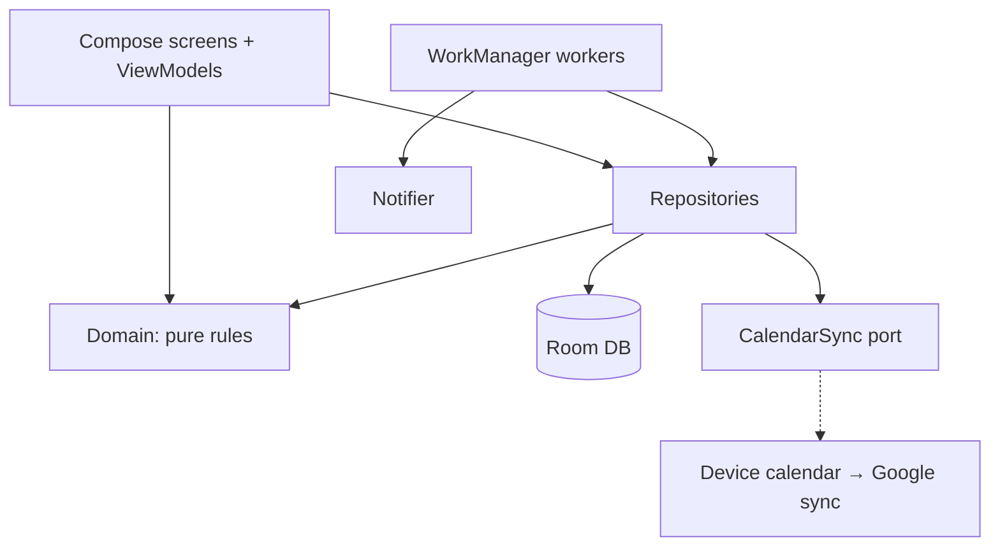

# Project Context

## Overview

A native Android app for a **single** private tutor to manage students, groups, subjects, schedule,
payments and debts. **Offline-first / local-only — no backend.** Russian UI, Material 3.
Currency is **BYN** (Belarusian ruble). See `PLANNING.md` for the product goal and success criteria.

---

## Architecture

MVVM with a **pure, unit-tested domain layer**. Room is the single source of truth; notifications
and calendar are best-effort *mirrors* of it, never the other way round. DI is Hilt.



### Layers / modules (single `app` module)

| Package | Responsibility |
|---|---|
| `domain/` | Pure Kotlin, no Android deps: billing, class rules, group rules (sessions, bookable subjects), calendar layout, reminders, reports, scheduling (bookable subjects, time conflicts), the `ReminderScheduler` port, and the models. All JVM-unit-tested. |
| `data/local/` | Room entities, DAOs, `AppDatabase`. Entities are also `@Serializable` (for backup). |
| `data/repository/` | Repositories mapping entities ⇄ domain models, and the place display **name ordering** is applied (`format/NameOrder`, not SQL). `ClassRepository` owns *all* side effects of a class change (calendar mirroring + reminder refresh); every write takes a whole **lesson** (see below). `EnrollmentRepository` owns the subject⇄price invariant — the single seam that links/unlinks a subject and sets/deletes its price together. `GroupRepository` is the only writer of group membership (a group is always saved together with its exact roster). |
| `data/backup/` | Whole-DB JSON snapshot: export + transactional replace-all import, plus `BackupRestore` — everything a *restore* entails beyond the rows (reminders, calendar re-mirror, ending first run), so both entry points share one path. |
| `calendar/` | `CalendarSync` port + a `CalendarContract` adapter, plus a `CalendarPermission` port so "enabling sync needs the permission" can be a view-model rule instead of a branch in a composable. |
| `notifications/` | `Notifier` port + an Android adapter, and `DueReminder` — everything a fired reminder does (is it still owed, whose name goes on it), kept outside the worker so a JVM test can drive it. |
| `diagnostics/` | `CrashLogger` — appends crashes to a capped local file, then chains to the platform default (so Play/Android Vitals still reports). Viewed/exported from `ui/diagnostics`. |
| `work/` | WorkManager workers + `WorkScheduler` (implements `ReminderScheduler`). |
| `format/` | Shared `ru`-locale date/time/money formatting, used by UI and non-UI. Also the two money-input rules (`MoneyInput.rate` allows zero, `.payment` doesn't) and `NameOrder`, the one definition of how names are listed. |
| `ui/` | Compose screens + `@HiltViewModel`s, `navigation/`, shared `common/` widgets, `onboarding/`, settings, and a `RootViewModel` gating onboarding vs. the main tabs. |
| `di/` | Hilt modules (database; calendar/work port bindings). |

---

## Key design decisions

- **Money is integer minor units (kopecks)** — no floating point.
- **Price is an hourly rate booked per class**, pre-filled from the student's rate for the subject —
  or, for a group lesson, from the **group's own rate** — and editable per lesson. At completion the
  charge = booked rate × lesson duration. Using the *booked* rate means later edits to a student's or
  group's rate never touch existing classes.
- **Status state machine**: `scheduled → completed | cancelled`, with corrections. A scheduled
  class **auto-completes once its end time passes** (opt-in setting). Cancelling voids the charge —
  there is no separate "missed" status.
- **One tutor, one lesson at a time.** A lesson can be neither booked nor moved onto an hour another
  lesson already holds (`Scheduling.conflicts`): there is one tutor, so an overlap describes a time
  that cannot happen. Back-to-back lessons are fine (the span is half-open), a **cancelled** class
  gives its slot back, and the lesson **being edited** is excluded by *every* one of its class ids —
  a group lesson would otherwise be found clashing with its own members. "Impossible" here means
  *double-booked*, not *unusual*: booking in the **past is still allowed** (recording a lesson that
  already happened is deliberate), as is any hour of the day. The rule is pure and JVM-tested, but the
  **refusal lives in the view models** — `ClassEditViewModel.conflict` disables save and names the
  clash under the time row, `ScheduleViewModel.move` refuses with a dialog — following the
  calendar-permission precedent below, because a refusal has to say *which* lesson is in the way
  rather than throw. The repository only offers the read (`observeConflicts`/`conflictsWith`), so
  restoring a backup still replaces the database verbatim.
- **Editing is allowed in any status; the charge is recomputed, not preserved.** Re-attributing a
  class to a new student/subject credits the new owner at the current rate, so editing history is
  safe. Edits update the row in place (never insert), so income can't be double-counted. The edit
  path goes through `ClassRules.edit`, which folds the move (re-plan) and rebill into one step so a
  caller can't persist a stale charge. **Move (reschedule) is allowed for any status.** A class can
  be **deleted in any status**; deleting a
  completed one removes its recognized income (derived, not stored, so it just disappears from
  reports/balances) and the UI warns before doing so. The repository's `delete` removes the
  calendar event and refreshes reminders regardless of status. Classes are **one-off only** — no
  recurring series.
- **A lesson is the unit of change.** Every `ClassRepository` write takes a `ClassSession` — a group
  lesson's *n* classes, or one student's class as a session of one (`ClassSession.of`). There is no
  separate single-class write path left to drift from a batch one: `book`, `apply`, `move`, `setStatus`
  and `delete` each fan out over the session, running the rules per class, mirroring each to the
  calendar, and refreshing reminders **once** for the lesson. The rules run *inside* `apply`, so no
  caller can hand over an already-resolved class and persist a stale charge. Re-attributing a class to
  another student is expressible only for a one-class session — `GroupRules.editsFor` refuses it for a
  group lesson, because membership is changed on the roster, not by editing one of its lessons.
- **A group prices its lessons; the students still owe for them.** A group carries **its own hourly
  rate** (`student_groups.priceMinor`), and booking a lesson for it writes **one class per member, all
  at that one rate** — never at the members' individual prices. Group teaching is priced as its own
  thing (usually below the one-to-one rate), so the rate belongs to the group rather than being
  assembled from *n* per-student prices that all had to be kept in step. What did **not** change is
  who owes: each member still gets their own class carrying that rate, so balances, debts and reports
  stay strictly **per student**. The group decides *how much*, never *who owes it* — which is why the
  labels say «Цена за час с ученика», not "price for the group": billing *n* members at one rate is
  not the same as one total for the room. A new group's rate is pre-filled from
  `settings.defaultGroupPriceMinor` (**0 means "not set"** → the field starts empty and the form is
  invalid until the tutor prices it, rather than inventing an amount); nothing else reads that
  setting, so changing it never re-prices an existing group. The form requires a rate but **allows 0**
  (a group taught for free still bills, at 0 — `MoneyInput.rate`).
  Because the rate no longer comes from the members, two mechanisms that existed only to guarantee one
  are **gone**: a group lesson can be booked for **any** subject (no `bookableSubjects` intersection),
  and **any** active student can join a group (no subject-first roster picking, no
  `memberCandidates`/`missingPrice`). The consequence to know: a group lesson can be booked for a
  subject a member has no `prices` row for, so "a student's subjects == their priced subjects" now
  describes **individual** lessons only — a member's group lessons can name a subject absent from their
  own subject list. Nothing breaks (income is derived from classes; `EnrollmentRepository` still
  refuses to unenroll a subject the student has classes for), but their student card won't list it.
  A **lesson has one rate**, so `SessionEdit` carries a single `price` and `ClassRepository.book`
  takes `studentIds` + one `price`; `ClassSession.sharedPrice` reports it, and comes back null only for
  a lesson booked *before* v5, whose members were billed individually — the booking form then offers
  the group's current rate instead of picking one member's arbitrarily. Lessons already booked are
  never restated: each class snapshotted the rate it was billed at, which is what makes the migration
  and re-pricing safe.
  Unchanged: the members' classes of one lesson share a `groupId` **and a start** — that pair *is* the
  "session" the schedule collapses into one card (`GroupRules.sessions`); sessions are derived, never
  stored, so a class moved on its own leaves its session by construction, with no membership flag to go
  stale. Archived students are left out of new lessons but keep their past ones. Per-member corrections
  stay expressible (mark the lesson completed, then cancel the absentee's class — the session then
  reads as "разные"), which is why status changes apply per class (`GroupRules.applicableTo` skips the
  ones a change isn't legal for). Groups are **archive-only once they have lessons** (deleting is
  refused, like subjects), and a group lesson **mirrors as one calendar event per member** — each
  student keeps their own invite and email reminder — with the group's name in the title. In-app
  **reminders are per lesson, not per member** (`Reminders.plan` dedupes a session and the notification
  names the group).
- **A student's subjects == their priced subjects** (single source of truth) — for **individual**
  lessons. Adding a subject links it and sets a price in one step; removing drops both, but is
  **refused when the student has any class for that subject**, preserving the invariant that an
  individually-booked subject always has a price. This is enforced in `EnrollmentRepository` (the only
  writer of subject links and prices), not by caller discipline in the view models. **Group lessons sit
  outside this**: they are billed at the group's rate, so they need no `prices` row (see the group
  bullet below).
- **History is structurally protected.** Subjects and groups are deletable only when unreferenced;
  `classes` and `payments` use `ON DELETE RESTRICT` on their parents (student, subject, group), so the
  DB itself refuses to cascade-erase earned income. Students are **archive-only** (no delete path);
  groups fall back to archiving once they have lessons.
- **Class mode** (in person / remote): each student has a default; a class inherits and can override
  it. Mirrored into the calendar event's location. Students also carry a free-text phone.
- **Offline-first.** Room is authoritative; calendar and notifications no-op if their
  permission/calendar is absent, never blocking or corrupting local data.
- **Crash diagnostics are local + Play, no backend** (`diagnostics/CrashLogger`): it chains to the
  platform's previous uncaught-exception handler (so crashes still reach Google Play's Android
  Vitals) and also appends each crash to a size-capped file in `filesDir`, viewable and
  SAF-exportable from **More → Диагностика**. No Crashlytics/Sentry, to avoid a third-party SDK,
  network calls and a privacy policy. The pure formatting/bounding lives in `domain/` (JVM-tested).
- **Settings live in Room** (single row): notifications, calendar sync, email invites, onboarding
  flag, reminder lead time, auto-complete (opt-in), theme, default lesson length, currency, «Группы»
  tab visibility. Device-local, so **not** part of the backup snapshot.
- **The bottom bar reads who → when → money**: «Ученики», «Группы», «Расписание», «Отчёты», «Ещё».
  Groups sits beside students because it is the same people seen as rosters. The app still *opens*
  on the schedule (it stays the nav graph's start destination) — the order is only where each tab
  sits. **«Группы» is the one tab that can be switched off** (Settings → Меню), for a tutor who
  teaches one-to-one: hiding it moves the section back into «Ещё» rather than taking it away, since
  the groups and their lessons still exist. Bar contents *and* "is this route a tab" both derive
  from `TopDestination.visible(showGroupsTab)`, so a route opened from «Ещё» can't render a bar with
  nothing selected; `GroupsScreen`/`MoreScreen` take a nullable callback each (no back arrow while
  it is a tab, no «Ещё» row while it has one), so the entry point moves instead of duplicating.
  **Labels are held to one line** (`ui/navigation/BottomBar.kt`): with five tabs «Расписание» wants
  all but a few pixels of its slot and used to wrap, stranding its last letter. It now shrinks — a
  step at a time, to a floor — on the narrower screens and larger font scales where the word truly
  does not fit, rather than breaking or cutting it.
- **Schema changes ship a real Room migration** in `data/local/Migrations.kt` (registered on the Room
  builder; the destructive fallback now only covers dev devices predating v1). **v2** added the group
  tables and `classes.groupId`, recreating `classes` to do so — which also retired the unused
  `recurringGroupId` column (recurring series are a non-goal, and the name clashed with the new group
  id). **v3** adds `settings.emailInvitesEnabled`, backfilled **on** for upgrades (a fresh install
  starts off) — its `DEFAULT 1` and the entity's
  `@ColumnInfo(defaultValue = "1")` must stay in step or Room's schema validation fails. **v4** adds
  `settings.showGroupsTab` (defaulting to 1, so an existing install keeps the tab it just gained).
  **v5** adds `student_groups.priceMinor` (a group's own rate) and `settings.defaultGroupPriceMinor`,
  both `DEFAULT 0` — an upgraded group is left explicitly *unpriced* rather than given an invented
  amount, since its members were billed individually and no single number is the truth about that.
  Migrations are validated against the exported schema JSONs by an instrumented test.
- **First-run onboarding is offered, not imposed.** It opens on a welcome step with three ways out:
  walk the setup (≥1 subject, then a first student with subjects and prices — each step still
  *requires* its input to move on), **restore a backup**, or **skip**. Skipping is the same flag flip
  as finishing, so the app can legitimately open empty — every screen already has an empty state, and
  the add-student form already refuses a student with no subject («Сначала добавьте предметы»), so an
  empty app guides rather than dead-ends. Restoring is not a third flip: `BackupRestore` marks first
  run done as part of what a restore *is*, so the rule holds for the settings screen's import too and
  the onboarding screen has nothing to do on success — the flag it flips swaps it for the main tabs.
  Every step but the welcome one keeps a back arrow, so restore and skip stay reachable after starting
  the setup; the restore confirms before replacing only when subjects already exist (on a fresh
  install there is nothing to lose, and «заменит все текущие данные» would be a lie).
- **Reports cover active students only**; archiving therefore hides a student's debt, so the app
  **warns before archiving a student with a non-zero balance**.
- **Email reminders via the calendar, not a backend**: a synced class event adds the student as an
  attendee with an email reminder, so the calendar account (e.g. Google) does the sending.
- **Inviting students by email is its own setting**, separate from calendar sync — a tutor may want
  their lessons in their calendar without mailing every student. It is **off by default**: syncing is
  a statement about the tutor's own calendar, and writing to someone else's inbox is a separate,
  deliberate opt-in. Upgrades are the exception — the v2 → v3 migration backfills it **on**, since
  that is what sync already did before the split and backfilling off would silently withdraw
  invitations students already have. So the entity's Kotlin default (off — what a new install gets,
  since rows are always written whole from Kotlin) and its `defaultValue`/the migration's `DEFAULT 1`
  (the upgrade backfill only) deliberately disagree. The setting only bites while sync is on, since
  the invitation rides on the event, so the settings row is shown dimmed until
  then and needs no permission check of its own. Crucially the flag is **not** just "skip the next
  invite": the student's address travels with every mirror alongside an `invited` flag
  (`calendar/Guest`), so turning the setting off and re-syncing **withdraws** the invitations
  already sent. That is why `CalendarSync.upsert` distinguishes "no address" (null — nothing to add
  or withdraw) from "this address, uninvited", and why the device adapter's attendee write is
  symmetric, touching only that one address so guests the tutor added in their own calendar survive.
- **The calendar-permission rule sits behind the view model, not behind the switch.**
  `SettingsViewModel` refuses to enable sync unless `CalendarPermission` says it is granted, returning
  `PERMISSION_NEEDED` for the screen to act on by requesting it. That flag is what the whole mirror
  keys off, so a screen that forgot the check would leave sync switched on with nothing able to write.
- **Names are ordered in Kotlin, not in SQL** (`format/NameOrder`). SQLite's `COLLATE NOCASE` folds
  ASCII only, so it cannot case-fold Russian names — it put «Ярослав» before «анна» — and keeping the
  order in the query forced the in-memory test fakes to restate it, differently, so tests asserted an
  order the app never produced. Those queries now return their rows unordered and the repositories
  apply one comparator. Time and id ordering stays in SQL, where no collation applies.
- **Calendar sync via `CalendarContract`, not the Google REST API** — writing to the device calendar
  lets the OS sync to Google, so there's no cloud project or OAuth to set up. Behind the
  `CalendarSync` port (a REST adapter could be added later). Opt-in; grants read + write calendar.
- **WorkManager** drives time-based behavior (precise one-shot reminders + a periodic maintenance
  worker that auto-completes due classes and refreshes reminders). The *decisions* are pure and tested.
- **A reminder only ever fires *ahead* of a lesson, never on booking.** The whole reminder plan is
  re-derived from scratch on every class change, app start and maintenance tick, so `Reminders.plan`
  drops any lesson whose lead moment has already passed instead of firing it at once: otherwise
  booking a class for the next hour would announce it immediately, and announce it again on every
  later change. The cost is that a lesson booked inside its own lead window gets no reminder at all —
  which is the point, since the tutor is looking at the lesson they just booked.
- **Backup = full DB snapshot → JSON via SAF.** Ids are preserved; import is one transaction. The
  format is versioned (**v2** carries groups, **v3** their rate); an older file still imports, since
  missing tables come back empty, missing columns take their default (a v2 file's groups arrive
  unpriced, as the v4 → v5 migration also leaves them) and retired keys are ignored. The bump exists
  for the *other* direction: a build predating the column would parse a v3 file and silently drop every
  group's rate, so `isSupported` refuses a newer version instead. **Restoring is more than importing**: `BackupRestore` owns
  the whole act — replace the rows, end first run, re-plan reminders, re-mirror to *this* device's
  calendar (the imported event ids came from another one) — so the settings screen and the first-run
  screen can't drift, and a rejected file leaves data *and* the onboarding flag untouched. The view
  models keep only the SAF read, where the `Uri` lives.
- **`java.time` everywhere + core-library desugaring** so it works on `minSdk 24`.
- **Design system** (`ui/theme/`): curated Material 3 palette (indigo + teal), light/dark schemes,
  dynamic color off by default for a consistent brand. Convention: content lists use the shared
  `ContentCard`; settings-style lists stay as plain `ListItem` rows. Shared atoms in `ui/common/`.
  **Avatar colours key off the student's id, not their name** (`domain/AvatarPalette`): hashing the
  name collided far more often than "1 in 10" suggests — it is the birthday problem, so a tutor with
  a handful of students already saw repeats — and it moved a student to a new colour when a typo in
  their name was fixed. Sequential Room ids give the first ten students one distinct colour each,
  stable across renames and backup restores (which preserve ids).
- **The schedule has three views**, picked from the top bar. **Day** and **month** both show one
  selected day's classes (the month grid is a day picker with an overview); **week** is the odd one
  out — its strip picks the day the add button books into, but the agenda below always lists the
  *whole* week grouped by day, since seeing a week at once is the point. Paging weeks or months only
  *browses* and never moves the selection; opening a calendar view snaps its page back to the
  selected day, so it can't open on a page where nothing looks selected. A cell marks its day with
  **one count per status** (`CalendarLayout.DayLoad.tallies`), tinted by that status and ordered
  scheduled → completed → cancelled so the actionable count reads first — a mixed day states its
  makeup instead of collapsing to a single dominant hue, and a status the day has none of is left out
  rather than printed as a zero. Since there are only three statuses a cell tops out at three numbers
  however busy the day is, so there's no marker cap and nothing is ever hidden. The counts sit
  *below* the day-number disc rather than inside it, which is what leaves room for two digits and
  keeps the colours readable on the selected day (whose disc is filled). Day markers are queried
  for the **active view's range only**, so browsing far from the selection never widens the query
  and the day view pays for no markers at all. The lessons follow the same rule: a single
  `ScheduleContent` flow keyed on the active view, so an off-screen view keeps no live query and the
  student/subject/group join and session collapse happen once rather than once per view. The layout rules — how many week rows a month needs,
  which neighbouring days pad them, where a week starts, how a day's classes tally up per status
  — are pure and JVM-tested in `domain/CalendarLayout`, leaving the composables to draw only. The
  chosen view is view-model state, deliberately **not** persisted: it isn't in the settings row, so
  no migration.
- **Responsive width.** Phone-first, but every screen's top-level scrollable content applies
  `Modifier.constrainedContent()` (`ui/common/`), capping width at ~600.dp and centring it on wide
  screens (tablets/foldables/landscape) while staying full-width on phones. Vertical fit comes from
  every screen scrolling, so short viewports never clip.

---

## Data flow

ViewModels observe repository `Flow`s and expose `StateFlow` UI state. Writes go ViewModel →
repository → Room, and the repository then mirrors the change to the calendar and refreshes
reminders — so ViewModels express intent only and can't forget a side effect. Balances and income
are derived on the fly, never stored.

---

## Non-goals (v1)

Multi-user/login, cloud sync across devices, web/iOS, in-app payments.

---

## Testing

- **JVM unit tests** (`src/test`, `testDebugUnitTest`) cover the domain layer and the backup format,
  plus the view models, repository side effects, mappers and formatters — run against **in-memory
  fake DAOs** with a test main dispatcher, so most logic is verified without an emulator. The fakes
  reproduce filtering and time ordering only: **name ordering is not restated there**, because that is
  the repositories' job (see `NameOrder`), so the fakes have no version of it to disagree with.
- Two tests exist purely as **tripwires against silent drift**, both deriving their expectations from
  something generated: `BackupSchemaCoverageTest` reads the exported schema JSON and fails when a table
  is neither carried by the snapshot nor deliberately named device-local, and `MappersTest` fails when
  an entity gains a column that nobody has mapped. Both are acknowledgement lists — the fix is to
  handle the new table/column and then say so there.
- **Instrumented tests** (`src/androidTest`) cover the Room integration (auto-complete, calendar
  sync on move, backup round-trip) and the **schema migrations** (`MigrationTest` runs each migration
  against the exported schema JSON, so a hand-written `CREATE TABLE` can't drift from the entities).
  They are also where **layout** is asserted (`BottomBarLabelTest`): real text measurement needs a
  device, and the questions are pixel ones — does this label wrap, is it cut short, at each phone
  width. A debug-only manifest entry lets the Compose test host activity show over the keyguard,
  so these can run against a locked phone (there is no emulator).
- Notification display and real calendar writes can only be observed on a device.

---

## Tooling & build

- Kotlin 2.3.20, AGP 9.2.1, Gradle 9.6.0, JDK 21 (Android Studio JBR). compileSdk 37, targetSdk 36,
  minSdk 24. **AGP 9 compiles Kotlin itself** (built-in Kotlin): there is no `kotlin.android` plugin;
  the root `build.gradle.kts` pins the built-in KGP to 2.3.20 via a `buildscript` classpath so it
  matches the Compose/serialization compiler plugins and KSP. **Kotlin tracks KSP** — KSP (which
  drives Room + Hilt codegen) lags Kotlin, so Kotlin can't move past the version the latest KSP
  embeds (KSP 2.3.9 → Kotlin 2.3.20).
- Hilt 2.59.2, Room 2.8, WorkManager, Navigation Compose, kotlinx-serialization — versions in
  `gradle/libs.versions.toml`.
- `lint { checkReleaseBuilds = false }` works around an AGP 9.2.1 lint-jar file-lock bug on Windows;
  lint still runs via `lintDebug`.
- Build needs `JAVA_HOME` set to a JDK 21 and `local.properties` pointing at the Android SDK.
- Common commands: `./gradlew :app:testDebugUnitTest`, `:app:assembleDebug`, `:app:assembleDebugAndroidTest`.
- **Release**: `release` is minified + resource-shrunk (R8). Signing reads `keystore.properties` (repo
  root, gitignored — see `keystore.properties.example`); when absent the release build is left
  unsigned so debug/CI/contributors are unaffected. Play artifact: `./gradlew :app:bundleRelease`
  (→ `app/build/outputs/bundle/release/app-release.aab`). Bump `versionCode` per upload. R8 keep
  rules for `@Serializable` types live in `proguard-rules.pro` (Room/Hilt ship their own).

```
app/src/main/java/com/seblful/repetit/
├── domain/            # pure rules + ports + models
├── data/{local,repository,backup}/
├── calendar/  notifications/  diagnostics/  work/  format/  di/
├── ui/{schedule,students,groups,subjects,reports,backup,more,onboarding,diagnostics,common,navigation,theme}/
├── MainActivity.kt    # @AndroidEntryPoint → AppRoot()
└── TutoringApp.kt     # @HiltAndroidApp, WorkManager config, startup scheduling
```
