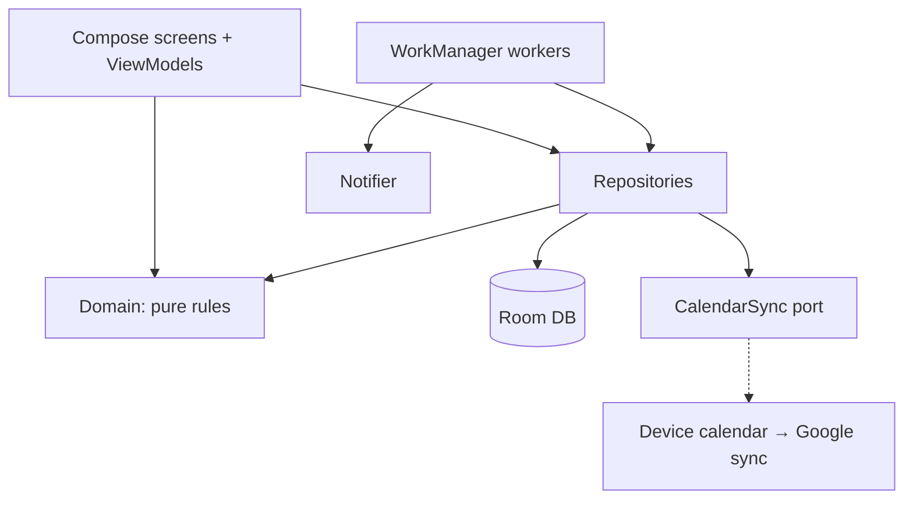

# Project Context

**Klas** — a native Android app for a **single** private tutor to manage students, groups, subjects,
schedule, payments and debts. **Offline-first / local-only — no backend.** Russian UI, Material 3.
Currency is **BYN**. See `PLANNING.md` for the product goal and success criteria.

The launcher label is the Latin **Klas** even though every other string is Russian: it is a brand, not
a word being read. It was renamed from «Репетит» (`com.seblful.repetit`) while still unpublished —
which is the only reason the application id could move with it. `TutoringClass` keeps its name: it is
the *domain* noun for a tutoring class, not the app's.

This file is the map: *what* was decided and *where* it lives. The **reasoning** for each rule sits in
the KDoc next to it — that is the place to add or read the argument, so this file can stay short
enough to read before starting work.

---

## Architecture

MVVM with a **pure, unit-tested domain layer**. Room is the single source of truth; the calendar and
notifications are best-effort *mirrors* of it, never the other way round. DI is Hilt. Single `app`
module.



| Package | Responsibility |
|---|---|
| `domain/` | Pure Kotlin, no Android deps: billing, class/group rules, scheduling, calendar layout, reminders, reports, `Taught` (what a stat row counts), `LessonKind` (individual vs a group's), models (incl. the report-only id types, `model/Ids.kt`), and the `ReminderScheduler` port. All JVM-tested. |
| `data/local/` | Room entities, DAOs, `AppDatabase`, and the `Transactor` port. Entities are also `@Serializable`, for the backup. |
| `data/repository/` | Entities ⇄ domain models, and where display **name ordering** is applied. Each repository owns one invariant end to end, and writes it in one transaction (see *Ownership* below). |
| `data/backup/` | Whole-DB JSON snapshot: export, transactional replace-all import, `BackupIntegrity` (what a file must be readable as before any of it is written), and `BackupRestore` (everything a *restore* means beyond the rows). |
| `calendar/` | `CalendarSync` + `CalendarPermission` ports and a `CalendarContract` adapter. |
| `notifications/` | `Notifier` and `NotificationPermission` ports + Android adapters, `DueReminder` (what a fired reminder decides), and `ReminderAlarms`/`ReminderReceiver` — reminders are **alarms**, not deferrable work. |
| `work/` | WorkManager's half: the periodic `MaintenanceWorker`, `WorkScheduler`, `BootReceiver` (alarms die on reboot), and `Maintenance` — what an upkeep pass decides, kept out of the worker. |
| `diagnostics/` | `CrashLogger` over `CrashLogStore`/`DeviceInfo` ports. Viewed and exported from `ui/diagnostics`. |
| `storage/` | `DocumentStore` port + SAF adapter over an opaque `DocumentRef`, so no view model touches a `Uri` or a `Context`. |
| `format/` | `ru`-locale date/time/money formatting, `MoneyField` (what a money input is), `NameOrder` (the one definition of how names are listed). |
| `ui/` | Compose screens + `@HiltViewModel`s, `navigation/`, shared `common/` atoms, `onboarding/`, settings, and `RootViewModel` gating onboarding vs. the tabs. |
| `di/` | The database module, the `@DebugBuild` flag, `@ApplicationScope`/`@Computation` (`CoroutinesModule`) and the `Clock` (`TimeModule`). Other Hilt modules live beside their adapters. |

### Ownership (one invariant, one place)

- `ClassRepository` — **all** side effects of a class change (calendar mirror + reminder refresh).
  Every write takes a whole **lesson** (`ClassSession`), so there is no single-class path to drift.
  Each write is also **one transaction**, in three fixed phases: pure rules → every row inside
  `Transactor.transaction` → calendar and reminders *after* the commit. A group lesson is *n* rows, so
  without the transaction a failure halfway leaves a torn lesson; the calendar stays outside it
  because it is an IPC call, and because a best-effort mirror must not be a participant in the write.
- `EnrollmentRepository` — the subject⇄price invariant, and where prices are read.
- `GroupRepository` — the only writer of group membership; a group is saved with its exact roster.
- `RateHistoryRepository` — what a *rate change* is, since two repositories set rates.
- `SettingsRepository` — one `update { it.copy(...) }` rather than a setter per field, serialized.
- `StudentRepository` — the whole act of **archiving**, which is more than a flag: a retired student's
  still-planned lessons are called off first (through `ClassRepository`, which owns what a class change
  costs). Reports count active students only, so a scheduled lesson left behind would auto-complete into
  income that exists in the database and appears in no total on any screen.

**A write that spans tables is one transaction, in all three of them.** `ClassRepository` came first
because a torn *lesson* is the loudest version of it, but the argument was never about lessons: an
`EnrollmentRepository` write touches `student_subjects`, `prices` and `price_history`, and
`GroupRepository.save` writes the group, its rate log and every roster link. In each case the thing
that could half-happen is exactly the invariant the class exists to hold — a subject the student takes
at no price, a roster nobody asked for — so a failure partway is not a lost edit but a broken one.
Being single-user does not help: the writes are sequential either way, and what a transaction rules
out is stopping. Reads that only *decide* whether to write (the class count that refuses an
un-enrollment, the eligibility check that narrows a roster) stay outside it, so a refusal costs no
transaction and the write lock is held for less time.

---

## Key design decisions

### Money and billing

- **Money is integer minor units** (kopecks) — no floating point, and **bounded** by `Money.MAX`
  (1 000 000,00). The bound is not tidiness: a charge is `rate × minutes`, so a rate that merely fits
  in a `Long` could still wrap past it and bill a **negative** amount. Enforced at both ways in — the
  typed-input gate (`parseMoneyOrNull`) and a restored file (`BackupIntegrity`).
- **An amount has a ceiling, enforced once where text becomes money** (`Money.MAX`, applied in
  `parseMoneyOrNull`). Fitting in a `Long` is not enough, because the arithmetic downstream
  *multiplies*: `chargeFor` is `rate × minutes` and `percentOf` is `part × 100`, so an uncapped rate
  the field called valid could bill a **negative** charge and read as a student's «Переплата». The
  ceiling is what makes those multiplications safe rather than merely unlikely, and it belongs at the
  input — every later stage sees a plain number that has already lost the truth. A backup's raw minor
  units do **not** pass this gate (`BackupIntegrity` checks only what a read can fail on).
- **Price is an hourly rate booked per class**, pre-filled from the student's rate for the subject (or
  the group's own), editable per lesson. `charge = booked rate × duration`, so later re-pricing never
  touches existing classes.
- **Balances and income are derived**, never stored.
- **Status**: `scheduled → completed | cancelled`, with corrections. Auto-completes once the end time
  passes (opt-in). Cancelling voids the charge — there is no "missed" status.
- **Reports cover active students only**, so archiving hides a debt — the app warns first.
- **A report is read inside a period** (`domain/ReportPeriod`): a month, a year, or all time, opening on
  the **year in progress** — an all-time total stops answering "how am I doing?" as soon as there is a
  second year of history. Every income number on the screen means that one slice at once. **Debts are
  the deliberate exception**: a balance is charges minus payments over a student's whole history, so
  clipping the charges to a year while the payments stay whole would invent credit. The section says so.

### Reading back what was stored

- **An enum's constant name is a persisted value.** `classes.status` and the three `mode` columns store
  it as text, two DAO queries match `'SCHEDULED'` as a SQL literal, and three columns default to
  `"IN_PERSON"` — so renaming a constant is a migration, and one that fails *silently in two different
  ways*: old rows stop being readable, and the SQL literals stop matching, which reads as "nothing is
  due" rather than as an error. `StoredEnumNamesTest` is the acknowledgement list that makes the rename
  fail in front of whoever does it.
- **Storage is parsed with a total function, never `valueOf`** (`ClassStatus.parse`, `ClassMode.parse`).
  `valueOf` throws, and it throws on the *read* path inside a `Flow`, where a throw reports nothing to
  anybody — it kills the collector and the screen simply never draws. What the mappers do with an
  unreadable column then splits on whether it carries money: a **mode** falls back to `IN_PERSON`, since
  the cost is one wrong word rather than a screen that won't open, while a **status** fails loudly,
  because `isBillable` is what makes a lesson count as income and every guess moves money
  (`SCHEDULED` un-bills what earned, `COMPLETED` invents what didn't).
- **Ids carry a type in the report breakdowns, and only there** (`domain/model/Ids.kt`). The three
  breakdowns are the same shape and each was paired by hand with one of three equally shaped tables of
  names; a mismatch was not a type error and did not fail either, since the lookup missed and
  `orEmpty()` drew a real amount against a blank label. Silence is what made it worth a type. Elsewhere
  an id is a named argument to a function that takes one kind, so the entities, models, Room and the
  backup format all keep plain `Long`.

### Lessons

- **A lesson lasts a positive number of minutes**, insisted on by `Scheduling.Slot`. This is a rule
  about the *overlap check*, not about tidiness: a zero-length slot has `end == start`, so it collides
  with a lesson that strictly contains it (10:30 inside 10:00–11:00) but not with one starting at the
  same instant, because the half-open comparison needs `other.start < end`. The one-tutor-one-lesson
  rule therefore held mid-hour and failed **open** at the edge — the worse direction, since the form
  still showed the time as free. The booking form already validated the range, but it is not the only
  way in, so the state stopped being representable instead. Read paths meeting a stored row that
  breaks it (`Scheduling.conflicts`) skip that row rather than throw: one bad row must not stop the
  check being made for every other lesson.
- **A lesson is the unit of change.** Every write takes a `ClassSession`: a group lesson's *n* classes,
  or one student's class as a session of one. Re-attributing a class to another student is expressible
  only for a session of one.
- **One tutor, one lesson at a time.** An overlapping slot is refused, not warned about. Back-to-back
  is fine, a cancelled class gives its slot back, and the lesson being edited is excluded by every one
  of its class ids. Booking in the **past is allowed**. The rule is pure; the *refusal* lives in the
  view models, because it has to name which lesson is in the way.
  **Every way back into an hour is checked, un-cancelling included.** A cancelled lesson giving its
  slot back is what lets the tutor re-book that hour for somebody else — so returning the first lesson
  to the schedule is a *second* claim on it, and it was the one path that made no check: booking, the
  form's edit and the move all refused, while «вернуть в расписание» simply drew two lessons at 10:00.
  `ScheduleViewModel.setStatus` therefore refuses it the same way a move is refused, through the one
  `timeConflict` both report, since it is the same fact — this hour is taken, by that lesson.
- **Editing is allowed in any status and the charge is recomputed**, in place, so income cannot be
  double-counted. Deleting is allowed in any status; deleting a completed lesson removes its income and
  the UI warns. Classes are **one-off only** — no recurring series.

### Groups

- **A group prices its lessons; the students still owe for them.** The group carries its own hourly
  rate and a lesson writes one class per member *at that one rate*. Balances, debts and reports stay
  strictly per student: the group decides *how much*, never *who owes it*. A new group's rate is
  pre-filled from settings (0 = "not set" → the field starts empty); a rate is required but may be 0.
- **A lesson has one rate.** Only a lesson restored from a backup written before a group had its own
  rate (`BackupData` v2 and older) can hold differing member rates; the form then offers the group's
  current rate rather than picking one member's.
- **A group is taught one subject, fixed on the group.** Only students priced for it can be members —
  the roster is intersected on save — and the booking form takes the subject from the group. The column
  is **nullable** for a group restored from a backup that predates it (`BackupData` v3 and older), and
  until the tutor picks one; such a group keeps the looser per-lesson behaviour.
- **Who attends one lesson is separate from who is on the roster**, and is a fact the tutor may
  correct afterwards. The lesson's form ticks its members — in any status, past or future. An unticked
  member has no class at all (not the same as a cancelled one); ticking one who has none writes a
  class at the lesson's own terms, taking **the status the lesson is in**, so adding somebody to a
  completed lesson owes exactly what being in it owed. Dropping a class that already billed removes
  that income, so the form asks first. An old lesson offers the group as it is *now* but ticks only
  its own members, so opening and re-saving it changes nothing.
- **A session is derived, never stored**: the classes sharing a `(groupId, start)` pair. Moving one
  class therefore leaves its session by construction. Statuses still apply per class, so a lesson
  whose members were corrected one at a time reads «Разные» — reachable now only through old data or
  the repository, since the schedule changes a lesson's status as a whole.
- **A group earns a report line of its own** (`Reports.incomeByGroup`), which no other breakdown can
  give: a member's line mixes their group lessons with the individual ones they also take, so only the
  group's own total answers whether running it is worth the evening.
- Groups are **archive-only once they have lessons**. A group lesson mirrors as **one calendar event
  per member** (each keeps their own invite), while in-app **reminders are per lesson**.

### Students and subjects

- **A student's subjects == their priced subjects** — for *individual* lessons. Adding links and prices
  in one step; removing is refused while any class exists for that subject. Group lessons sit outside
  this, being billed at the group's rate.
- **Class mode** (in person / remote): a student default, overridable per class, mirrored into the
  calendar event's location.

### History and data safety

- **History is structurally protected.** `classes` and `payments` use `ON DELETE RESTRICT` on their
  parents, so the database itself refuses to cascade-erase earned income. Students are archive-only;
  subjects and groups are deletable only while unreferenced.
- **A rate is current state; its past is a log** (`price_history`). One table covers both a student's
  price and a group's rate, discriminated once into the sealed `RateOwner` on the way out of storage.
  Two nulls carry meaning: no previous rate = the history starts here; no date = the rate predates the
  log (what v7 seeded, rather than inventing an upgrade date). An **unchanged rate logs nothing**, and
  un-enrolling a subject forgets its log.

### Storage, migrations, backup

- **Offline-first.** Room is authoritative; the calendar and notifications no-op when their permission
  or calendar is absent, never blocking or corrupting local data.
- **Settings live in Room** (single row) and are **device-local** — deliberately not backed up. Writes go
  through one `update {}` **under a `Mutex`**: the row is written whole, so two overlapping updates
  lost one, and the settings screen launches a coroutine per switch.
- **The platform's own backup is off** (`allowBackup="false"`, plus explicit exclusions in
  `res/xml/data_extraction_rules.xml`). Auto Backup would have copied `klas.db` — every student's name,
  phone and email — to Google's servers, contradicting the local-only design and Play's Data safety
  declaration; copied it without a WAL checkpoint; and restored it *without* `BackupRestore`, leaving
  every `calendar_event_id` pointing at the old device's calendar. The app's own JSON export is the way
  data moves between devices, and the export screen says the file is unencrypted PII.
- **The database is at v1 and ships no migrations.** The only builds ever released are
  `com.seblful.repetit` (v0.1.0-beta, v0.1.1); the rename to `com.seblful.klas` changed the
  application id *and* the file name (`tutoring.db` → `klas.db`), and Android never upgrades one
  application id into another. No device can therefore hold a pre-v1 `klas.db`, so the six
  development-only migrations were dropped and the schema restarted at v1.
- **The destructive fallback is debug-only.** It exists for a dev device carrying a pre-release schema
  — which the squash to v1 makes every `.debug` install on hand — but Room applies it to *any* version
  it finds no path for, so left unconditional it would also answer a forgotten migration by recreating
  a released database empty, silently, on the first launch after an ordinary update. A release build
  therefore **refuses to open** a database it cannot migrate: a crash leaves every row on disk for the
  next build, and is recoverable in the way a wipe is not.
- **Once v1 is released the "no migrations" part stops being true**: from that point every schema
  change must bump the version and ship a real migration, validated against the exported schema JSON
  by an instrumented test, with an entity's `defaultValue` and the migration's `DEFAULT` kept in step
  or Room's validation fails. `MigrationChainTest` is what makes that a rule rather than a habit —
  see *Testing*. Until then, **`BackupData.version` is the only cross-build compatibility story the
  app has** — a backup file is the one way data moves between builds, and the only bridge out of
  `com.seblful.repetit`, whose data the rename left where it stands.
- **Backup = full DB snapshot → JSON via SAF.** Ids preserved, import is one transaction (through the
  same `Transactor` port the class writes use). The format is versioned: an **older** file still imports
  (missing tables come back empty, missing columns take their default), a **newer** one is refused —
  which is the reason the version exists. A restored file is reproduced as given; v7's seeding is
  deliberately not repeated on import.
- **A backup is checked for readability before a row of it is written** (`data/backup/BackupIntegrity`).
  The import writes rows verbatim — it never interprets them — while the text columns holding an enum
  are only read back much later, in `data/Mappers.kt`, inside the `Flow`s the screens collect. So a file
  carrying an unknown `status`, or a lesson of no length, used to import *successfully* and then break
  the app: every read of that row threw, the schedule could not be drawn, and reopening never helped
  because the bad row was now the saved data. The check runs **before** the transaction, so the reason
  survives to be shown rather than being whatever the first bad row happened to throw. It covers
  exactly the columns a read can *fail* on — a backup is allowed to be strange, just not unreadable;
  referential integrity is left to the foreign keys.
- **A refused backup says which refusal it was** (`data/backup/BackupFailure`): a file from a newer
  build (carrying both version numbers), a file that isn't a Klas backup, or a file that wouldn't open.
  One flat "failed" told the tutor to check a file that may have been perfectly fine — a copy from a
  newer build needs an app update, not another look. Classification is pure; the wording is shared by
  the backup screen and the first-run restore.
- **Restoring is more than importing**: `BackupRestore` owns the whole act (replace rows, end first run,
  re-plan reminders, re-mirror to *this* device's calendar), so both entry points share one path.

### Calendar, reminders, diagnostics

- **Calendar sync via `CalendarContract`, not the Google REST API** — the OS syncs to Google, so there
  is no cloud project or OAuth. Opt-in, behind the `CalendarSync` port.
- **Email reminders ride on the calendar**: a synced event adds the student as an attendee with an email
  reminder, and the calendar account does the sending.
- **Inviting students by email is its own setting**, separate from sync and **off by default** (writing
  to someone else's inbox is a distinct opt-in; upgrades backfill it *on*). It is not merely "skip the
  next invite" — turning it off and re-syncing **withdraws** invitations already sent.
- **The calendar-permission rule sits behind the view model**, not behind the switch: sync cannot be
  enabled without the grant, since that flag is what the whole mirror keys off.
- **A lesson mirrors as one batch, under one snapshot of the settings** (`ClassRepository.mirror`). The
  settings row governs every class of a lesson identically, so reading it per class asked one question
  once per member — and let a lesson mirror half under the old invite setting and half under a new one.
- **A reminder only fires *ahead* of a lesson, never on booking.** The plan is re-derived from scratch
  on every change, so a lesson booked inside its own lead window gets none — which is the point.
  "From scratch" means over the **horizon**, not over the whole history: `Maintenance` names the horizon
  once and uses it both to fetch the window and to filter it, since a window narrower than the filter
  would drop a reminder silently. `MaintenanceTest` pins the boundary lesson.
- **A reminder is an alarm; upkeep is a worker.** The split is by whether being late is acceptable.
  Reminders were `OneTimeWorkRequest`s with a delay, which WorkManager treats as a *lower bound* and
  batches under Doze — «занятие через час» two hours late is not a late reminder but a wrong one, and
  `Reminders.shouldPost` would still post it. They now ride `AlarmManager` (`ReminderAlarms`): exact
  where `SCHEDULE_EXACT_ALARM` allows, `setAndAllowWhileIdle` where it does not, never prompting for
  the permission. Armed ids are kept in preferences because `AlarmManager` has no cancel-all and an
  alarm can only be cancelled by rebuilding its `PendingIntent`. Alarms die on reboot, so `BootReceiver`
  re-derives the plan. `refreshNow` and the periodic upkeep stay on WorkManager, where deferring is fine.
- **Upkeep also runs in process at startup** (`KlasApp`), not only as an enqueued worker: auto-completion
  is what *bills* a finished lesson, so leaving it to WorkManager meant the schedule and reports the
  tutor was about to read were as current as WorkManager felt like being — and on a battery-restricted
  install, possibly not at all.
- **The notification permission is asked for where reminders are**, in settings, never over a first
  launch. And the row shows the **platform's** answer beside the tutor's intent: the setting is on by
  default and the permission is not, so a fresh install read «включено» while `AndroidNotifier` no-opped
  in silence. Deliberately *not* the calendar's rule — that flag gates a mirror, this one is only a
  preference, so it is never refused (`NotificationPermission`).
- **Crash diagnostics are local + Play, no backend**: chains to the platform handler (so Android Vitals
  still reports) and appends to a size-capped file, exportable from **Ещё → Диагностика**. No
  Crashlytics/Sentry, to avoid a third-party SDK, network calls and a privacy policy.

### UI

- **The app pins its own locale to Russian** (`RussianLocale.inRussian`, applied in `KlasApp` and
  `MainActivity` via `attachBaseContext`). Strings live in the unqualified `values/` and the formatters
  name `ru` outright, but a **plural** rule set comes from the *configuration's* locale, i.e. the phone's
  — so on an English phone Russian text was declined by English rules (two forms) and the app said
  «0 занятия», «5 занятия». Counted nouns therefore always go through `<plurals>`, never through
  `%d` plus a fixed word, and the bundle does not split by language (there is only one resource set).
- **A screen draws; it does not decide.** Rules that used to sit inside composables now live in the
  module behind them, because a `@Composable` can only be exercised on a device: `ClassFormState`
  answers every question the booking form has, `MoneyField` answers what a money input is, `leaveIntent`
  answers what back does, `Maintenance`/`CrashLogger` hold what the workers used to decide inline.
- **A refusal is said out loud.** View models report one-shot outcomes through `UiEvents` rather than
  failing silently. The exception is `ScheduleViewModel.moveConflict`, which is state because it must
  survive a rotation.
- **The bottom bar reads who → when → money**: «Ученики», «Группы», «Расписание», «Отчёты», «Ещё».
  The app still *opens* on the schedule. «Группы» is the one tab that can be switched off, which moves
  the section into «Ещё» rather than removing it; bar contents and "is this route a tab" derive from one
  place. Labels shrink a step at a time rather than wrapping or being cut.
- **Today rolls over at midnight.** The screen used to read `LocalDate.now()` in its own body, evaluated
  per composition and never again, so an app left open overnight went on marking yesterday. It now comes
  from a flow that sleeps until the next local midnight and re-reads an injected `Clock` — which is what
  makes the boundary testable, since `advanceTimeBy` moves virtual time and `now()` knows nothing of it.
  A test collecting it must advance by a stated amount: a clock has no last emission, so
  `advanceUntilIdle()` never returns.
- **The schedule has three views.** Day and month both show one selected day; week always lists the
  whole week. Paging only *browses* — it never moves the selection, and opening a view snaps back to it.
  A calendar cell shows **one count per status**, so a mixed day states its makeup. Both the markers and
  the lessons are queried for the **active view's range only**, so no off-screen view holds a live query.
- **The two lesson-kind icons are one pair, not a ranking** (`ui/common/LessonKindUi`): same brand
  colour, and matched on **ink height** rather than nominal size. `Person` fills 16 of its 24-unit
  viewport vertically and `Groups` only 12, so asking for one size drew the person a third taller; each
  is scaled by its own fill and centred in a shared slot so what follows the icon stays aligned.
- **One place answers "who was in this lesson"** — the lesson's own form, where the answer can be
  changed. The schedule's action sheet acts on the whole lesson (edit, move, status, delete) and
  deliberately lists no members: a menu for changing a lesson's status is not where a roster belongs.
- **A student's and a group's card are tabbed, with the numbers on top** — a `StatRow` whose values
  shrink to fit, then a sticky `SecondaryTabRow` over one full-length list. A student's tabs are «Предметы |
  Занятия | Платежи»; a group's are «Ученики | Занятия» **only**, because a balance belongs to a student
  and spans all their lessons. Editing either sits behind the pencil, so the card can answer "how is
  this going?" rather than only "how do I change this?". A group's roster tab adds how many of its
  lessons each member actually attended. **Booking is not offered on a card** — it belongs to the
  schedule, the one place that knows what else the hour holds; the form still accepts a group to
  pre-select, but nothing passes one.
- **A stat row counts lessons, not classes — for a group** (`domain/Taught`): a lesson taught to three
  is *one* lesson of the tutor's, and ran for its own duration. The money is the other way round, summing
  the members' charges. A session counts as taught when **any** of its classes completed, which keeps a
  per-member correction one lesson rather than a lost one. A student's debt tile flips to «Переплата»
  instead of printing a negative.
- **Individual and group lessons are told apart wherever they meet** (`domain/LessonKind`). The schedule
  marks *both* kinds, not only the group ones. A student's lesson list — the one list that genuinely
  mixes them, at two different rates — names the group each lesson was one of, and offers counted chips
  when the student is taught both ways. Reports carry an income split by kind, the one question the
  per-student and per-subject lines cannot answer.
- **A report draws a number only where the shape says something the number does not**, and stays plain
  text otherwise — a picture on every row is wallpaper, not a chart. The period is pinned above the
  report, because it is what everything below means. Then: a **column chart** where the order is *time*
  (buckets one step finer than the period — a year draws its months, all time its years, a single month
  nothing); **one stacked bar** where two parts make the whole (individual vs group), since the question
  is how the whole divides; **ranked bars** where rows are compared with each other, each scaled to the
  *largest* row and dropped when a section has only one; **plain text** for totals, counts, per-month
  amounts and debts — a debt is money to collect, not a proportion. A percentage is printed only where
  the rows genuinely partition the income (so not for groups, and not for debts), is integer arithmetic
  on kopecks, and is **not** forced to add up to 100.
- **Leaving a filled-in form asks first** (`ui/common/UnsavedChanges`). `leaveIntent(dirty, canSave)`
  picks the question: a complete form is offered «Сохранить / Не сохранять», an incomplete one only
  «Не сохранять / Отмена», an untouched one nothing. What counts as *dirty* differs per form on purpose
  — a snapshot where the baseline settles (student, group), "was touched" where the form keeps
  filling itself in (booking). Dialogs get no question, only `dismissOnClickOutside = false`.
- **First-run onboarding is offered, not imposed**: walk the setup, restore a backup, or skip. Skipping
  is the same flag flip as finishing, so the app may legitimately open empty — every screen has an empty
  state. Restore ends first run as part of what a restore *is*.
- **Names are ordered in Kotlin, not SQL** (`format/NameOrder`): `COLLATE NOCASE` folds ASCII only, so
  it cannot case-fold Russian. Time and id ordering stays in SQL.
- **Design system** (`ui/theme/`): curated Material 3 palette (indigo + teal), light/dark, dynamic
  colour off for a consistent brand. Content lists use `ContentCard`; settings-style lists stay plain
  `ListItem`s. **Avatar colours key off the student's id, not their name**, so a rename or a typo fix
  doesn't move them and collisions follow ids rather than the birthday problem.
- **Responsive width**: every top-level scrollable applies `Modifier.constrainedContent()` (~600.dp cap,
  centred on wide screens, full-width on phones). Vertical fit comes from every screen scrolling.
- **`java.time` everywhere** + core-library desugaring, so it works on `minSdk 24`.

---

## Data flow

ViewModels observe repository `Flow`s and expose `StateFlow` UI state. Writes go ViewModel →
repository → Room, and the repository then mirrors to the calendar and refreshes reminders — so a
ViewModel expresses intent only and cannot forget a side effect.

**Reads live in `viewModelScope`; writes do not.** A write goes to the injected `@ApplicationScope`
(`di/CoroutinesModule`) and the view model keeps only the navigation and the one-shot event, because
`viewModelScope` dies with its screen: tapping «Сохранить» and going straight back would otherwise
cancel a save between its committed rows and the mirroring that follows them. `ClassEditViewModel`
awaits the write for its `onDone`; the schedule's status/move/delete actions just launch it.

**Deriving state happens off the main thread.** Every screen is
`combine(…repository flows…) { … }.flowOn(computation).stateIn(viewModelScope, …)`. Without that
`flowOn` the whole derivation ran on `Dispatchers.Main.immediate` — Room's own `flowOn` governs only
what is upstream of *it*, so the repositories' mapping, `NameOrder.sorted`, `GroupRules.sessions`,
`Taught` and all of `Reports` were UI-thread work on every emission. The dispatcher is injected
(`@Computation`) so tests keep one scheduler; `ReportsViewModelTest` has a tripwire that fails if the
`flowOn` is deleted.

**A failed write is reported, not fatal.** `@ApplicationScope` carries a `CoroutineExceptionHandler`
into the crash log: `SupervisorJob` scopes *cancellation*, not failure, so an exception from a write
launched there still reached the thread's default handler and killed the process. Where a screen can
say so it does — `ClassEditViewModel` guards inside the `async` (a failure has to come back as a value,
since `async` holds it in the `Deferred` where no handler sees it), and the schedule's sheet actions
report `ACTION_FAILED` rather than silently not changing the lesson.

State a view model exposes is **read-only** (`StateFlow`, never `MutableStateFlow`) and changes only
through its mutators — which is what keeps derived bookkeeping like `ClassEditViewModel.touched` in
step with the form it describes.

Guarded suspend calls use `runCatchingCancellable`, never `runCatching`: the latter catches
`CancellationException` too, which reports a cancelled operation as a failed one and lets a dead
coroutine carry on. Plain `runCatching` stays only around **non**-suspending best-effort work, as in
the calendar adapter.

---

## Non-goals (v1)

Multi-user/login, cloud sync across devices, web/iOS, in-app payments, recurring lesson series.

---

## Testing

- **JVM unit tests** (`src/test`, `testDebugUnitTest`) cover the domain layer, the backup format and
  its failure classification, view models, repository side effects and transaction boundaries, mappers
  and formatters — against **in-memory fake DAOs** with a test main dispatcher, so most logic is
  verified without a device. Android-bound halves are reachable through their ports; a worker or
  handler is an adapter, never a decision. The fakes reproduce filtering and time ordering only —
  **name ordering is not restated there**, so they have no version of it to disagree with.
- **`isReturnDefaultValues` is deliberately off.** It turns an unmocked framework call — something a
  JVM test here should never make — into a silent pass on `null`/`0`. A test that needs Android has
  found a missing port, not a reason to switch it on.
- **Two test doubles exist for what cannot otherwise be observed**: `CountingDispatcher` (was the
  derivation really moved off the main thread — a `flowOn` is invisible in the result) and `MutableClock`
  (a midnight rollover, which needs the wall clock and the scheduler moved together).
- **Fixtures pin the clock, not `now()`.** Times built from `Instant.now()` fail for the time of day
  rather than the behaviour. Seed a fixed hour and pick days by excluding today.
- Four tests are **tripwires against silent drift**, all deriving expectations from a real artifact
  rather than restating them: `BackupSchemaCoverageTest` (a new table must be carried or named
  device-local), `MappersTest` (a new column must be mapped), `StoredEnumNamesTest` (a renamed enum
  constant is a migration — it reads the DAO source, since `@Query` is not retained at runtime) and
  `MigrationChainTest` (a bumped schema version must ship a migration for every step from v1 *and*
  wire it into the builder, and the destructive fallback must stay debug-only — it reads
  `AppDatabase.kt`, since `@Database` is `BINARY`-retained). The first three are acknowledgement
  lists; the last is the upgrade path, and it sits in the **unit** suite precisely because the
  instrumented migration tests need a device CI does not have — so a forgotten migration would
  otherwise first be noticed on a tutor's phone. Two more guard structure rather than data: one asserts the booking
  form leaves **no query open** once nothing collects it (`WhileSubscribed` has to be true, not
  decorative), and one asserts a save is launched into the application scope by cancelling that scope
  and finding nothing written.
- **`EdgeCaseCombinationsTest` is the one test file not beside its subject**, deliberately: what it
  tests is the *combination*, and each case spans layers that have no shared home (the schedule's
  status change against the booking rule, a subject's deletion against a group's foreign key, a money
  field against the charge arithmetic). It holds regressions for bugs found that way, and — kept in
  the same file on purpose — pins for behaviour that reads like a bug and is decided (a lesson cannot
  cross midnight, saving a group re-staffs it), so the next person to notice one finds the answer
  where they went looking rather than re-deriving it.
- **Atomicity is tested by counting transactions**, not by rolling back: the fake DAOs are in-memory
  maps with no rollback to reproduce, so `RecordingTransactor` counts and nests them, and the tests
  assert a multi-table write is **one** flat transaction and that a failed one mirrors nothing and
  refreshes no reminders. Real rollback is only observable against Room and belongs in `androidTest`.
- **CI** (`.github/workflows/ci.yml`) runs the unit suite, `lintDebug`, the debug APK and the
  *compilation* of the instrumented tests on every push and PR — a tripwire nobody runs is not a
  tripwire. The instrumented tests themselves still need a device.
- **Instrumented tests** (`src/androidTest`) cover Room integration — including the FK cascade and
  restrict rules (`SubjectDeletionCascadeTest`) — and **layout** questions that need real text
  measurement (`BottomBarLabelTest`).
  A debug-only manifest entry lets the test host show over the keyguard, so they run against a locked
  phone (there is no emulator).
- Notification display and real calendar writes can only be observed on a device.

---

## Tooling & build

- Kotlin 2.3.21, AGP 9.3.1, Gradle 9.6.1, JDK 21 (Android Studio JBR). compileSdk 37, targetSdk 36,
  minSdk 24. Hilt 2.60.1, Room 2.8, WorkManager, Navigation Compose, kotlinx-serialization — versions
  in `gradle/libs.versions.toml`.
- **AGP 9 compiles Kotlin itself**: there is no `kotlin.android` plugin, and the root `build.gradle.kts`
  pins the built-in KGP so it matches the Compose/serialization plugins and KSP. That pin repeats the
  catalog's `kotlin` because `libs` accessors do not exist yet inside `buildscript {}` — so a
  configuration-time `check` fails the build if the two drift, a mismatch otherwise surfacing as an
  unrelated-looking codegen or Compose error.
- **Kotlin tracks KSP** — KSP drives Room + Hilt codegen, and its `major.minor` is the Kotlin *line* it
  supports, so Kotlin moves freely within that line and never past it. Kotlin 2.4.x is released and
  lint offers it on every build; there is no KSP 2.4.x, and taking it would leave the app with no Room
  DAOs and no Hilt graph. The catalog says so at the pin, with how to re-check.
- **Lint's remaining warnings are all "a newer version is available"** and are left deliberately: the
  Kotlin one is held by KSP as above, and `OldTargetApi` asks for a `targetSdk` bump, which changes
  runtime behaviour and so wants a pass on the device rather than a green desktop build.
- `lint { checkReleaseBuilds = false }` works around an AGP 9.2.1 lint-jar file-lock bug on Windows;
  lint still runs via `lintDebug`.
- Needs `JAVA_HOME` on a JDK 21 and `local.properties` pointing at the Android SDK.
- Common commands: `./gradlew :app:testDebugUnitTest`, `:app:assembleDebug`,
  `:app:assembleDebugAndroidTest`, `:app:lintDebug`.
- **Release** is minified + resource-shrunk (R8); signing reads `keystore.properties` (gitignored, see
  the `.example`) and is left unsigned when absent. Play artifact: `./gradlew :app:bundleRelease`. Bump
  `versionCode` per upload. R8 keep rules for `@Serializable` types live in `proguard-rules.pro`.

```
app/src/main/java/com/seblful/klas/
├── domain/            # pure rules + ports + models
├── data/{local,repository,backup}/
├── calendar/  notifications/  diagnostics/  work/  format/  storage/  di/
│                 └── ReminderAlarms + ReminderReceiver (reminders are alarms, not workers)
├── Coroutines.kt      # runCatchingCancellable — the only way suspend calls are guarded
├── ui/{schedule,students,groups,subjects,reports,backup,more,onboarding,diagnostics,common,navigation,theme}/
├── MainActivity.kt    # @AndroidEntryPoint → AppRoot()
└── KlasApp.kt     # @HiltAndroidApp, WorkManager config, in-process startup upkeep
```
