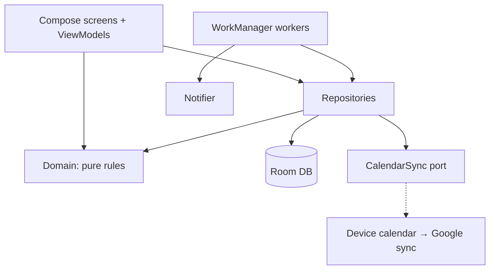

# Project Context

## Overview

A native Android app for a **single** private tutor to manage students, subjects,
schedule, payments and debts. **Offline-first / local-only — no backend.** Russian UI,
Material 3. Currency is **BYN**, displayed with the sign **Br** (e.g. `1500 Br`).

See `PLANNING.md` for the product goal and the 7 success criteria.

---

## Architecture

MVVM with a **pure, unit-tested domain layer**. Room is the single source of truth;
notifications and calendar are best-effort *mirrors* of it, never the other way round.
Dependency injection is Hilt.



### Layers / modules (single `app` module)

| Package | Responsibility |
|---|---|
| `domain/` | Pure Kotlin, no Android deps. `Billing` (incl. the multi-student `balancesFor` aggregate), `ClassRules`, `Recurrence`, `Reminders`, `Reports`, `CalendarSyncPolicy`, the `ReminderScheduler` **port**, and `model/Models.kt`. All JVM-unit-tested. |
| `data/local/` | Room: `@Entity` rows, DAOs, `AppDatabase`. Entities are also `@Serializable` (used by backup). |
| `data/repository/` | Repositories mapping entities ⇄ domain models. `ClassRepository` owns *all* side effects of a class change (calendar mirroring + reminder refresh via the port). |
| `data/backup/` | `BackupData` (whole-DB snapshot) + `BackupManager` (JSON export / transactional replace-all import). |
| `calendar/` | `CalendarSync` **port** + `DeviceCalendarSync` adapter (CalendarContract); `CalendarEvent` owns event display shape. |
| `notifications/` | `Notifier` — reminder channel + posting. |
| `work/` | `MaintenanceWorker` (periodic), `ReminderWorker` (one-shot), `WorkScheduler` (implements `ReminderScheduler`). |
| `format/` | Shared `ru`-locale date/time/money formatting, used by UI **and** non-UI (notifications, view models). |
| `ui/` | Compose screens + `@HiltViewModel`s, `navigation/`, shared `common/` widgets. |
| `di/` | Hilt modules (`DatabaseModule`; `CalendarModule` and `WorkModule` bind the ports). |

---

## Key design decisions

- **Money is an integer count of minor units (kopecks)** — no floating point. `Money` value class.
- **Price versioning by snapshot.** A class captures its charge from the then-current price
  *at completion* (`ClassRules.applyStatus`). Editing a price never touches completed classes.
- **Status state machine** (`ClassRules`): `scheduled → completed | cancelled`, reversible for
  corrections (`completed → cancelled | scheduled`, `cancelled → scheduled`). A scheduled class
  **auto-completes once its end time passes** (the app knows only the clock; Option A). A class
  that didn't happen is `cancelled`, which voids the charge — there is no separate "missed"
  status. `ClassRules.availableTransitions` is the single source of truth for the actions menu, so
  it never offers the status a class is already in.
- **A class's subject must have a price for the student** (`Scheduling.assignableSubjects`): the
  booking screen only offers subjects priced for the chosen student, since a completed class
  snapshots its price — an unpriced subject could never be billed, so the price is added first.
- **Class mode** (`ClassMode`: in person / remote — «Очно»/«Удалённо»): each student carries a
  `defaultMode`; a new class inherits it and can be overridden per occurrence. Mirrored into the
  calendar event's location. Students also carry a free-text `phone`.
- **Offline-first.** Room is authoritative. Calendar and notifications are best-effort: if the
  permission/calendar is absent they no-op, never blocking or corrupting local data.
- **Calendar sync via `CalendarContract`, not the Google Calendar REST API** *(deviation from
  PLANNING's Stack line)*. Writing events to the device's calendar makes the OS sync them to the
  user's Google account — so there is **no Google Cloud project, OAuth consent screen, or privacy
  policy** to set up, which fits the "no backend" goal. It sits behind the `CalendarSync` port, so
  a REST adapter can be added later without touching the rest of the app. Opt-in via the More tab
  grants **both** `READ_CALENDAR` (the provider query that finds the writable calendar needs read)
  and `WRITE_CALENDAR`; enabling it backfills events for the existing classes.
- **WorkManager** for time-driven behavior: precise one-shot `ReminderWorker`s for upcoming
  classes, plus a periodic `MaintenanceWorker` that auto-completes due classes and re-derives
  reminders (the safety net for changes made while the app was closed). The *decisions*
  (`Reminders.plan`) are pure and tested; WorkManager is just the trigger.
- **Backup = full DB snapshot → JSON via SAF.** Entities are `@Serializable`; ids are preserved so
  import into an empty DB reproduces identical data. Import is one transaction (no partial restore).
- **`java.time` everywhere + core-library desugaring** so it works on `minSdk 24` (java.time is API 26+).

---

## Data flow

ViewModels observe repository `Flow`s (Room → domain models) and expose `StateFlow` UI state.
Writes go ViewModel → repository → Room; the repository then mirrors the change to the calendar
and asks the `ReminderScheduler` port (implemented by `WorkScheduler`) to refresh reminders — so
ViewModels express intent only and can't forget a side effect. Balance/income are derived on the
fly by `Billing` / `Reports` from the observed data — never stored.

---

## Non-goals (v1)

Multi-user/login, cloud sync across devices, web/iOS, in-app payments.

---

## Testing & success criteria

- **JVM unit tests** (`src/test`, run with `testDebugUnitTest`) cover the domain layer and the
  backup serialization format: criteria 1–4 (domain), 5 (move), 6 (format), 7 (reminder planning).
- **Instrumented tests** (`src/androidTest`, need a device/emulator) cover the Room integration:
  `AutoCompleteTest` (criterion 1 end-to-end), `ClassCalendarSyncTest` (criterion 5: move updates
  the synced event), `BackupRoundTripTest` (criterion 6: export→import on an empty DB).
- Notification *display* and real calendar writes can only be observed on a device.

---

## Tooling & build

- Kotlin 2.1.0, AGP 8.7.3, Gradle 8.9, JDK 21 (Android Studio JBR). compile/target SDK 35, minSdk 24.
- Hilt 2.55 (older Hilt can't read Kotlin 2.1 metadata), Room 2.6.1, WorkManager, Navigation Compose,
  kotlinx-serialization — all via `gradle/libs.versions.toml`.
- Build needs `JAVA_HOME` set to a JDK 21 (e.g. `C:\Program Files\Android\Android Studio\jbr`) and
  `local.properties` pointing at the Android SDK.
- Common commands: `./gradlew :app:testDebugUnitTest`, `:app:assembleDebug`, `:app:assembleDebugAndroidTest`.
```
app/src/main/java/com/seblful/tutoringapp/
├── domain/            # pure rules + ports + model/Models.kt
├── data/{local,repository,backup}/
├── calendar/  notifications/  work/  format/  di/
├── ui/{schedule,students,subjects,reports,backup,more,common,navigation,theme}/
├── MainActivity.kt    # @AndroidEntryPoint → AppRoot()
└── TutoringApp.kt      # @HiltAndroidApp, WorkManager config, startup scheduling
```
