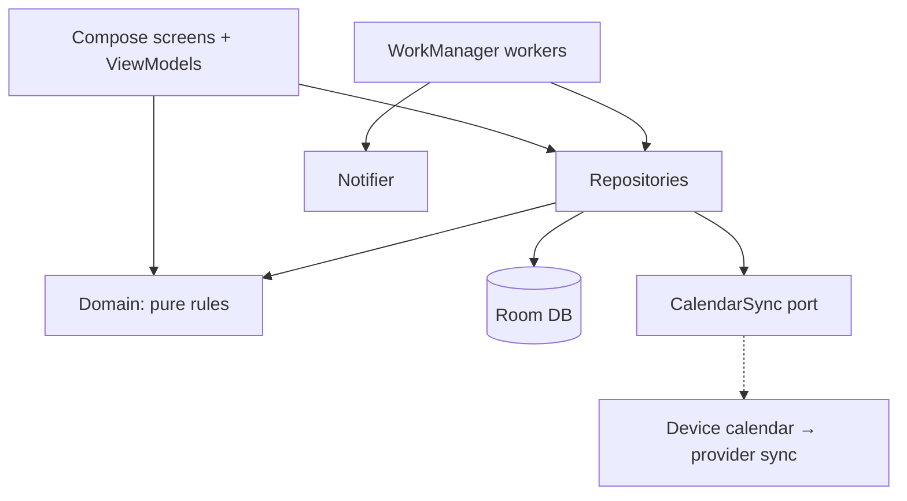

# Architecture

Room is the source of truth. Calendar events and notifications are best-effort mirrors, never inputs.
MVVM lives in `:app`; pure rules live in `:domain` (`commonMain`). The compiler rejects Android/JDK
APIs in the domain. Dates use kotlinx-datetime; instants/durations use `kotlin.time`. Device time
crosses through `WallClock`; locales cross as BCP 47 tags and currency codes.

## Where code goes

Paths below are inside `com.seblful.klas`; follow the linked sources for individual types.

| Location | Responsibility |
|---|---|
| [Domain](../domain/src/commonMain/kotlin/com/seblful/klas/domain/) | Models and pure lesson, scheduling, billing, report, homework, people and reminder rules. |
| [Data](../app/src/main/java/com/seblful/klas/data/) | Room entities/DAOs, mappers, repositories and backup format. `SnapshotDao` alone exposes whole-table operations. |
| [Calendar](../app/src/main/java/com/seblful/klas/calendar/) / [notifications](../app/src/main/java/com/seblful/klas/notifications/) | Device ports, Android adapters, permission prompts, tray actions and navigation. |
| [Work](../app/src/main/java/com/seblful/klas/work/) | Maintenance, digests, boot/clock-change rescheduling and worker creation. |
| [Storage](../app/src/main/java/com/seblful/klas/storage/) / [diagnostics](../app/src/main/java/com/seblful/klas/diagnostics/) | Document storage/sharing ports and a capped local crash log. |
| [Format](../app/src/main/java/com/seblful/klas/format/) | Locale, money/date/time formatting and device preferences; `java.time` stays here. |
| [UI](../app/src/main/java/com/seblful/klas/ui/) | Screens and view models by feature; shared atoms/state in `common/`, routes in `navigation/`, booking in `schedule/booking/`. Feature-only parts stay with their feature. |
| [DI](../app/src/main/java/com/seblful/klas/di/) | Metro graph and platform bindings. `KlasApp` owns the graph/upkeep; `MainActivity` hosts `AppRoot`. |

## Who owns writes

| Repository | Contract |
|---|---|
| `ClassRepository` | Whole-lesson writes (`ClassSession`), overlap refusal, calendar/reminder effects. `bookSeries` reports taken slots instead of refusing the run. |
| `CalendarMirror` | Event content, sync backfill/withdrawal and restore reconciliation. |
| `EnrollmentRepository` / `RateHistoryRepository` | Subjects and prices stay paired; rate changes share one log. |
| `GroupRepository` | Only writer of group membership. |
| `HomeworkRepository` | Only writer of homework; no mirror/refresh phase because reminders read homework when firing. |
| `PaymentRepository` | Payment dates, corrections and derived instants. |
| `SettingsRepository` | Serialized `update {}` returns required side effects; owns default currency/display locale. |
| `StudentRepository` / `SubjectRepository` | Archiving cancels a student's planned lessons; subject deletion requires no references. |

A write spanning tables is one `Transactor.transaction`, including conflict reads guarding the write.
Order: pure rules → transactional rows → calendar/reminders after commit.

View models observe repository `Flow`s and expose read-only `StateFlow`. Reads use `viewModelScope`;
writes use injected `@ApplicationScope` through `write`/`writeAwaited`, so saves outlive screens.
`derive` moves state computation off the main thread. Guarded failures become UI events; unguarded
failures reach the application handler and crash log. Use `runCatchingCancellable`, which preserves
coroutine cancellation. See [UI conventions](ui-conventions.md) for screen plumbing.

## Dependency injection

Metro checks bindings at compile time. Before upgrading Kotlin, check Metro's compiler compatibility
in [the version catalog](../gradle/libs.versions.toml).

- [AppGraph.kt](../app/src/main/java/com/seblful/klas/di/AppGraph.kt) defines `KlasGraph` and `AppScope`.
  Bind adapters with `@ContributesBinding`/`@SingleIn`; providers use `@ContributesTo`/`@BindingContainer`.
  The graph factory receives `@ApplicationContext Context`.
- Android-created objects use `context.appGraph`: receivers inject first in `onReceive`, workers use
  `AppWorkerFactory` with nested `@AssistedFactory`/`@WorkerKey`, and the activity provides the view-model
  factory. metrox's `AppComponentFactory` needs API 28; minSdk is 24.
- View models contribute via `@ViewModelKey` and `@ContributesIntoMap` and use `metroViewModel()`.
  Navigation arguments require assisted `SavedStateHandle`, a nested factory and `assistedMetroViewModel()`.
- Test graphs replace bindings with `excludes` (`StoreGraph`). `KlasGraphTest` checks runtime discovery
  of view models, workers and manifest receivers.
