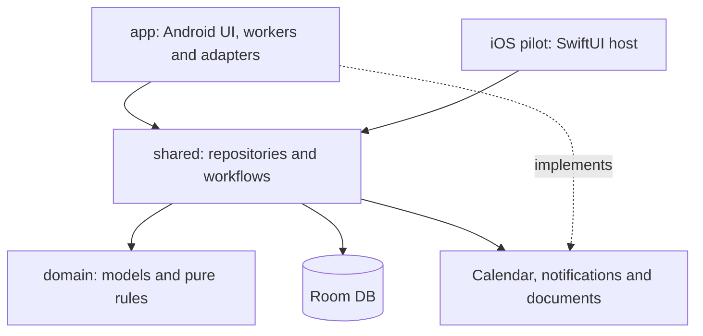

# Architecture

Room is the source of truth. Calendar events and notifications are best-effort mirrors, never inputs.
MVVM and Android integrations live in `:app`. Shared persistence and workflows live in `:shared`;
pure rules live in `:domain`. Both libraries use Kotlin Multiplatform with iOS targets. `:baselineprofile`
drives the app to collect its baseline profile and ships nothing. Shared common
sources reject Android/JDK APIs. Dates use kotlinx-datetime; instants/durations use `kotlin.time`.
Device preferences cross as BCP 47 tags and ISO currency codes.

## Where code goes

Paths below are inside `com.seblful.klas`; follow the linked sources for individual types.

| Location | Responsibility |
|---|---|
| [Domain](../domain/src/commonMain/kotlin/com/seblful/klas/domain/) | Models and pure lesson, scheduling, billing, report, homework, people and reminder rules. |
| [Shared data](../shared/src/commonMain/kotlin/com/seblful/klas/data/) | Room types and repositories grouped by people, lessons, billing, homework and settings. Backup format lives in `backup/`; `local/` owns the database, migrations and transactional snapshots. |
| [Shared settings](../shared/src/commonMain/kotlin/com/seblful/klas/settings/) / [maintenance](../shared/src/commonMain/kotlin/com/seblful/klas/maintenance/) | Settings side effects and upkeep, independent of screens and background scheduling. |
| [Shared queries](../shared/src/commonMain/kotlin/com/seblful/klas/queries/) | Student details and reports join repository flows into portable results; homework rows and date changes are shared too. Hosts own loading state, collection lifetime, events and navigation. |
| [Shared calendar](../shared/src/commonMain/kotlin/com/seblful/klas/calendar/) / [notifications](../shared/src/commonMain/kotlin/com/seblful/klas/notifications/) / [storage](../shared/src/commonMain/kotlin/com/seblful/klas/storage/) | Calendar mirroring, reminder/digest posting decisions and device interfaces. |
| [Android calendar](../app/src/main/java/com/seblful/klas/calendar/) / [notifications](../app/src/main/java/com/seblful/klas/notifications/) / [work](../app/src/main/java/com/seblful/klas/work/) | Device adapters, permission prompts, tray navigation, receivers and WorkManager scheduling. |
| [Android widgets](../app/src/main/java/com/seblful/klas/widget/) | Glance home-screen widgets: today's lessons and shortcuts. Both open the app through `TrayNavigation`; the check marks a lesson taught through `ReminderActions`. They speak the stored language (`DisplayLocale.observe`), not the last one read. `WidgetUpdates` redraws them while the process lives — on lesson or language changes, and on a clock change via `ClockChangeReceiver` — and Today at midnight through a non-waking alarm. `WidgetPreviews` publishes the Android 15+ picker previews once per install and language. |
| [Android storage](../app/src/main/java/com/seblful/klas/storage/) / [diagnostics](../app/src/main/java/com/seblful/klas/diagnostics/) | Document picker/sharing adapters and a capped local crash log. |
| [Shared format](../shared/src/commonMain/kotlin/com/seblful/klas/format/) / [Android format](../app/src/main/java/com/seblful/klas/format/) | Portable exact amount parsing and observable-clock interface; Android owns localized display and device preferences. |
| [UI](../app/src/main/java/com/seblful/klas/ui/) | Screens and view models by feature; generic design-system parts (no domain types) in `designsystem/`, shared atoms/state in `common/`, routes in `navigation/`, the start tab in `today/`, booking in `schedule/booking/`, settings index/categories and permission UI in `settings/`. Feature-only parts stay with their feature. |
| [DI](../app/src/main/java/com/seblful/klas/di/) | Metro graph and platform bindings. `KlasApp` owns the graph/upkeep; `MainActivity` hosts `AppRoot`. |

## Who owns writes

| Repository | Contract |
|---|---|
| `ClassRepository` | Whole-lesson writes (`ClassSession`), overlap refusal, calendar/reminder effects. `bookSeries` reports taken slots instead of refusing the run. |
| `CalendarMirror` | Event content, sync backfill/withdrawal and restore reconciliation. |
| `EnrollmentRepository` / `RateHistoryRepository` | Subjects and prices stay paired; rate changes share one log. |
| `GroupRepository` | Only writer of group membership; archiving cancels the group's planned lessons. |
| `HomeworkRepository` | Only writer of homework; refreshes affected calendar descriptions after saving. Phone reminders read homework when firing. |
| `PaymentRepository` | Payment dates, corrections and derived instants. |
| `SettingsRepository` | Serialized `update {}` returns required side effects and publishes portable language state. Device currency defaults arrive through `DevicePreferences`. |
| `SettingsWorkflow` | Applies a settings update, calendar changes and maintenance; returns the number of lessons settled. Permission prompts and confirmation remain with the host UI. |
| `StudentRepository` / `SubjectRepository` | Archiving cancels a student's planned lessons; subject deletion requires no references. |

A write spanning tables is one `Transactor.transaction`, including conflict reads guarding the write.
Order: pure rules → transactional rows → calendar/reminders after commit.

`buildDatabase` owns the bundled driver and migration chain. Platform source sets supply database
builders; only the Android debug host opts into destructive migration. Keep exported schemas under
`shared/schemas/` and preserve the existing database name and backup keys when moving code.

Hosts open a `KlasDatabase` and consume the [KlasStore](../shared/src/commonMain/kotlin/com/seblful/klas/KlasStore.kt)
interface. `PersistenceBindings` supplies DAOs and transactions within the shared module; the Android
database module supplies only the database lifetime. Room is an implementation dependency of `:shared`.
Low-level Room types remain accessible for migration and schema tests; hosts do not need to wire them.
Close collectors and finish store work before closing `KlasDatabase`.

Android `RootViewModel` publishes the foreground `AppLocale` before its settings reach screens.
Background calendar and notification adapters resolve `DisplayLocale` directly from shared language
state, so formatting does not depend on a screen collecting settings. `ObservableWallClock` supplies
zone-change events; fixed clocks emit their chosen zone once.

View models observe repository `Flow`s and expose read-only `StateFlow`. Reads use `viewModelScope`;
writes use injected `@ApplicationScope` through `write`/`writeAwaited`, so saves outlive screens.
`derive` moves state computation off the main thread. Guarded failures become UI events; unguarded
failures reach the application handler and crash log. Use `runCatchingCancellable`, which preserves
coroutine cancellation. See [UI conventions](ui-conventions.md) for screen plumbing.

## Dependency injection

Metro checks bindings at compile time. Before upgrading Kotlin, check Metro's compiler compatibility
in [the version catalog](../gradle/libs.versions.toml).

- [AppGraph.kt](../app/src/main/java/com/seblful/klas/di/AppGraph.kt) defines `KlasGraph` in Metro's `AppScope`.
  Bind adapters with `@ContributesBinding`/`@SingleIn`; providers use `@ContributesTo`/`@BindingContainer`.
  The graph factory receives `@ApplicationContext Context`.
- `KlasGraph` also exposes `KlasStore`. Other hosts call `createKlasStore(database, host)` with
  `HostServices`; the shared Metro graph constructs the same repositories, queries and workflows.
- Android-created objects use `context.appGraph`: receivers and widget action callbacks inject first, workers use
  `AppWorkerFactory` with nested `@AssistedFactory`/`@WorkerKey`, and the activity provides the view-model
  factory. metrox's `AppComponentFactory` needs API 28; minSdk is 24.
- View models contribute via `@ViewModelKey` and `@ContributesIntoMap` and use `metroViewModel()`.
  Navigation arguments require assisted `SavedStateHandle`, a nested factory and `routeViewModel(route)`, which
  hands the route's properties to the handle under their names (Navigation 3 does not).
- Test graphs replace bindings with `excludes` (`StoreGraph`). `KlasGraphTest` checks runtime discovery
  of view models, workers and manifest receivers.

To add another host, open its database and provide `HostServices`. Keep shared constructors independent
of Android graph types. The [iOS pilot](ios.md) supplies local-only adapters and a callback interface
for SwiftUI, while reusing production repository wiring. Shared UI is a separate choice.
