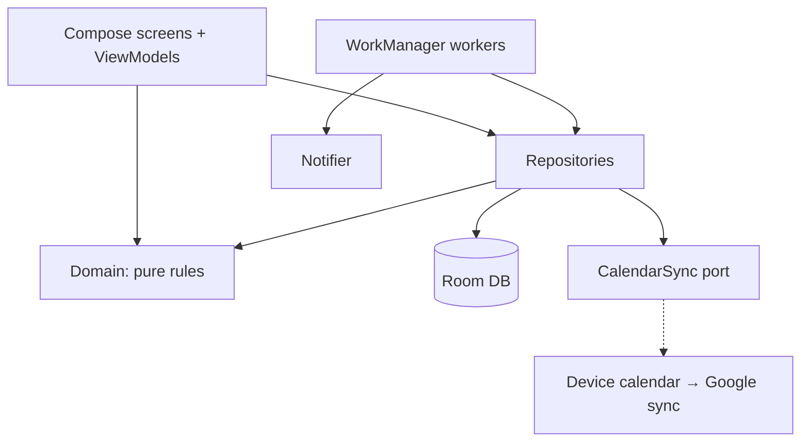

# Architecture

Where code goes in Klas, and which class owns each rule. The reasoning behind a rule lives in KDoc next
to the code.

MVVM, pure unit-tested domain layer. Room is the single source of truth; calendar and notifications are
best-effort mirrors of it, never the reverse. DI: Hilt.

Two Gradle modules, one package (`com.seblful.klas`): `:domain` holds `domain/` as plain Kotlin/JVM,
and `:app` (Android) holds everything else and depends on it. The split exists so that "no Android in
the domain" is a compile error, not a convention — `:domain` has no `android.jar` and no libraries,
only the JDK and the Kotlin standard library.

## Packages

| Package | Responsibility |
|---|---|
| `domain/` (`:domain` module) | Pure Kotlin, no Android deps (compiler-enforced), all JVM-tested, one subpackage per concept (below). |
| `domain/model/` | The types every rule shares: `TutoringClass`, `ClassSession` (one lesson's classes), `Student`, `Group`, `Money`, `Balance`, `Currency`, `AppLanguage`, `ThemeChoice`. |
| `domain/lesson/` | What a lesson is and how it changes: `ClassRules`, `SessionRules` (every lesson: sessions, edits, transitions), `GroupRules` (a group's roster), `LessonEdits`, `LessonPhase`, `LessonKind`, `DeleteWarning`, `CalendarSyncPolicy`. |
| `domain/schedule/` | Time: `Scheduling` (slots, the one-tutor refusal, bookable subjects), `Recurrence`, `DayBounds`, `CalendarLayout`, `DaySummary`, `TimeConflict`, `ScheduleEmpty`. |
| `domain/billing/` | `Billing` (what counts as income, balances, a row's amount), `PaymentDate`. |
| `domain/reports/` | `Reports`, `ReportPeriod`, `ReportCsv`, `Taught`. |
| `domain/reminders/` | `Reminders`, `ReminderScheduler` port, `Digests`, `DigestScheduler` port. |
| `domain/homework/` | `HomeworkRules`. |
| `domain/people/` | Names and finding people: `PeopleSearch`, `NameOrder`, `Captions`, `SubjectNames`, `Phone`, `AvatarPalette`. |
| `data/local/` | Room entities, DAOs, `AppDatabase`, `Migrations`, `EnumConverters`, `Transactor` port. `SnapshotDao` is the separate whole-table seam. |
| `data/Mappers.kt` | Entities ⇄ domain models. |
| `data/repository/` | One invariant each, end to end, one transaction (see [Who owns each rule](#who-owns-each-rule)). |
| `data/backup/` | File format: export, transactional replace-all import, integrity/failure classification, restore. |
| `calendar/` | `CalendarSync`/`CalendarPermission` ports, `CalendarContract` adapter, calendar/guest choice rules, and the permission prompt (`rememberCalendarPermissionRequest`). |
| `notifications/` | `Notifier` + permission ports/adapters, the permission prompt (`rememberNotificationPermissionRequest`), reminder/digest content, tray actions/navigation, alarm scheduling. |
| `work/` | Periodic maintenance worker, three digest workers, `WorkScheduler`, `BootReceiver`, `ClockChangeReceiver`, `Maintenance`. |
| `diagnostics/` | `CrashLogger` over a capped local log file, and `Diagnostics` (what a crash entry says); viewed/exported from `ui/diagnostics`. No Crashlytics/Sentry — Play Vitals still receives the crash. |
| `storage/` | `DocumentStore` (SAF) and `DocumentSharing` (`ACTION_SEND`) ports. |
| `format/` | Date/time/money formatting, `AppLocale`, `MoneyField`, the lesson-mode word (`ClassMode.labelRes`, read by screens and the calendar alike), and what the device says: `Localization.kt` (`Context.inLanguage()`, `deviceLocales()`), `WeekStart.kt` (the phone's first day of the week). |
| `ui/` | Compose screens + `@HiltViewModel`s, one package per feature, `onboarding/`, `RootViewModel`, `AppRoot` (theme, locale, the tabs' chrome). The «Задания» tab and the homework parts the student and group cards share in `ui/homework/`. Settings/About in `ui/more/`. Theme in `ui/theme/`. |
| `ui/navigation/` | `Routes`, the graph (`KlasNavGraph.kt`: `klasGraph`, `navigateToTab`), the tabs, what a tray tap opens (`TrayArrivals.kt`), `Arrival`. |
| `ui/common/` | Shared atoms (`KlasScreen`, `detailCard`, fields, dialogs, badges…) and, in `state/`, the view models' plumbing with no Compose in it: `Loadable`, `derive`/`hold`, `Clock.days()`/`minutes()`, `UiEvents`, `write`/`writeAwaited`. A part only one feature uses lives in that feature. |
| `ui/schedule/` | The schedule screen (split into the screen, `LessonCard`, `ScheduleHeaders`, `ClassActionsSheet`, `CalendarViews`) and its view model and models, with `SchedulePages` (the selected day and visible pages, pure); the booking form in `booking/` (`ClassForm`, `ClassFormState`, `BookingForm`, the edit screen and view model). |
| `preview/` (debug only) | `@Preview`s of `ui/common/`. |
| `di/` | DB module, scopes/dispatchers, `Clock`, week-start, device locales. |
| root | `KlasApp` (`@HiltAndroidApp`, WorkManager config, notification channels, the periodic upkeep pass; the catch-up as the UI opens is `RootViewModel.catchUp`), `MainActivity` → `AppRoot()`, `Coroutines.kt` (`runCatchingCancellable`, and `launchAsync` for every broadcast receiver). |

## Who owns each rule

- `ClassRepository` — side effects of a class change (calendar mirror, reminder refresh) and the
  one-tutor-one-lesson refusal. Every write takes a whole lesson (`ClassSession`). `bookSeries` reports
  instead of refusing.
- `CalendarMirror` — what a mirrored event shows; owns sync on/off backfill and withdrawal.
- `EnrollmentRepository` — the subject⇄price invariant.
- `GroupRepository` — the only writer of group membership.
- `HomeworkRepository` — the only writer of `homework`; its writes owe no phase 3 (no calendar, and a
  reminder reads what is attached as it fires).
- `PaymentRepository` — a payment's date and correcting one in place; the instant is derived here.
- `RateHistoryRepository` — what a rate change is (two repositories set rates).
- `SettingsRepository` — one serialized `update {}`, returning what the change owes the rest of the app.
  Also owns the default currency and the display locale.
- `StudentRepository` — archiving calls off a retired student's planned lessons first.
- `SubjectRepository` — deletable only while unreferenced.

**A write spanning tables is one transaction**, including any conflict reads that guard its writes;
otherwise two saves can both reserve an apparently free hour. The phases are pure rules → rows inside
`Transactor.transaction` → calendar/reminders after commit.

## Data flow

ViewModels observe repository `Flow`s, expose `StateFlow`. Writes: ViewModel → repository → Room →
(repository) mirrors calendar + refreshes reminders.

Reads live in `viewModelScope`; writes go to the injected `@ApplicationScope` so a save outlives its
screen, through `write`/`writeAwaited` (`ui/common/state/Writes.kt`). Deriving state happens off the main thread
(`combine(...).derive(scope, computation, initial)`). A failed write is never fatal: a guarded one is
reported to the screen as an event, and an unguarded one reaches the application scope's handler, which
records it to the crash log. ViewModel
state is read-only (`StateFlow`, never mutable). Guarded suspend calls use `runCatchingCancellable`
(never plain `runCatching`, which swallows cancellation).
