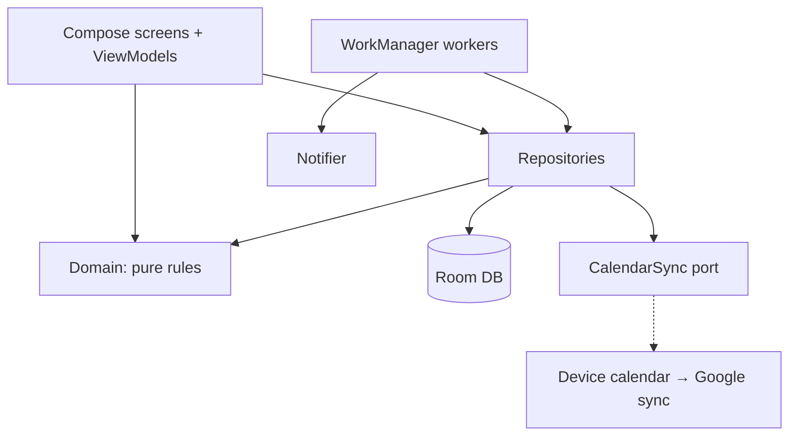

# Architecture

Where code goes in Klas, and which class owns each rule. The reasoning behind a rule lives in KDoc next
to the code.

MVVM, pure unit-tested domain layer. Room is the single source of truth; calendar and notifications are
best-effort mirrors of it, never the reverse. DI: Hilt. Single `app` module.

## Packages

| Package | Responsibility |
|---|---|
| `domain/` | Pure Kotlin, no Android deps: billing, class/group rules, scheduling, recurrence, calendar policy, reminders, `LessonPhase`, `HomeworkRules`, `Digests`, reports, search, formatting-adjacent models (`Balance`, `Currency`, `AppLanguage`). All JVM-tested. |
| `data/local/` | Room entities, DAOs, `AppDatabase`, `Migrations`, `Transactor` port. `SnapshotDao` is the separate whole-table seam. |
| `data/Mappers.kt` | Entities ⇄ domain models. |
| `data/repository/` | One invariant each, end to end, one transaction (see [Who owns each rule](#who-owns-each-rule)). |
| `data/backup/` | File format: export, transactional replace-all import, integrity/failure classification, restore. |
| `calendar/` | `CalendarSync`/`CalendarPermission` ports, `CalendarContract` adapter, calendar/guest choice rules. |
| `notifications/` | `Notifier` + permission ports/adapters, reminder/digest content, tray actions/navigation, alarm scheduling. |
| `work/` | Periodic maintenance worker, three digest workers, `WorkScheduler`, `BootReceiver`, `Maintenance`. |
| `diagnostics/` | `CrashLogger` over a capped local log file; viewed/exported from `ui/diagnostics`. No Crashlytics/Sentry — Play Vitals still receives the crash. |
| `storage/` | `DocumentStore` (SAF) and `DocumentSharing` (`ACTION_SEND`) ports. |
| `format/` | Date/time/money formatting, `AppLocale`, `MoneyField`, `NameOrder`. |
| `ui/` | Compose screens + `@HiltViewModel`s, `navigation/`, shared `common/` atoms, `onboarding/`, `RootViewModel`. The «Задания» tab and the homework parts the student and group cards share in `ui/homework/`. Settings/About in `ui/more/`. Theme in `ui/theme/`. |
| `preview/` (debug only) | `@Preview`s of `ui/common/`. |
| `di/` | DB module, scopes/dispatchers, `Clock`, week-start, device locales. |
| root | `KlasApp` (`@HiltAndroidApp`, WorkManager config, in-process startup upkeep), `MainActivity` → `AppRoot()`, `Coroutines.kt` (`runCatchingCancellable`), `Localization.kt` (`Context.inLanguage()`, `deviceLocales()`). |

## Who owns each rule

- `ClassRepository` — side effects of a class change (calendar mirror, reminder refresh) and the
  one-tutor-one-lesson refusal. Every write takes a whole lesson (`ClassSession`). `bookSeries` reports
  instead of refusing.
- `CalendarMirror` — what a mirrored event shows; owns sync on/off backfill and withdrawal.
- `EnrollmentRepository` — the subject⇄price invariant.
- `GroupRepository` — the only writer of group membership.
- `HomeworkRepository` — the only writer of `homework`; its writes owe no phase 3 (no calendar, and a
  reminder reads what is attached as it fires).
- `PaymentRepository` — a payment's date and correcting one in place; the instant is derived here.
- `RateHistoryRepository` — what a rate change is (two repositories set rates).
- `SettingsRepository` — one serialized `update {}`, returning what the change owes the rest of the app.
  Also owns the default currency and the display locale.
- `StudentRepository` — archiving calls off a retired student's planned lessons first.
- `SubjectRepository` — deletable only while unreferenced.

**A write spanning tables is one transaction**, in three phases: pure rules → rows inside
`Transactor.transaction` → calendar/reminders after commit.

## Data flow

ViewModels observe repository `Flow`s, expose `StateFlow`. Writes: ViewModel → repository → Room →
(repository) mirrors calendar + refreshes reminders.

Reads live in `viewModelScope`; writes go to the injected `@ApplicationScope` so a save outlives its
screen. Deriving state happens off the main thread (`combine(...).derive(scope, computation, initial)`).
A failed write is reported via the crash log and, where possible, the screen — never fatal. ViewModel
state is read-only (`StateFlow`, never mutable). Guarded suspend calls use `runCatchingCancellable`
(never plain `runCatching`, which swallows cancellation).
