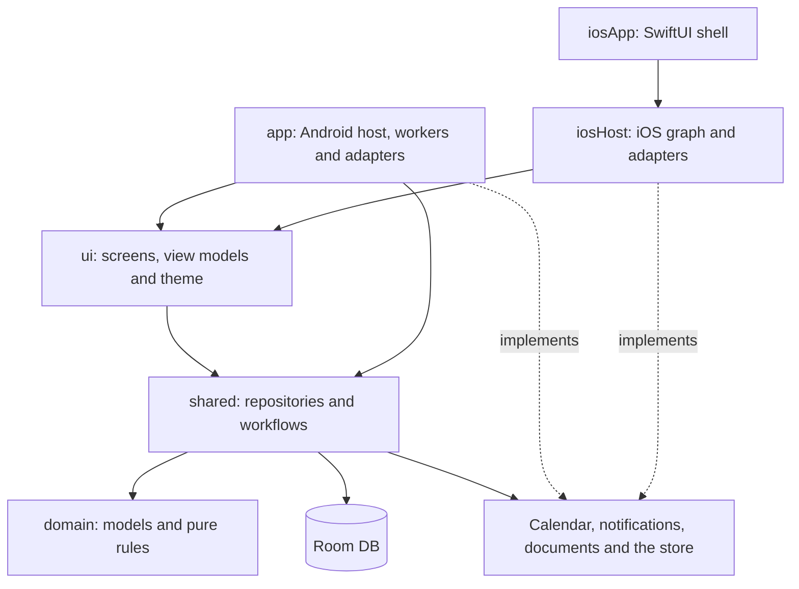

# Architecture

Room is the source of truth. Calendar events and notifications are best-effort mirrors, never inputs.
Screens, view models, theme, text and display formatting live in `:ui` (Compose Multiplatform). `:app` is
the Android host: device adapters, workers, widgets and the Metro graph. `:iosHost` is the iOS host — its
adapters, graph and entry point — linked as the `KlasApp` framework into the SwiftUI shell in `iosApp/`
([iOS app](ios.md)); `:ui`'s `iosMain` keeps only the screens' `*.ios.kt` seams. Shared persistence and workflows live
in `:shared`; pure rules live in `:domain`. The three libraries use Kotlin Multiplatform with iOS targets. `:baselineprofile`
drives the app to collect its baseline profile and ships nothing; `:testing` and `:uiTesting` hold the test
fixtures and ship nothing either ([Testing](testing.md)). Shared common
sources reject Android/JDK APIs. Dates use kotlinx-datetime; instants/durations use `kotlin.time`.
Device preferences cross as BCP 47 tags and ISO currency codes.

## Where code goes

Paths below are inside `com.seblful.klas`; follow the linked sources for individual types.

| Location | Responsibility |
|---|---|
| [Domain](../domain/src/commonMain/kotlin/com/seblful/klas/domain/) | Models and pure lesson, scheduling, billing, report, homework, people and reminder rules. |
| [Shared data](../shared/src/commonMain/kotlin/com/seblful/klas/data/) | Room types and repositories grouped by people, lessons, billing, homework and settings. Backup format lives in `backup/`; `local/` owns the database, migrations and transactional snapshots. |
| [Shared settings](../shared/src/commonMain/kotlin/com/seblful/klas/settings/) / [maintenance](../shared/src/commonMain/kotlin/com/seblful/klas/maintenance/) | Settings side effects and upkeep, independent of screens and background scheduling. Hosts forward events to `Upkeep.on(trigger)`, which decides the pass, the tray report and the weekly copy. |
| [Shared queries](../shared/src/commonMain/kotlin/com/seblful/klas/queries/) | Today's lessons, student/group details and reports join repository flows into portable results. `DebtsQuery` owns who owes what — whole-history balances, the active debtors and their last payment — for Today, the debt digest, the students list and group details. `HomeworkQuery` owns homework visibility, attachment history, date changes and projections for lists, sheets, reminders and the calendar. Hosts own loading state, collection lifetime, events and navigation. |
| [Shared calendar](../shared/src/commonMain/kotlin/com/seblful/klas/calendar/) / [notifications](../shared/src/commonMain/kotlin/com/seblful/klas/notifications/) / [storage](../shared/src/commonMain/kotlin/com/seblful/klas/storage/) | Calendar mirroring, reminder/digest posting decisions and device interfaces. |
| [Android calendar](../app/src/main/java/com/seblful/klas/calendar/) / [notifications](../app/src/main/java/com/seblful/klas/notifications/) / [work](../app/src/main/java/com/seblful/klas/work/) | Device adapters, receivers and WorkManager scheduling. The permission prompts and tray navigation the screens use are in `:ui` ([calendar](../ui/src/commonMain/kotlin/com/seblful/klas/calendar/), [notifications](../ui/src/commonMain/kotlin/com/seblful/klas/notifications/)). |
| [Android widgets](../app/src/main/java/com/seblful/klas/widget/) | Glance home-screen widgets: today's lessons and shortcuts. Today and its widget read the same shared lesson query, and the rows (`TodayRows.kt`) and buttons (`Shortcuts`) are `:ui`'s, shared with iOS's widgets. Both open the app by `klas://` link (`TrayNavigation.linkFor`); the check marks a lesson taught through `ReminderActions`. They speak the stored language (`DisplayLocale.observe`), not the last one read. `WidgetUpdates` redraws them while the process lives — on lesson or language changes, and on a clock change via `ClockChangeReceiver` — and Today at its next lesson's start or end (when «On now» moves; `TodayLessons.nextChange`), else at midnight, through a non-waking alarm. Its rows give start–end like the Day view, its tick is read as «Mark Olivia Brooks, 15:00 taught», and its spacing is the app's `Spacing`; only the type stays Glance's (sp, system font). `WidgetPreviews` publishes the Android 15+ picker previews once per install and language. |
| [Android storage](../app/src/main/java/com/seblful/klas/storage/) / [diagnostics](../app/src/main/java/com/seblful/klas/diagnostics/) | SAF document store, sharing and backup-folder adapters and the file-backed crash log; the screens' side (`FolderGrants`, `SharedDocuments`, `CrashLogStore`) is in `:ui`. |
| [Print](../ui/src/commonMain/kotlin/com/seblful/klas/print/) | `Sheet` (title, sections of label–amount rows, paginated purely) and the `SheetPrinter` port in `:ui`; Android's [`PdfSheetPrinter`](../app/src/main/java/com/seblful/klas/print/PdfSheetPrinter.kt) draws it over `PdfDocument`, iOS's [`IosSheetPrinter`](../iosHost/src/iosMain/kotlin/com/seblful/klas/print/IosSheetPrinter.kt) over UIKit's PDF renderer. The report summary and the statement print through it. Only a device can write the PDF, so its test is in `androidTest`. |
| [Shared format](../shared/src/commonMain/kotlin/com/seblful/klas/format/) / [display format](../ui/src/commonMain/kotlin/com/seblful/klas/format/) / [device preferences](../app/src/main/java/com/seblful/klas/format/) | Portable exact amount parsing and observable-clock interface; `:ui` owns localized display, the host reads the device clock, language and week start. |
| [UI](../ui/src/commonMain/kotlin/com/seblful/klas/ui/) | Screens and view models by feature; generic design-system parts (no domain types) in `designsystem/`, shared atoms/state in `common/`, routes in `navigation/`, the start tab in `today/`, booking in `schedule/booking/`, settings index/categories and permission UI in `settings/`. Feature-only parts stay with their feature. |
| [DI](../app/src/main/java/com/seblful/klas/di/) | Metro graph and platform bindings; the qualifiers the screens inject are in [`:ui`](../ui/src/commonMain/kotlin/com/seblful/klas/di/Qualifiers.kt). `KlasApp` owns the graph/upkeep; `MainActivity` hosts `AppRoot`. |

## Who owns writes

| Repository | Contract |
|---|---|
| `ClassRepository` | Whole-lesson writes (`ClassSession`), overlap refusal, calendar/reminder effects. `bookSeries` reports taken slots instead of refusing the run. |
| `LessonChanges` | Undoable lesson, completion and archive writes; owns calendar settlement in the host application's scope. Every change, completion included, is one opaque `LessonChange` that the writer's `undo`/`undoAll` take back as an `UndoResult`. Completion (`complete`, or a writer's `setStatus` to completed) is judged inside its transaction and mirrors at once, so it needs no scope; `correctCompletion` is the explicit correction. The only way the app archives a student or group: their repositories keep just `restore`. `ClassRepository.setStatus`, `move` and `setAttendance`, and its own `archiveWithoutUndo`, write with no undo window and need `@WritesWithoutUndo`, which only test source sets opt into. |
| `CalendarMirror` | Event content, sync backfill/withdrawal and restore reconciliation. |
| `EnrollmentRepository` / `RateHistoryRepository` | Subjects and prices stay paired; rate changes share one log. The student form's edit saves the student and their subjects in one transaction. |
| `GroupRepository` | Only writer of group membership; archiving cancels the group's planned lessons. |
| `HomeworkRepository` | Only writer of homework; refreshes affected calendar descriptions after saving. Phone reminders read homework when firing. |
| `PaymentRepository` | Payment dates, corrections and derived instants. |
| `SettingsRepository` | Reads the settings row and publishes portable language state. Its serialized `update {}` returns what the change owes (`SettingsChange`) without doing it, so it needs `@WritesWithoutEffects`: tests, fixtures and `BackupRestore` (which re-mirrors after the import) opt in. Device currency defaults arrive through `DevicePreferences`. |
| `GuideRepository` | The new tutor's guide: tips seen and the first-steps card in the settings row, and whether each first step has happened (`GuideDao`). |
| `ProAccess` | Whether the tutor has Klas Pro (`Access`, `ProGate`): caches the store's answer in `proOwned`, buys through `ProStore`, and on losing Pro switches calendar sync and digests off through `SettingsWorkflow`. Android's store is `PlayProStore` (Play Billing, Play's sheet opened on `ResumedActivity`); iOS's `IosProStore` sells nothing yet. Screens ask `LocalPro` (`ProDoor`), which `AppRoot` provides; `ProGated` stands the Klas Pro screen in for a form a free tutor has no room for. See [Klas Pro](domain-rules.md#klas-pro). |
| `SettingsWorkflow` | The settings writer: stores an update and finishes what it owes (calendar, alarms, digests, channels, the auto-completion sweep) before returning the number of lessons settled. Permission prompts and confirmation remain with the host UI. |
| `BackupExports` | Manual and weekly snapshot export, optional sealing and awaited history recording; weekly folder guards and failure flags. Hosts own scope and result messages; `AutoBackup` owns due checks and retention. |
| `StudentRepository` / `SubjectRepository` | Archiving cancels a student's planned lessons and writes the stored row in the same transaction; subject and group deletion recheck their references inside it. |

A write spanning tables is one `Transactor.transaction`, including conflict reads guarding the write.
Order: pure rules → transactional rows → calendar/reminders after commit.

`buildDatabase` owns the bundled driver and migration chain. Platform source sets supply database
builders; only the Android debug host opts into destructive migration. Keep exported schemas under
`shared/schemas/` and preserve the existing database name and backup keys when moving code.

Hosts open a `KlasDatabase` and consume the [KlasStore](../shared/src/commonMain/kotlin/com/seblful/klas/KlasStore.kt)
interface. `PersistenceBindings` supplies DAOs and transactions within the shared module; the Android
database module supplies only the database lifetime. Room is an implementation dependency of `:shared`.
Low-level Room types remain accessible for migration and schema tests; hosts do not need to wire them.
Close collectors and finish store work before closing `KlasDatabase`.

`RootViewModel` publishes the foreground `AppLocale` tag before its settings reach screens.
Formatting is common code over a per-language `LocaleData` (date patterns, month and weekday names,
number separators, currency side) that each platform reads from its own CLDR tables: `java.text` and
`java.time` on Android, Foundation on iOS. Languages cross module boundaries as BCP 47 tags; only Android
adapters turn them into `java.util.Locale`.
Background calendar and notification adapters resolve `DisplayLocale` directly from shared language
state, so formatting does not depend on a screen collecting settings. `ObservableWallClock` supplies
zone-change events; fixed clocks emit their chosen zone once.

Hosts forward their lifecycle to `AppSession` (`foregrounded`, `backgrounded`, `keepApplied`), which owns
the app lock and what settings ask of the host: the switcher's picture and the icon's shortcuts, done through
each platform's `HostEffects`. A new host-level setting goes there, so both platforms must implement it.

View models observe repository `Flow`s and expose read-only `StateFlow`. Reads use `viewModelScope`;
writes use injected `@ApplicationScope` through `write`/`writeAwaited`, so saves outlive screens.
`derive` moves state computation off the main thread. Guarded failures become UI events; unguarded
failures reach the application handler and crash log. Use `runCatchingCancellable`, which preserves
coroutine cancellation. See [UI conventions](ui-conventions.md) for screen plumbing.

## Text

The app's words are one catalog for Android and iOS. Translators edit
[`ui/src/commonMain/strings`](../ui/src/commonMain/strings/) — one Android-format `values…/strings.xml` per
language, `values/` English and the fallback. The `klas.strings` plugin in [`build-logic`](../build-logic/)
compiles them into `Strings`, `Plurals` and `StringArrays` keys plus one table per language, read through
[`Texts`](../ui/src/commonMain/kotlin/com/seblful/klas/text/Texts.kt). It keeps aapt2's escapes and
whitespace rules and refuses format specifiers other than `%1$s`, `%1$d` and `%%`.

Lookup takes the language explicitly rather than the process locale: Settings can choose a language
other than the phone's, and background work (notifications, widgets, calendar events) speaks the stored
one. That is why the catalog is not Compose Multiplatform's string resources, which follow
`Locale.getDefault()`; fonts and images are Compose resources. Plural forms use CLDR rules written out in
`PluralRules`, which `PluralRulesTest` holds to Android's ICU; `%d` takes the language's digits from the
platform's number formatter. Strings that Android reads from XML — the launcher label and the widget
picker's names — stay Android resources in `app/src/main/res/values…/launcher_strings.xml`.

## Platforms

Every screen, view model and the theme are `commonMain` code in `:ui`, so a screen is written once for
Android and iOS. Where a screen needs the platform it calls an `expect` declaration in the common file,
and the platform's answer sits beside it at the same package path as `X.android.kt` and `X.ios.kt`:
pickers (`DocumentPickers`, `ContactPicker`), other apps (`ExternalApp`), system settings pages
(`SettingsPermissions`), permission prompts, notification and link arrivals (`TrayArrivals`), the
platform's language plumbing (`AppLanguage`), theme facts (`Theme`) and the small facts in `PlatformUi`.
An `expect` names what the screen needs, never a platform type. Android-only helpers with no iOS
counterpart (`PermissionPrompts`, `KeyboardShortcuts`, `Localization`) live in `androidMain` only.

Below the screens the same rule holds: each port (`Notifier`, `CalendarSync`, `DocumentStore`, `ProStore`,
`BackupCipher`, `SheetPrinter`…) has an Android adapter in `:app` and an iOS one in `:iosHost`, and
whatever the two would both decide stays in common code — each notification as a `TrayNotice` that both
`TrayNotifier`s only draw, its words in `TrayText`, which lessons a
digest names in `TrayContent`, GCM in `AesGcm`. [iOS](ios.md) lists the pairs and where iOS behaves
differently.

`:iosHost:compileKotlinIosSimulatorArm64` is the purity check: it compiles common code without Android or
the JDK, checks the iOS Metro graph, and runs on Windows. Formatting reads `LocaleData` from each platform (see [Text](#text)), so
`:ui` common tests hold both platforms to the same expectations.

## Dependency injection

Metro checks bindings at compile time. Before upgrading Kotlin, check Metro's compiler compatibility
in [the version catalog](../gradle/libs.versions.toml).

- [AppGraph.kt](../app/src/main/java/com/seblful/klas/di/AppGraph.kt) defines `KlasGraph` in Metro's `AppScope`.
  Bind adapters with `@ContributesBinding`/`@SingleIn`; providers use `@ContributesTo`/`@BindingContainer`.
  The graph factory receives `@ApplicationContext Context`.
- `KlasGraph` also exposes `KlasStore`. Other hosts call `createKlasStore(database, host)` with
  `HostServices`; the shared Metro graph constructs the same repositories, queries and workflows.
- Android-created objects use `context.appGraph`: receivers and widget action callbacks inject first, workers use
  `AppWorkerFactory` with nested `@AssistedFactory`/`@WorkerKey`, and the activity provides the view-model
  factory. metrox's `AppComponentFactory` needs API 28; minSdk is 24.
- View models contribute via `@ViewModelKey` and `@ContributesIntoMap` and use `metroViewModel()`.
  Navigation arguments require assisted `SavedStateHandle`, a nested factory and `routeViewModel(route)`, which
  hands the route's properties to the handle under their names (Navigation 3 does not).
- Dispatchers are injected, never named at a call site: `@Computation` for flow mapping and state combination, `@Io` for
  blocking file, content-provider and calendar calls, so a test controls both. Compile, min and target SDK levels
  live in the version catalog.
- Test graphs replace bindings with `excludes` (`StoreGraph`). `KlasGraphTest` checks runtime discovery
  of view models, workers and manifest receivers.

iOS has its own graph, `IosGraph` in `:iosHost` (`di/`), over the same `AppScope` contributions:
every shared and `:ui` binding is found by both graphs, and each platform contributes its adapters. A
binding added to common code with no adapter on one platform fails that platform's compile. Keep shared
constructors independent of Android graph types.
